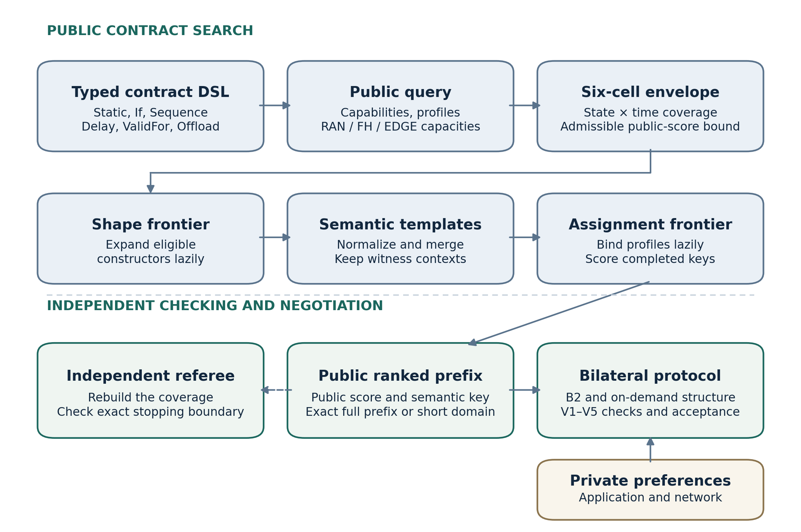
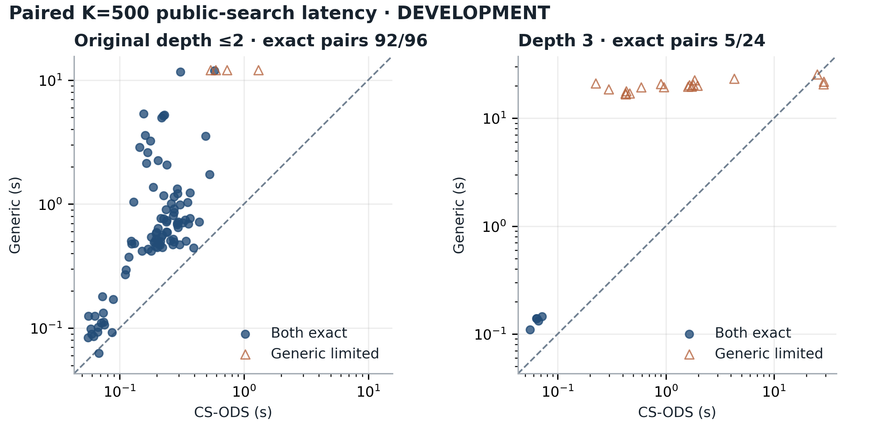
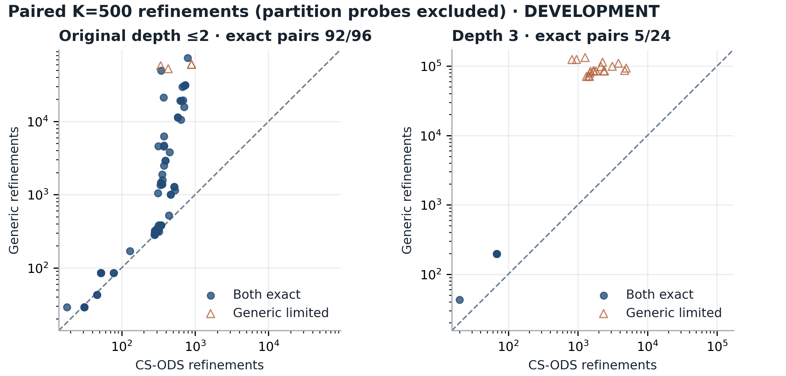
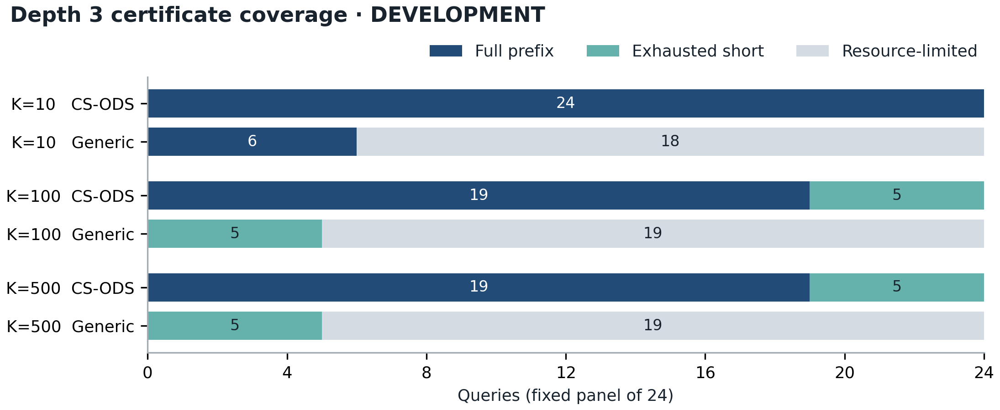
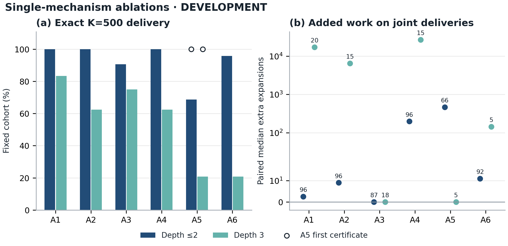
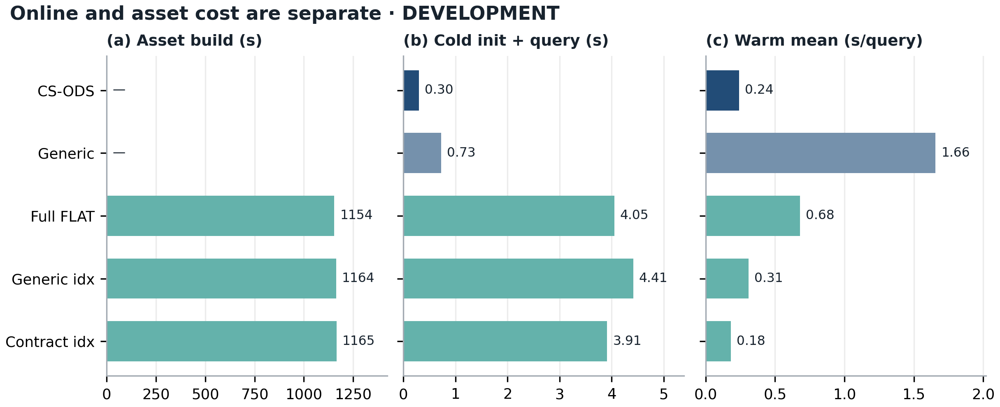

# 面向6G智能体通信意图协商的能力语义约束按需合同合成方法

**Capability-Semantic On-Demand Contract Synthesis for Agentic Communication-Intent Negotiation in 6G Networks**

## 摘要

应用智能体和网络智能体面向同一业务时，通常分别掌握需求偏好和资源条件。固定字段合同即使允许扩大数值范围，也难以表达随状态切换、延迟生效、分阶段服务或跨域卸载的协商结果。本文研究有限通信意图合同语言上的精确按需合成，提出能力语义约束按需合同合成方法 CS-ODS。方法以能力注册表约束候选，利用状态—时间—资源包络计算公开排序分数的保守下界，先归一化等价的符号合同，再惰性实例化其参数。搜索逐项给出公开排序的精确前缀证书，按需生成时无需预先构建完整语义图。验证器随后检查容量和公共硬约束，双方在协商阶段分别判断是否接受。实验使用含接入网、前传和边缘计算约束的抽象基准。在共享公开目标、验证器和协商协议的固定开发比较中，原深度面板的 96 个查询中，CS-ODS 与强通用 best-first 基线分别有 96 和 92 个取得 K=500 精确证书。在双方均获证的 92 对上，逐对时延比（通用基线除以 CS-ODS）的中位数为 2.57。Depth 3 开发面板上，两方法分别有 24 和 5 个查询获证。对 CS-ODS 的 24 个固定 Depth 3 查询，独立覆盖裁判核验了全部 72 个检查点，含 10 个已证穷尽的短前缀。本文结果限于冻结的有限语言和开发数据。独立持出确认与实际网络履约验证尚待进行。

**关键词**：6G 通信意图，能力语义，结构化合同，按需程序合成，精确 Top-K，双边协商

## Abstract

Application and network agents negotiating the same service often hold different information about preferences and resources. A contract with fixed fields cannot directly express state-dependent service, delayed activation, phased profiles, or cross-domain offloading. We study exact on-demand synthesis in a finite communication-intent contract language and present Capability-Semantic On-Demand Contract Synthesis (CS-ODS). CS-ODS conditions the grammar on available capabilities, derives conservative public-score bounds from a state–time–resource envelope, normalizes symbolic contracts, and instantiates parameters lazily. It generates a certified prefix of the public ranking without materializing the full semantic graph. Capacity, public hard constraints, and bilateral acceptance are checked after candidate delivery. We evaluate CS-ODS on an abstract benchmark with radio-access, fronthaul, and edge-compute constraints. On the 96 original-depth development queries, CS-ODS and a strong generic best-first baseline certified the K=500 prefix for 96 and 92 queries, respectively. Among the 92 jointly certified pairs, the median ratio of baseline to CS-ODS latency was 2.57. On the 24 Depth 3 development queries, the methods certified 24 and 5 queries, respectively. An independent coverage checker verified all 72 CS-ODS checkpoints in that fixed panel, including 10 exact prefixes shorter than the requested length because their legal domains were exhausted. The evidence concerns the frozen finite language and development data. Independent holdout confirmation and real-network fulfillment remain open.

**Keywords**: 6G communication intent, capability semantics, structured contracts, on-demand synthesis, exact Top-K, bilateral negotiation

## 1 引言

应用向网络表达预期服务时，往往知道哪些性能变化可以接受，却未必知道网络可用哪些措施来实现。网络一方知道当前资源和可执行能力，也需要判断应用能否接受相应的服务变化。网络意图的声明式定义为这种职责分离提供了背景，ITU-R 的 IMT-2030 框架也将分布式计算、跨设备与网络卸载列入 AI 与通信场景的用例 [\[1\]](#ref-clemm2022rfc9315), [\[2\]](#ref-itur2023m2160)。本文将应用和网络分别表示为持有私有偏好的智能体，研究二者在共享公开能力及运行条件下，可以得到哪些待协商的结构化通信合同。

合同空间的表达能力会直接限制协商选项。以本文的边缘卸载场景为例，相同的质量、时延目标和速率，在本地执行与边缘执行时会产生不同的无线接入、前传和边缘计算资源需求。本文的静态三元组域只有这些服务属性，扩大其取值也无法直接表示执行位置切换。类似地，条件服务和分阶段服务需要把约束系于公开状态和运行时段。将这些机制写成合同构造器可以产生新的候选，但每增加一层构造器都可能增加语法派生。同一行为还可能由多条派生表示。全域枚举可用于参照，线上重复物化或加载全量空间则会消耗时间和内存。预建索引可在重复查询时分摊图构建成本，这使无图合成与图上检索都值得在同一排序任务下比较。

本文的问题是，在给定能力、公开资源状态、有限合同文法和深度预算时，能否**按需产生精确有序、可独立核验的合同前缀**。提出能力语义约束按需合同合成方法 CS-ODS（Capability-Semantic On-Demand Contract Synthesis）。部分合同用状态、时间和资源语义包络表示，其可采纳下界指导按需展开。可合并的合同状态以规范语义身份去重，并保留可重建的代表合同。生成器以公开分数及规范键交付有证书的候选流，既有验证与双边协议随后处理硬可行性、提案与私有接受。这个问题的精确性针对公开排序，双方是否接受某一候选取决于另外的验证和接受条件。

本文的贡献有三项。第一，建立限定于本文有限基准的合同操作语义，将条件、阶段、延迟、有效窗和卸载与执行能力、六个状态—时间单元及资源承担关联。第二，针对该语义结合保守下界、上下文安全的规范化及符号等价归并，在无需完整语义图的条件下生成精确排序合同流，并独立复核前缀与搜索空间覆盖。第三，在相同公开目标和规范候选域上，与强通用合成基线、图检索方法及消融版本比较，分列在线搜索、离线资产、证书与协议结果。本文的性能证据来自固定开发查询。独立确认的终点和判据单列。

## 2 相关工作

### 2.1 通信意图与自动协商

IRTF 的 RFC 9315 区分声明式目标、实现转换与履约保障。3GPP TS 28.312 Release 19 已包含意图探索、可行性反馈和履约阶段协商的管理过程，同时把具体履约实现留给系统 [\[1\]](#ref-clemm2022rfc9315), [\[3\]](#ref-3gpp2026ts28312)。关于 6G 多智能体协作，Liang 与 Yu 的个人 Internet-Draft 讨论了智能体发现、能力暴露和协议依赖，反映正在推进的体系结构探索 [\[4\]](#ref-liang2026multiagent)。这些工作为本文给定公开能力、寻找候选合同的任务提供背景。CS-ODS 从已经结构化的公开查询出发，其输出是给验证和协商使用的有序合同流。本文应用与网络角色是基准抽象，标准符合性属于后续验证。

Contract Net 将任务分派表述为分布式节点间的协作，自动谈判研究分辨协商对象、协议以及各方决策 [\[5\]](#ref-smith1980contractnet), [\[6\]](#ref-jennings2001negotiation)。在网络场景中，Marsico 等为应用感知的传送网络服务设计了自动协商，允许网络寻找替代供给方案；Mostafa 等研究用涌现通信把应用的体验质量意图映射到网络切片能力 [\[7\]](#ref-marsico2020automated), [\[8\]](#ref-mostafa2024emergent)。本文同样关注应用与网络之间的服务协调，具体研究对象是同一有限能力域内的结构合同合成及其精确顺序。双边接受和提案规则采用既有实验协议。

### 2.2 合同与可验证网络语义

合同式系统设计借助假设—保证关系分析组件与环境的组合 [\[9\]](#ref-benveniste2018contracts)。网络资源语言 Merlin 为供给策略定义声明式表达、编译与委派后政策的核查 [\[10\]](#ref-soule2014merlin)。本文的合同是在离散状态和时间域上解释的结构化行为。每份合同的能力适用性、资源占用与双方接受情况都按冻结基准核查。核验限定在这一抽象执行模型内，真实网络的设备映射、遥测、故障和动态资源仍属于部署层验证。

### 2.3 程序合成、语义去重与有序检索

语法引导合成以文法限制候选程序，SemGuS 同时允许用户定义构造器语义。抽象解释提供保守地描述具体执行集合的方法，SYNGAR 使用抽象有限树自动机和精化进行合成 [\[11\]](#ref-alur2013sygus), [\[12\]](#ref-kim2021semgus), [\[13\]](#ref-cousot1977abstract), [\[14\]](#ref-wang2018syngar)。Mell 等的最优程序合成框架用广义部分程序表示一组完成式，并以抽象解释得到的可采纳目标界引导 A\* 搜索 [\[15\]](#ref-hart1968astar), [\[16\]](#ref-mell2024optimal)。本文的通用合成对照按这一思路在同一合同域内实现，包含公开下界、确定性分区和精确完成规则。CS-ODS 利用状态—时间转移、必需能力角色及其资源占用，依据条件归一化所需的上下文共享语义等价类，并惰性实例化赋值与恢复代表合同。

等式饱和中的 e-graph 可共享同余表达式，说明用等价结构减少重复在程序优化与合成中已有基础 [\[17\]](#ref-willsey2021egg)。本文的可合并关系由合同签名、上下文条件及规范化语义给出。Top-K 聚合算法可以利用已有记录的排序访问来提前确定高排名对象 [\[18\]](#ref-fagin2003topk)，本研究也将已有图上的通用索引和合同索引纳入比较。对于不加载完整图的合成，裁判须另行覆盖语法根与完成空间，并在公开分数并列时验证规范键次序。本文据此区分在线生成、独立证书开销和离线图资产。

## 3 系统模型与问题定义

### 3.1 参与方与公共环境

给定一次通信意图协商查询 $x=(x_{\mathrm{pub}},\theta_A,\theta_N)$。应用智能体持有服务偏好 $\theta_A$，网络智能体持有资源及运维偏好 $\theta_N$。双方分别保存自己的保留效用 $u_A^0,u_N^0$。公共输入包含状态与时间域、各单元资源容量、公开参数取值域、能力注册表及可用能力、公共硬约束。按需合成仅接收这一公共投影。私有效用进入后续提议与接受决策。两类效用都根据已解释的合同计算。

基准的时间域为 $\mathcal T=\{0,1,2\}$，状态域为 $\mathcal S=\{\mathrm{still},\mathrm{moving}\}$。令 $J=\mathcal T\times\mathcal S$，六个单元按时间优先、状态次序排列。每个 $j\in J$ 的容量向量 $c_j$ 对应无线接入网（RAN）、前传（FH）和边缘计算（EDGE）。状态单元是外生情形，分别执行容量检查。本文使用归一化负载和离散时间。容量、质量、时限和速率采用基准量纲，尚未校准至 NR 资源块、Mb/s、毫秒或计算周期。不同单元分别检查备选状态下的容量。一次查询内，公开能力、参数域及资源快照固定。

一个服务配置为 $p=(q,\ell,r)$，依次表示质量、时限和速率。公开配置域 $\mathcal P$ 由 $\{0.4,0.6,0.8\}\times\{1,1.5,2\}\times\{0.5,0.75,1\}$ 构成，共 27 个配置。静态参照 B2 在整个区间采用同一配置，涵盖这 27 个配置。结构合同以同一 $\mathcal P$ 为叶参数，可重组服务配置对状态、时间和资源的依赖。

### 3.2 以能力为约束的合同 DSL

``` text
Contract ::= Static(p)
           | If(moving, a, b) | Sequence(1, a, b)
           | Delay(1, a) | ValidFor([0,2), a) | Offload(edge, a)
```

`Static` 的深度为 0，其他节点的深度为其最深子树的深度加 1。每个构造器和参数都来自本查询的公开类型域。能力注册表为角色定义输入输出类型、公开前置谓词、效果、适用作用域，以及资源与执行成本。绑定时匹配声明语义，等价实现可具有不同标识或提供者。五个基础角色用于设定质量、时限和速率，以及预留 RAN、FH。结构角色由相应构造器触发。

表 1 汇总各构造器的局部语义及所需角色。

  -----------------------------------------------------------------------------------------------------
  构造器                  在局部时间 $t$、状态 $s$ 下解释                      所需结构角色
  ----------------------- ---------------------------------------------------- ------------------------
  `Static(p)`             使用 $p$ 并采用本地模式                              基础角色

  `If(moving,a,b)`        moving 时解释 $a$，still 时解释 $b$，保留 $t$        运动状态观测、条件策略

  `Sequence(d,a,b)`       $t<d$ 时解释 $a$，其余时间以 $t-d$ 解释 $b$          分阶段策略

  `Delay(o,a)`            $t<o$ 时空闲，否则以 $t-o$ 解释 $a$                  延迟调度

  `ValidFor([a,b),h)`     区间内以 $t-a$ 解释 $h$，其余时间空闲                有效期设置

  `Offload(edge,a)`       保持原时间与状态，将子合同所有活跃单元设为边缘模式   边缘卸载、边缘资源预留
  -----------------------------------------------------------------------------------------------------

  : 表 1　冻结合同 DSL 的构造器、执行含义与能力角色。

设规范化后的合同在单元 $j$ 中为空闲 $\bot$，或为 $(p_j,o_j,M_j)$，其中 $o_j$ 是本地或边缘模式，$M_j$ 是所选活跃路径上的角色集合。角色按集合计入，不对嵌套路径上的重复角色再计费。未选分支仍可保留在合同级能力足迹中。空闲单元的运行成本为零，基准的部署成本设为零。冻结规范化规则先递归处理子合同，再将两个分支公共语义键一致的 `If` 替换为按字典序选出的等价子合同。以下解释、计费和验收均采用该规范合同。

令 $e_j$ 和 $b_j$ 分别表示活跃角色的执行成本之和及资源成本向量之和。活跃单元的基础需求 $v_j$ 为

$$v_j=\begin{cases}
(q_j,\ 0.4r_j,\ 0),&o_j=\mathrm{local},\\
(0.5q_j,\ (0.4r_j)\,0.7,\ 0.5q_j),&o_j=\mathrm{edge}.
\end{cases}$$

空闲单元令 $v_j=b_j=0$，$e_j=0$。实际验证负载为 $v_j+b_j$，逐单元逐资源核对 $0\le v_j+b_j\le c_j$，且无边缘预留角色时 EDGE 负载须为零。冻结公共硬约束要求至少一个单元活跃，活跃配置的质量至少为 0，时限至多为 2。执行轨迹在单元内先预留资源，再设置服务参数。类型和深度、能力绑定和谓词、结构语义、公共可行性、双边接受依次记为 V1 至 V5。

具体地，令 $\mathcal I$ 为所有活跃单元，$Z_{t,s}$ 表示 $(p_j,o_j)$ 或 $\bot$。定义 $Q=\sum_{j\in\mathcal I}q_j/6$， $L=\sum_{j\in\mathcal I}(1+\ell_j)^{-1}/6$。 令 $D$ 为两状态下首次活动时刻除以 3 的平均，从未活动的状态取值为 1。令 $S=\sum_{s\in\mathcal S}\sum_{t=1}^2\mathbf 1[Z_{t,s}\ne Z_{t-1,s}]/4$， $H=|\{(p_j,o_j):j\in\mathcal I\}|/6$， $\bar v=\sum_{j\in J}(v_j+b_j)/6$ 与 $E=\sum_{j\in J}e_j/6$。双方效用为

$$u_A=\operatorname{clip}_{[0,1]}\left(
\frac{w_qQ+w_\ell L+w_d(1-D)+w_s(1-S)}{w_q+w_\ell+w_d+w_s}
\right),$$

$$u_N=\operatorname{clip}_{[0,1]}\left(
1-\frac{\lambda_R\bar v_R+\lambda_F\bar v_F+\lambda_E\bar v_E+
\lambda_h H+\lambda_s S}{\lambda_R+\lambda_F+\lambda_E+\lambda_h+\lambda_s}-E
\right).$$

两组权重及保留效用分别属于两个智能体。通过 V1–V4 且同时满足 $u_A\ge u_A^0$ 和 $u_N\ge u_N^0$ 的合同才满足基准的协议验收条件。协议评价中的 $u_Au_N$ 是已接受合同的效用乘积，原日志列名为 Nash。

### 3.3 语义身份、公开目标与预算

对固定的 $x_{\mathrm{pub}}$，规范语义签名 $\sigma_x(h)$ 包含三部分。第一部分为整个合同所需的规范角色及其声明、作用域和谓词结果，第二部分为结构语义有效位，第三部分为六单元的空闲标志或活动配置、边缘模式、活跃角色及其成本。未执行分支的声明约束和实际执行路径的角色成本因此可分别检查。固定注册表下，成本可由活跃角色确定。实现把有效签名无损编码为 49 字节的规范键，其中前 25 字节记录有效位和能力足迹，余下每个单元用 4 字节。对通过相同类型、深度和公开能力前置要求的候选，相等键保留 V2–V5 所需的基准语义。原始推导的 V1 资格仍在规范化前核查。

令 $d$ 为有效组合深度，$\mathcal R_d(x)$ 为先按本查询的基础角色、可用构造器与公开参数筛选得到的有序原始类型化推导域，树深至多 $d$。对其中每条推导规范化并核查结构语义有效位，再按规范键唯一化与筛选组数，得到 $\mathcal D_d(x)$。一个键的代表从 $\mathcal R_d(x)$ 中所有产生该键的原始语法键取最小者再规范化。缺少条件能力的原始推导 `If(moving,a,a)` 即使在忽略可用性时可折叠为合格的 $a$，也不参与该键的见证选择。结构组计数 $g$ 从规范合同足迹获得，四组对应条件、调度、分阶段或有效期、卸载。原深度 1–2 的结构流取 $1\le g\le 2$，Depth 3 扩展取 $1\le g\le 4$。B2 仍走独立静态路径。这里集合资格不依赖 V4 容量和硬约束，也不依赖 V5 私有偏好。

公开排序沿用原 FLAT 分数。写 $z_{j,k}=(v_{j,k}-c_{j,k})/\max(c_{j,k},10^{-9})$，定义

$$V=\frac1{18}\sum_{j\in J}\sum_{k\in\{R,F,E\}}\max(z_{j,k},0),$$

$$M=\frac1{18}\sum_{j\in J}\sum_{k\in\{R,F,E\}}\operatorname{clip}_{[-1,1]}(-z_{j,k}),$$

$$A=\frac1{6}\sum_{j\in J}\left(e_j+\sum_{k\in\{R,F,E\}}b_{j,k}\right),$$

$$f_x(h)=V-0.025M+0.02A+0.08(1-Q)+0.01g .$$

其中 $V$ 和 $M$ 使用基础需求 $v$，角色成本作为单独的 $A$ 项。分数保留冻结实现的 binary64 运算次序，先按分数升序，再按规范键的无符号字节字典序。原深度语义图的类编号由这些已排序的规范键生成，因此同分顺序与原参照一致。Depth 3 沿用规范键，无需该深度的全图编号。

任务是在源合同空间中，对同一签名仅交付一个代表，返回 $\mathcal D_d(x)$ 的精确有序前缀，长度为 $\min(K,|\mathcal D_d(x)|)$。输出携带排序和覆盖证书。若域短于 $K$，还须证明穷尽。墙钟时间、工作集、前沿和实现原生展开计数共同限制搜索。资源达限时保留已证明的较短前缀并标记未取证的检查点。公开排序认证、通过 V4 公共可行性检查、取得双方接受是依次区分的三个事件。

## 4 CS-ODS 按需合同合成

CS-ODS 将语法树的构造器选择和叶配置赋值分为两个交错推进的前沿。构造器队列从类型洞 `ClauseHole(d)` 开始，只展开当前公开可用的能力产生式。一个 `Static` 产生式先保留完整配置域的 `ProfileHole`。搜索将闭合的构造器骨架归约为带配置变量的语义模板。赋值队列按公开分数下界细化该模板的候选配置。完成项队列以精确分数与规范键排序，其记录还保存模板标识、已赋值配置及已用配置掩码以恢复见证。算法按查询创建有界缓存、公开配置表和角色掩码的成本表，省去物化整张合同语义图的步骤。

图 1 展示公开搜索前沿、覆盖裁判与双边协议之间的接口。

{width="91%"}

### 4.1 状态—时间—资源包络

每个部分合同的包络保留六个单元的可空闲位、本地和边缘模式的可能配置位集、必需与可能的活跃角色位集，以及从这些集合得到的需求、质量、速率、时限和成本极值。合同级另存必需和可能的角色足迹以及对应结构组数上下界。对带剩余深度的类型洞，包络将 `Static` 及所有可用构造器对浅一层包络的传输作并合。单元之间可以保留无法同时实现的选择，这会放宽分数下界。

时间算子以 DSL 的局部时间规则把子包络的单元搬到父包络。卸载重标活动模式并合入对应角色。条件可能保留两条分支，也可能因完整子签名相等而归约。保留情形加入该条件的角色，折叠情形沿用共同子合同的角色。角色包络对两种未排除情形取可能角色并集和必需角色交集。子合同可以已经使用相同角色，同一单元的重复角色只计一次。对已知不相交的子包络，可以排除等值归约情形。构造器缺少兼容角色时直接从可用产生式中排除。结构组上界为零或下界超出当前组限制的分支不可能进入 $\mathcal D_d(x)$。

### 4.2 从构造器骨架到语义模板

对打开的闭合骨架，给各 `Static` 位置编号。先以纯公开的解释规则找出由根六单元读取的位置，再加入每个原始 `If` 的两个子合同分别独立作为根时读取的位置。后者保留可能被外层掩蔽、却决定内层等值归约的位置。例如 `If(moving,If(moving,Static(a),Static(b)),Static(a))` 的根活动配置从不取 $b$。当 $b=a$ 时两层条件可归约，而当 $b\ne a$ 时内层条件检查仍可能保留条件角色。因此，根计划相同不足以合并这两种情况。

算法枚举相关位置的相等关系，用受限增长串表示每个分区。各分区的不同块必须取不同配置，块数超过公开配置数的分区无法实例化。对一个分区，用互异占位配置执行冻结规范化，将实际存活的配置块按首次出现在六单元中的顺序重编号。模板键包含固定足迹和有效位、每个单元的空闲或变量、模式和角色位集、可见变量数及结构组数。相同模板共享一条可见变量赋值流，同时保留来自各语法分区的原始见证配方。赋值过程按质量、速率、时限分割较大掩码，只对尚未使用的配置分支，完整赋值后才计算精确分数。

为一个模板恢复见证时，先绑定可见变量。对仍相关但隐藏的变量，按其首次出现顺序从尚未用过的配置中择字典序最小者。所有隐藏块共用同一配置域，只需满足互异约束。冻结的配置序列化彼此没有严格前缀关系，因此按隐藏块首次出现贪心选择得到单条配方的最小原始语法键。完全不影响语义的叶位置取字典序最小允许配置。逐配方构造实际原始语法键，从中选取最小键再规范化，并重新编码校核结果键和深度。

### 4.3 有序交付与协商接口

**算法 1　CS-ODS 有序前缀**

``` text
输入  公开查询 x_pub、有效深度 d、前缀长度 K、资源预算
输出  有序规范签名及代表、检查点状态
将根类型洞按下界放入构造器堆；清空赋值堆与完成堆
重复，直至返回 K 个完成项
    取两个前沿的最小下界，展开期间保留原节点的下界
    当前沿非空，且（完成堆为空或前沿最小下界不大于最小完成分数）
        检查资源限额
        取下界最小前沿节点，同下界优先构造器
        若为构造器洞，只细化先序的第一个未决类型洞
        若为完整构造器骨架，归约相关位置分区并合并同签名模板
        若为赋值节点，以互斥掩码细化下一变量
        为新增开放分支计算下界，为完整赋值计算精确分数
        检查新前沿及在途状态
    若完成堆为空且前沿皆空，返回穷尽
    检查资源限额，弹出最小 (分数, 规范键)
    恢复、校核代表并输出该项
返回已证明前缀。若展开中达限，只保留此前发射的已证前缀，
不给出新增候选或穷尽证书，逐检查点记录状态
```

协商接口复用已有双边协议。协议先在 B2 静态参照中寻找合同。结构流在需要时补充候选。公共验证器按最多 16 项的批次做精确 V1–V4 检查，合格候选进入追加式公共池。轮到一方时，从未提议过且达到其保留效用的候选中选效用最高者，同效用时按规范键消解。对方以自己的保留阈值决定接受或拒绝，无可报价时当前一方可以跳过。达成一致后，原协议重算规范代表及其公开状态机执行轨迹。开发回放另行复核双方效用和 V5 接受证据。准确验证调用预算为 100、500、1,000 与 5,000，报价上限为 10,000 轮，回放受实际可用前缀约束。日志保留证书、验证调用和提议轨迹。线上候选流的生成顺序只由公开分数和语义键决定。协议可在已有前缀上重放，命中验收、预算耗尽和穷尽无协议分别记录。

## 5 正确性与复杂度

### 5.1 组合性和包络涵盖

下述结论限于三时隙、两状态、冻结公开参数域、相容注册表及公开正谓词基础上的类型化合同。规范紧凑键在一个公共查询内对结构语义签名单射。若某子合同替换为等签名子合同，非条件算子依据相同参数选择或搬移相同单元，再合入相同父角色和作用域，整树签名保持不变。对 `If`，子签名相等关系在替换前后相同；归约时任选其字典序最小代表所给出的语义签名也相同。对子树结构归纳即可得到上下文同余。单元活跃角色与合同级足迹都要进入这个论证，仅比较配置值会丢失能力和计费信息。

进一步对部分树和类型洞剩余深度归纳。固定配置和公开配置位集的叶包络涵盖全部合法选择。时间与卸载算子按真实的单元搬移和角色追加传输。`If` 的保留情形根据状态选分支，等值归约情形的共同语义包含在两分支包络交集中，对所有尚可行情形并合保持涵盖。类型洞对允许产生式并合，保留每个合法完成式至少一种推导。由此，单元需求下界、质量上界及角色足迹下界均适用于该开放分支的每个合法完成式。

### 5.2 下界可纳性

令 $\underline v_{j,k}$、$\overline q_j$ 和 $\underline a_j$ 分别为单元的基础需求最小值、质量最大值和公开角色成本下界。可能空闲的单元允许零角色成本，其余单元对包含必需角色的所有角色掩码取最小成本。将 $\underline v$ 输入第 3 节的分数公式，归一化超限项得到 $V^-$，余量项得到 $M^+$。令 $\overline Q=\sum_j\overline q_j/6$、$\underline A=\sum_j\underline a_j/6$，并令 $g^-$ 为必需合同角色对应的结构组下界，则

$$L_{\mathrm{coord}}=V^- -0.025M^+ +0.02\underline A+0.08(1-\overline Q)+0.01g^-.$$

容量分母为固定正数，超限对需求单调不减；余量单调不增且在得分中系数为负。质量的上界和成本、组数的下界给出其余方向一致的松弛。保持原有的有限 binary64 运算与累加次序后，这些单调性仍成立，故 $L_{\mathrm{coord}}\le f_x(h)$。

进一步令 $\Omega_j$ 为单元包络允许的配置及模式，含允许的空闲值。对每个单元备选 $\omega$，用原已舍入资源项计算 $\phi_j(\omega)=\sum_k\max(z_{j,k},0)/18-0.025\sum_k\operatorname{clip}_{[-1,1]}(-z_{j,k})/18-0.08q_j(\omega)/6$。 跨单元独立求最小值放松了共同变量和时序约束，对任何一个真实完成式均给出不大的联合代价。联合表达式的加法重组在 binary64 中须做向下校正。设 $Z_{\max}$ 为查询表中的最大超限分量，$A_{\max}$ 为完整角色掩码成本，冻结实现取

$$L_{\mathrm{joint}}=\sum_{j\in J}\min_{\omega\in\Omega_j}\phi_j(\omega)
+0.02\underline A+0.08+0.01g^- -
2^{-38}(32+32Z_{\max}+12A_{\max}).$$

该比较从按原次序得到的同一组已舍入资源分量和相同的 binary64 系数出发。每个单元的三项非负超限分量均不超过 $Z_{\max}$，裕度绝对值至多 1，质量不高于 1，单元非负角色成本至多 $A_{\max}$，组数至多 4。因此 $W=32+32Z_{\max}+12A_{\max}$ 覆盖两棵求值树的绝对系数加权输入量。每树按不超过 128 次舍入计，合计误差界为 $2\gamma_{128}W$，其中 $\gamma_{128}=128u/(1-128u)$ 且 $u=2^{-53}$。因 $2\gamma_{128}\approx 2^{-45}$，实现使用的 $2^{-38}W$ 余量在该冻结有限域内还覆盖余量求值及最终减法的舍入。实际下界取 $\max(L_{\mathrm{coord}},L_{\mathrm{joint}})$，非有限输入或结果在受控入口被拒绝。赋值队列使用固定模式及角色和剩余配置位集构造同一类包络，故同一不等式适用。

### 5.3 语义去重与精确证书

在骨架固定时，对配置编号作保持相等关系的注入重命名。它保留条件子签名的相等关系、局部时间解释、足迹、活动角色及有效性，只改动被观察到的配置字节。第 4 节的相关位置定义包括根和每个原始条件子树的独立观察，因而这一性质可随递归归约归纳至根。规范键可唯一恢复固定字段及按出现次序重编号的可见相等模式，故不同模板的具体键集合互不相交。对同一模板的可见互异赋值，可从同一公开配置域补足任何被保留配方的隐藏相关块。这样合并同模板只合并同一组键，并保留计算最小见证所需的配方。包络相同本身不足以推出这种等价。

初始类型洞覆盖所有合格推导。第一个未决类型洞的替换覆盖构造器选择；闭合骨架分区覆盖配置相等关系；互异赋值掩码覆盖模板的实际配置。每次展开期间，其未完全安装的子分区仍由在途前沿下界代表。开放区域之外的候选依据精确分数和键存于完成堆，或已经按序发出。当最小完成分数严格低于所有前沿下界时，尚未处理的候选均不能提前，也不能产生可改变该键规范代表的同分推导。完成堆的键次序于是给出当前最优合同。同分时继续细化前沿，直到严格分离。此不变量对每次输出成立，继而给出精确前缀。开放和完成堆皆空才证明穷尽。在途子分区未全部安装时保持原下界，预算在此处中断只影响尚未证实的部分。独立裁判仅接收没有在途展开的检查点。

独立复核采用分区覆盖证书。裁判从公开语法根重建允许的结构区间与相关位置分区，在模板上检查剩余赋值掩码和实际子分支构成互斥全覆盖。它逐个重算开放区域的下界、完成项的精确分数和键、已交付见证和截止次序。证书用内容寻址共享重复记录，正文所述论证依赖可检查的分区，而非记录哈希的相等。原深度另有独立 Full FLAT 排序参照。Depth 3 的裁判共享冻结类型、状态机、规范化、键编码、抽象传输及评分内核，独立于生产者的优先队列执行顺序。

### 5.4 开销与适用范围

设 $P$ 为叶配置数，$u$ 和 $b$ 为可用一元及二元算子–参数组合数。深度不超过 $d$ 的原始树数满足 $N_0=P$ 和 $N_d=P+uN_{d-1}+bN_{d-1}^2$。全能力冻结域内 $u=3,b=2$，仅按算子形状计数时可令 $P=1$，深度 2 和 3 分别得到 91 与 16,836 个骨架。若某骨架有 $m$ 个相关叶位置，可实例化的分区至多 $\sum_{i=0}^{\min(m,P)}S(m,i)\le B_m$ 项，其中 $S(m,i)$ 为 Stirling 第二类数，$B_m$ 为第 $m$ 个 Bell 数；其模板的 $l$ 个可见块至多有 $P(P-1)\cdots(P-l+1)$ 种全赋值。这些计数描述候选增长来源。

对实际查询，若三个堆中的状态总数为 $F$，一次堆操作为 $O(\log(1+F))$。总体时间还包括已处理的分区、包络传输、精确分数计算和用于见证恢复的配方。活动前沿、生成的模板和保留的配方、已见键与缓存决定空间开销。设角色数为 $R$，预计算角色掩码成本和超集最小值需要 $O(R2^R)$ 次基本操作及 $O(2^R)$ 个表项，冻结模型取 $R=12$。这张表的大小与完整语义图的类数无关。若分数下界较松或大量候选同分，较短的目标前缀也可能要求解析大量状态。实现与复核覆盖冻结 DSL 的有效深度 1、2、3。原始树数的递推描述文法规模。工程预算内的认证覆盖与相对性能由具体查询测量。

## 6 实验评价

### 6.1 评价问题与固定输入

评价考察三个问题。第一，CS-ODS 能否在与通用合成基线相同的评分、预算和候选域下，按精确顺序交付结构合同。第二，能力过滤、时空资源包络与等价模板各减少了哪些工作。第三，免建图路径与可重复使用的图索引分别承担什么成本。所有实测结果来自封存的 **DEVELOPMENT** 工件。本次交付的独立确认范围、终点与授权状态单列。

三档压力下 RAN 容量基值为 0.92、0.72、0.52，各实例叠加一次在 \[−0.04, 0.04\] 上均匀抽取的扰动。令扰动后的值为 $c_0$，同一查询内 FH 和 EDGE 分别取 $0.75+0.1c_0$ 与 $0.8+0.1c_0$。F1 将 moving 单元的 RAN 容量乘 0.68，F2 将首时隙乘 0.35，F3 将首时隙乘 0.65，F4 将全部单元乘 0.72。其余 RAN 倍率为 1。容量值均保留六位小数。F2、F3 共享时间瓶颈的位置，瓶颈强度不同。各场景相应的能力可用性和合法参数域还影响可选结构。

固定面板包含 96 个原深度查询，每个预定配置选取一个已有序列化实例。四类场景分别刻画移动条件切换、启动时隙瓶颈、阶段性瓶颈和边缘卸载，另交叉三档压力、两档偏好冲突、两档能力丰富度和深度 1 或 2。Depth 3 使用其中 24 条高冲突、原深度 2 的输入，在四类场景、三档压力与两档能力丰富度上均衡，保留公开和私有数据。两组共有 120 个查询视图、96 个基础实例。Depth 3 的有效组合深度和机制组上限一起扩大。它给出同一 Depth 3 候选域内的方法对照，跨深度的变化仍包含域定义差异。另用公开条件化后至少有 100,000 个结构候选的 30 个原深度查询描述高成本情形，其中包含 24 个 rich-depth2 查询。

原深度比较 CS-ODS、确定性 MRV 通用抽象 best-first、Full FLAT、Generic Index、Contract-Aware Index 和六项单因素消融。通用合成基线保留语法类型和同一精确发射规则，采用最小剩余值分区、父界继承、抽象缓存、终端语义去重，以及区分 idle 与 active 的有限输出因子局部联合最小化。A2 则仅移除 CS-ODS 内的联合界，保留坐标界。通用对照是同一合同域内的可重复实现，Mell 等人在其他 DSL 上的原实现属于不同评价范围。Full FLAT 对条件化图记录的精确分数排序，两种索引在同一图与能力 witness 资产上惰性查找。Depth 3 比较八条合成路线，三条图方法的结果记为 N/A。构建审计覆盖富能力、原深度下的 1,394,064 个图语义类，其中包括 27 个 B2 静态类。rich-depth2 的比较过滤至每条查询的 1,252,611 个结构候选。B2 由共享协议单独处理。

已封存运行使用 Windows 64 位、CPython 3.12.14 和 NumPy 2.3.5。同一查询实例在所有适用路线间配对，同机按固定顺序交错深度并轮换方法，一次只发出一个活跃检索。开发运行可同时驻留暖态图进程和无图进程，逐次只执行一个活跃查询。暖态图进程共同加载两套索引，无图进程保留加载后的运行环境。工作集统计为相应进程的观察值。开发启动下限 1,280 MiB，持出计划另设 2,048 MiB，系统紧急下限同为 768 MiB。开发预算为原深度 12 s、Depth 3 45 s，采样工作集限额 2 GiB。两组原生展开／前沿限额分别为 300,000／180,000 和 2,000,000／260,000，计数单位随冻结搜索实施，图节点访问与语法细化分列。公开检索计时与图构建、冷启动、B2、验证、协商和独立复核分开。

### 6.2 正确性、暖态延迟与搜索工作量

全开发面板包括 1,248 次方法—查询尝试和 4,800 个检查点。原深度的 K 为 10、50、100、500，Depth 3 为 10、100、500。归档的开发运行和比较器记录 4,206 个全长、384 个穷尽短域和 210 个达限未认证检查点，观测到的不健全检查点为 0。比较器核对语义键、binary64 分数与规范见证。原深度使用经 Full FLAT 核对的封存参照，Depth 3 的方法比较使用同查询封存的 CS-ODS 前缀。独立覆盖证书另限于第 6.3 节的 CS-ODS 面板。通用合成器还在 15 个独立缩减域接受全域排序和穷尽核对。同前缀输入下的 1,248 条协议重放记录逐字段一致。784 条完成全部预算档的回放，418 条仅完成可用前缀支持的部分预算档，其中 412 条最高至 B=500、6 条至 B=100。另有 46 条前缀不足，未返回协商结果。在记录提供相应字段时，复核预算、交互轨迹、效用和效用乘积（日志列名 Nash）。

在原深度 K=500 上，CS-ODS 交付 96/96，通用合成基线交付 92/96，余下四次达到墙钟限额。92 个共同认证配对中，CS-ODS 在 91 个上更快。对共同认证的行，采用达到 K=500 证书的公开时钟（归档字段 `proof_elapsed_s`）。逐对通用时延除以 CS-ODS 时延的中位数为 **2.57**，逐对秒差的中位数为 **0.352 s**。rich-depth2 的精确交付分别为 24/24 和 22/24，共同认证的 22 对中时延比中位数为 **4.10**。这些比值刻画双方已完成的固定配对。全体观察在独立表中保留达限原因、采样内存、实际停点工作量及分母。 [K=500 汇总表](PAPER1_TABLES/method_k500_summary.csv) · [共同认证配对统计](PAPER1_TABLES/paired_k500_comparisons.csv)

表 2 给出固定开发面板的覆盖及共同认证时延。

  ----------------------------------------------------------------------------------------
  K=500 开发集合          CS-ODS 精确       通用精确       共同精确   共同配对时延比中位数
  -------------------- -------------- -------------- -------------- ----------------------
  原深度全部                    96/96          92/96             92                   2.57

  原深度 rich-depth2            24/24          22/24             22                   4.10

  Depth 3                       24/24           5/24              5                   2.04
  ----------------------------------------------------------------------------------------

  : 表 2　固定开发面板上的 K=500 认证覆盖及共同认证的逐对时延。

时延比为通用合成秒数除以 CS-ODS 秒数。Depth 3 的五个共同配对均为已证穷尽的短域。

{width="90%"}

共同认证的原深度 92 对中，逐对通用方法与 CS-ODS 展开的中位比为 **1.11**。移除 CS-ODS 特有的等值分区探测后，可报告细化次数的逐对中位比为 **1.14**。rich-depth2 的 22 对中相应为 **7.03**。细化计数的形式仍由各实现决定，符号骨架与通用部分程序的单步开销可以不同。内存方面，原深度暖态采样的工作集中位数分别为 CS-ODS 272.1 MiB、通用合成 272.3 MiB。共同驻留图和两个索引的进程在对应三条路线中记录了约 518–520 MiB。这样的工作集保留暖态运行环境的启用成本。 [逐查询细化点](PAPER1_TABLES/paired_search_work.csv)

{width="90%"}

### 6.3 Depth 3 覆盖与证书复查

Depth 3 的 K=500 开发队列中，CS-ODS 获得 19 个全长和 5 个经证明穷尽的短前缀。通用基线取得同五个短前缀，另外 19 个达到前沿限额。该层主要比较固定预算下的覆盖。按所有已启动尝试的在线观察时间（归档字段 `online_elapsed_s`），CS-ODS 的中位数为 0.749 s、p95 为 28.25 s，通用基线用时的中位数为 19.45 s、p95 为 23.06 s，后者包括停止于前沿上限的大量查询。一次以全长数量设计的历史门槛曾记录 `DEPTH3_PARTIAL`。后续审计逐类证明五个短域共有四个 81 类和一个 27 类，固定队列最多提供 19 个全长 K=500 前缀。

独立 Depth 3 裁判对这 24 个开发查询的 72 个检查点全部复核通过，覆盖了 62 个全长检查点和 10 个穷尽短域检查点。两种证明格式各拒绝 11 项负对照，包括缺漏参数分支、虚高下界和错误合并。证明生成及独立复核的实测中位数分别为 0.985 s 和 2.825 s，p95 为 37.06 s 和 43.18 s。压缩证明大小的中位数为 0.347 MiB，p95 为 1.062 MiB。这些费用对同一查询的三个 K 共享，独立列于暖态公共搜索之后。 [Depth 3 检查点汇总](PAPER1_TABLES/depth3_certificate_counts.csv)

{width="88%"}

### 6.4 单因素消融

六种消融保持语法、候选域、排序、验证和协议相同。A1 将模板去重延后，A2 仅使用坐标界，A3 将公开能力过滤延至完成赋值。A4 用六单元并集拓宽包络，A5 在首次获得证书后继续至穷尽，A6 将领域规范化推迟到完整 AST。A2 保留原游标而切换下界，独立通用基线仍有自己的联合因子界。A4 保留抽象语义转移的计算成本，它估计将细粒度单元信息交给下界的边际效果。A6 同时减少可用的早期规范等价共享。

在 30 个高成本开发查询的共同交付配对中，A1、A2 和 A4 增加的展开次数中位数分别是 **351、1,246 和 7,790**，A4 的对应秒差为 **0.629 s**。A3 在 rich-depth2 的 24 条查询与原方法展开相同，在完整原深度面板中有九条查询达到展开限额。Depth 3 的 A6 只精确交付 5/24，少量共同交付配对不足以概括其失败代价。A5 在原深度和 Depth 3 均先达到全部 K=500 证书，继续至穷尽的最终交付分别为 **66/96** 与 **5/24**。对 Depth 3 中继续后达限的 19 条查询，首次证书后仍展开了中位 **79,750** 个原生状态，记录到的后续墙钟中位数为 **43.28 s**。这两项刻画已发生的额外工作，完成穷尽所需的全部增量可能更高。各项仅反映固定对照中的边际作用。 [消融统计与分母](PAPER1_TABLES/ablation_k500_summary.csv)

{width="90%"}

### 6.5 图资产、冷启动与暖态批次

按整次已启动尝试的在线观察时间（归档字段 `online_elapsed_s`），在 96 条原深度暖态批次上，CS-ODS 和 Contract-Aware Index 都交付 96/96，检索累计 **23.053 s** 与 **17.485 s**。Generic Index 和 Full FLAT 也交付 96/96，累计分别为 **29.585 s** 和 **65.127 s**。通用合成的累计 **158.984 s** 包含四次达限后的停止观察。独立工程归档中，图构建、序列化统计和 17 个能力索引准备合计 **1,154.218 s**，两个索引合包新增的构建与序列化量为 **20.866 s**。图和能力包共占 20,110,803 B，含两个索引与共享数组的合包合计 177,759,306 B。每条图方法复用经验证的完整语义图并支付配置及加载费用。无图路线省去这些资产，其合成状态与缓存工作记入查询。冷启动对照仅使用一条固定 sparse 查询，在五个独立子进程中测量，文件缓存未受控。图 6 将该单夹具、离线资产和暖态批次按各自计量范围分列。 [各阶段原始数字](PAPER1_TABLES/engineering_costs.csv)

{width="90%"}

### 6.6 独立确认状态

**INDEPENDENT_CONFIRMATION。** 持出方案锁定 2,880 个基础身份及其中 480 个 Depth 3 派生身份。端点 A 在 720 个 rich-depth2 配对考察固定预算处罚后的时延比与覆盖保护，端点 B 在 480 个 Depth 3 配对考察精确证书覆盖差及当前认证率。两者均在 K=500 评价。A 使用配置等权的配对处罚 log 时延比。已认证时长的下限为 1 ms，有可核对资源原因的未认证尝试用 12 s 处罚。校正几何时延比下界须严格大于 1.25，CS-ODS 认证率至少 95%，相对通用基线认证覆盖差至少 −2 个百分点。B 的配置等权认证率差校正下界须严格大于 +20 个百分点，且 CS-ODS 认证率至少 95%。两个判据的固定 Hoeffding 单侧检验分别取 $\alpha=0.025$，采用 Bonferroni 控制。图 2 的共同认证配对速度比分布是开发阶段描述统计，其定义和未认证处理与终点 A 不同。交付时正式确认仍处于 `APPROVAL_PENDING`，两项均未取得独立结果，六项消融的现有证据均来自开发面板。

## 7 讨论与局限

### 7.1 结构协议收益与排序效率

本文方法的实验对象是按公开目标生成候选合同的代价。候选空间较固定字段方案更具表达能力，是这一合成问题的动机。PILOT 后归因使用冻结的同实例反事实语义空间。在 842 个 B2 无协议但完整 O1 有协议的开发实例中，783 个仅允许 OFFLOAD 结构也可达协议，721 个在去掉 OFFLOAD 后失去所有已验证协议，仍有 121 个可在无 OFFLOAD 的语义域中达成协议。充分性与必要性对应不同的集合检验，结果可重叠。四类样本也呈现不同构成。在 F4 的 229 个 B2 失败且完整 O1 成功的开发实例中，OFFLOAD 均为必要条件。该类容量构造在所有单元压缩 RAN，而卸载映射降低 RAN 与 FH 的基础需求，并把部分负载移至 EDGE。该归因反映当前工作负载与模型，无法直接推定其他业务的结构收益份额。完整 O1 是诊断性存在性参照，不能归因于 CS-ODS 的搜索顺序。

提高有效合成深度可以产生旧图中缺少的规范语义。固定 24 查询中，有一个最终选择的合同经核对不属于完整 depth≤2 语义空间，但该实例的原 O1 已经可达协议。该例为 F3 的中压力、高冲突、稀疏能力查询。其深度 3 代表包含条件与卸载两组机制，两种状态下的活跃分支都采用边缘模式和 $(q,\ell,r)=(0.8,1.0,0.5)$。嵌套条件的完整子签名及能力足迹需要和执行配置一起比较。开发数据未观察到相对于 depth≤2 O1 从无协议转为有协议。由于较深设置同时允许更多机制组，合约新颖性、深度效应与协议率变化需要分别评价。未完成的搜索保持未知状态。公开 Top-K 证书保证给定目标和域内的次序，验证过程仍需要 V1–V5 与双方保留效用检验。效用乘积最大化和协议达成是单独的评价目标。

### 7.2 无图生成与索引检索的使用条件

共同认证子集显示了 CS-ODS 相对强通用合成的开发集时延优势。完整面板保留未获证项，因为仅比较双方快且能完成的查询会改变所描述的总体。预建索引在固定语义空间和高查询复用下仍具价值。在原深度开发面板中，Contract-Aware Index 的暖态时延中位数低于 CS-ODS，它依赖已物化图及其索引资产。对于没有可用全图或能力与深度改变的查询，CS-ODS 可从冻结 DSL 和公开能力域直接生成。成本比较应同时记录图与索引构建、存储、冷启动、暖态检索，以及采用独立覆盖验证时的证明生成与检查开销。开发面板的缓存与主机条件限制了性能外推。

### 7.3 有限解释器与实际通信系统

六个解释单元来自三段离散时间与两个运动状态。RAN、FH 和 EDGE 使用归一化能力需求与容量刻画资源相互作用。能力注册表提供形式化的类型、角色、前置条件、作用范围和成本。模型中的负载和收益参数服务于可控基准。真实系统还需要校准业务到物理资源的映射，验证跨域能力发现、注册表更新、并发竞争、观测误差、时钟同步、故障转移和资源预留的原子性。`benchmark_verified` 的可执行性对应有限状态机上的 guarded schedule。实际设备、控制面和网络各域履约需要独立验证，关键条件包括资源快照的时效、跨域原子预留和可用于运营核查的遥测。本文的私有输入隔离限定于生成器和双边接受接口，提案、拒绝或运行时的信息泄漏仍需专门评估。双边报价与接受协议在本文中作为固定消费者，用于观察精确合同流如何接入协商。

### 7.4 独立实证的解释边界

开发样本参与了 DSL、搜索边界与性能机制的设计。其时延、认证率和消融均是可复核的描述性证据。本文保留早期方法和无图搜索受限结果，也保留原 Depth 3 评价门禁的历史判定。已证短域对 K 的可达长度有限，独立覆盖复核支持当前固定查询的前缀正确性。面向新样本的在线效率和证书覆盖由预定的两个独立终点检验，现阶段没有观测值。外部效度、未见配置表现与动态能力域下的性能仍需用前瞻实验评价。

## 8 结论

本文将通信意图协商中的结构合同候选生成建模为能力约束有限 DSL 上的精确有序合成。CS-ODS 结合逐单元语义包络、保守公开评分下界、上下文安全的规范化和惰性赋值，在需要时产生合同前缀。冻结开发证据显示该方法能够保留已知排序与既有协议输出，并在与强通用合成的比较中减少多类查询的搜索工作。独立裁判对固定 Depth 3 开发查询验证了根空间至前沿的覆盖。由此支持有限模型内可认证的按需合同生成。关于未见样本上的性能差异和真实网络履约的结论仍需要相应实验。

# 参考文献 {#bibliography .unnumbered}

::::::::::::::::::::: {#refs .references .csl-bib-body entry-spacing="0"}
::: {#ref-clemm2022rfc9315 .csl-entry}
[\[1\] ]{.csl-left-margin}[A. Clemm, L. Ciavaglia, L. Z. Granville, and J. Tantsura, “Intent-based networking – concepts and definitions,” RFC Editor, Informational RFC, IRTF 9315, Oct. 2022. doi: [10.17487/RFC9315](https://doi.org/10.17487/RFC9315).]{.csl-right-inline}
:::

::: {#ref-itur2023m2160 .csl-entry}
[\[2\] ]{.csl-left-margin}[International Telecommunication Union Radiocommunication Sector, “Framework and overall objectives of the future development of IMT for 2030 and beyond,” International Telecommunication Union, Recommendation ITU-R M.2160-0, Nov. 2023. Available: <https://www.itu.int/rec/R-REC-M.2160-0-202311-I>]{.csl-right-inline}
:::

::: {#ref-3gpp2026ts28312 .csl-entry}
[\[3\] ]{.csl-left-margin}[[3rd Generation Partnership Project]{.nocase}, “LTE; 5G; management and orchestration; intent driven management services for mobile networks,” European Telecommunications Standards Institute, 3GPP Technical Specification TS 28.312, V19.5.0, Release 19, Apr. 2026. Available: <https://www.etsi.org/deliver/etsi_ts/128300_128399/128312/19.05.00_60/ts_128312v190500p.pdf>]{.csl-right-inline}
:::

::: {#ref-liang2026multiagent .csl-entry}
[\[4\] ]{.csl-left-margin}[S. Liang and M. Yu, “Multiple agents collaboration in 6G network,” IETF Datatracker, Individual Internet-Draft draft-ly-multi-agent-in6g-00, Jul. 2026. Available: <https://datatracker.ietf.org/doc/draft-ly-multi-agent-in6g/00/>]{.csl-right-inline}
:::

::: {#ref-smith1980contractnet .csl-entry}
[\[5\] ]{.csl-left-margin}[R. G. Smith, “The contract net protocol: High-level communication and control in a distributed problem solver,” *IEEE Transactions on Computers*, vol. C–29, no. 12, pp. 1104–1113, 1980, doi: [10.1109/TC.1980.1675516](https://doi.org/10.1109/TC.1980.1675516).]{.csl-right-inline}
:::

::: {#ref-jennings2001negotiation .csl-entry}
[\[6\] ]{.csl-left-margin}[N. R. Jennings, P. Faratin, A. R. Lomuscio, S. Parsons, M. J. Wooldridge, and C. Sierra, “Automated negotiation: Prospects, methods and challenges,” *Group Decision and Negotiation*, vol. 10, no. 2, pp. 199–215, 2001, doi: [10.1023/A:1008746126376](https://doi.org/10.1023/A:1008746126376).]{.csl-right-inline}
:::

::: {#ref-marsico2020automated .csl-entry}
[\[7\] ]{.csl-left-margin}[A. Marsico, M. Savi, D. Siracusa, and E. Salvadori, “An automated negotiation framework for application-aware transport network services,” *Optical Switching and Networking*, vol. 38, p. 100571, 2020, doi: [10.1016/j.osn.2020.100571](https://doi.org/10.1016/j.osn.2020.100571).]{.csl-right-inline}
:::

::: {#ref-mostafa2024emergent .csl-entry}
[\[8\] ]{.csl-left-margin}[S. Mostafa, M. S. ElBamby, M. K. Abdel-Aziz, and M. Bennis, “Intent profiling and translation through emergent communication,” in *ICC 2024 – IEEE international conference on communications*, 2024, pp. 5281–5286. doi: [10.1109/ICC51166.2024.10622580](https://doi.org/10.1109/ICC51166.2024.10622580).]{.csl-right-inline}
:::

::: {#ref-benveniste2018contracts .csl-entry}
[\[9\] ]{.csl-left-margin}[A. Benveniste *et al.*, “Contracts for system design,” *Foundations and Trends in Electronic Design Automation*, vol. 12, no. 2–3, pp. 124–400, 2018, doi: [10.1561/1000000053](https://doi.org/10.1561/1000000053).]{.csl-right-inline}
:::

::: {#ref-soule2014merlin .csl-entry}
[\[10\] ]{.csl-left-margin}[R. Soulé *et al.*, “Merlin: A language for provisioning network resources,” in *Proceedings of the 10th ACM international conference on emerging networking experiments and technologies*, 2014, pp. 213–226. doi: [10.1145/2674005.2674989](https://doi.org/10.1145/2674005.2674989).]{.csl-right-inline}
:::

::: {#ref-alur2013sygus .csl-entry}
[\[11\] ]{.csl-left-margin}[R. Alur *et al.*, “Syntax-guided synthesis,” in *2013 formal methods in computer-aided design*, 2013, pp. 1–8. doi: [10.1109/FMCAD.2013.6679385](https://doi.org/10.1109/FMCAD.2013.6679385).]{.csl-right-inline}
:::

::: {#ref-kim2021semgus .csl-entry}
[\[12\] ]{.csl-left-margin}[J. Kim, Q. Hu, L. D’Antoni, and T. Reps, “Semantics-guided synthesis,” *Proceedings of the ACM on Programming Languages*, vol. 5, no. POPL, pp. 30:1–30:32, 2021, doi: [10.1145/3434311](https://doi.org/10.1145/3434311).]{.csl-right-inline}
:::

::: {#ref-cousot1977abstract .csl-entry}
[\[13\] ]{.csl-left-margin}[P. Cousot and R. Cousot, “Abstract interpretation: A unified lattice model for static analysis of programs by construction or approximation of fixpoints,” in *Proceedings of the 4th ACM SIGACT-SIGPLAN symposium on principles of programming languages*, 1977, pp. 238–252. doi: [10.1145/512950.512973](https://doi.org/10.1145/512950.512973).]{.csl-right-inline}
:::

::: {#ref-wang2018syngar .csl-entry}
[\[14\] ]{.csl-left-margin}[X. Wang, I. Dillig, and R. Singh, “Program synthesis using abstraction refinement,” *Proceedings of the ACM on Programming Languages*, vol. 2, no. POPL, pp. 63:1–63:29, 2018, doi: [10.1145/3158151](https://doi.org/10.1145/3158151).]{.csl-right-inline}
:::

::: {#ref-hart1968astar .csl-entry}
[\[15\] ]{.csl-left-margin}[P. E. Hart, N. J. Nilsson, and B. Raphael, “A formal basis for the heuristic determination of minimum cost paths,” *IEEE Transactions on Systems Science and Cybernetics*, vol. 4, no. 2, pp. 100–107, 1968, doi: [10.1109/TSSC.1968.300136](https://doi.org/10.1109/TSSC.1968.300136).]{.csl-right-inline}
:::

::: {#ref-mell2024optimal .csl-entry}
[\[16\] ]{.csl-left-margin}[S. Mell, S. Zdancewic, and O. Bastani, “Optimal program synthesis via abstract interpretation,” *Proceedings of the ACM on Programming Languages*, vol. 8, no. POPL, pp. 16:1–16:25, 2024, doi: [10.1145/3632858](https://doi.org/10.1145/3632858).]{.csl-right-inline}
:::

::: {#ref-willsey2021egg .csl-entry}
[\[17\] ]{.csl-left-margin}[M. Willsey, C. Nandi, Y. R. Wang, O. Flatt, Z. Tatlock, and P. Panchekha, “[egg]{.nocase}: Fast and extensible equality saturation,” *Proceedings of the ACM on Programming Languages*, vol. 5, no. POPL, pp. 23:1–23:29, 2021, doi: [10.1145/3434304](https://doi.org/10.1145/3434304).]{.csl-right-inline}
:::

::: {#ref-fagin2003topk .csl-entry}
[\[18\] ]{.csl-left-margin}[R. Fagin, A. Lotem, and M. Naor, “Optimal aggregation algorithms for middleware,” *Journal of Computer and System Sciences*, vol. 66, no. 4, pp. 614–656, 2003, doi: [10.1016/S0022-0000(03)00026-6](https://doi.org/10.1016/S0022-0000(03)00026-6).]{.csl-right-inline}
:::
:::::::::::::::::::::
