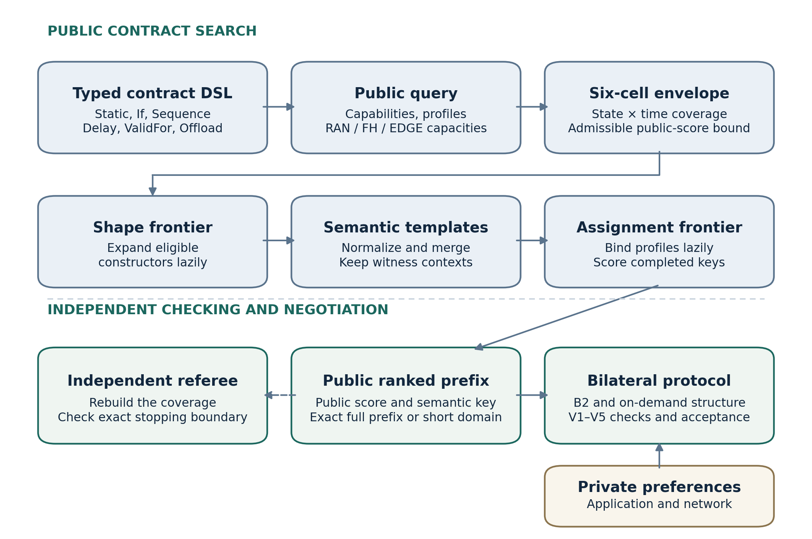
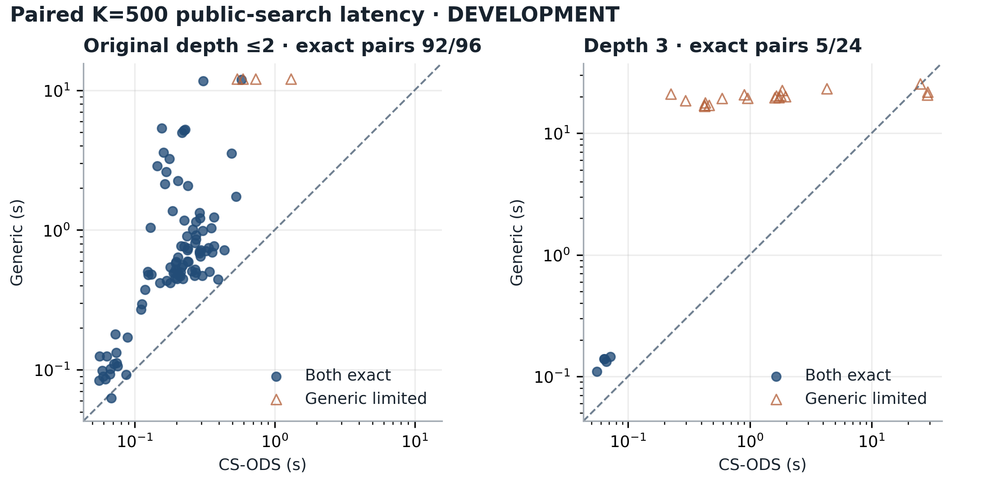
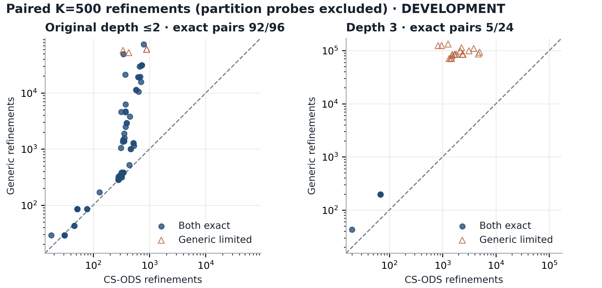
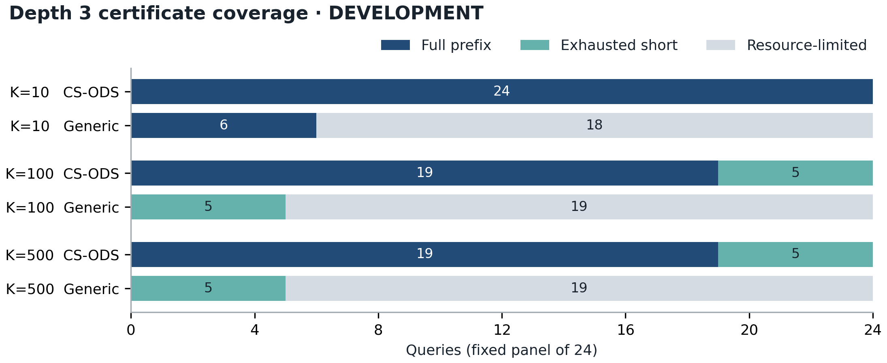
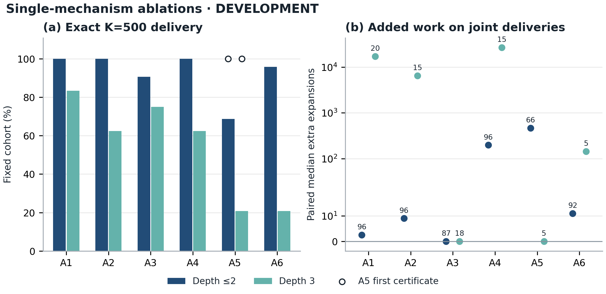
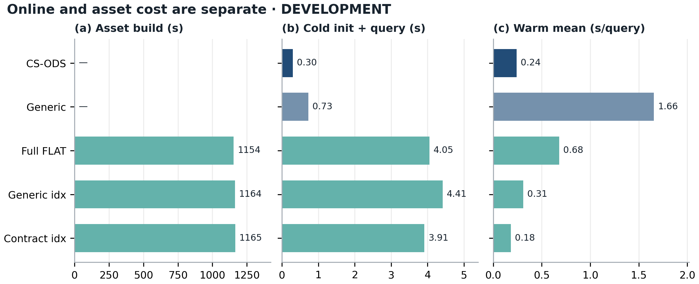

# 面向通信意图协商的能力约束合同按需合成与精确有序枚举

**On-Demand Synthesis and Exact Ranked Enumeration of Capability-Constrained Contracts for Communication-Intent Negotiation**

## 摘要

结构化通信意图合同可表达条件服务、延迟启动、分阶段配置和边缘卸载。本文研究在有限合同语言和公开能力约束下，如何按需生成公开排序的精确前缀。CS-ODS 根据部分合同的状态、时间和资源语义计算保守分数界，在兼容上下文内归并等价派生，并惰性展开候选。生成阶段无需预先构建完整语义图。交付后，有限状态机检查公共硬约束和容量，应用与网络双方依据各自效用检查接受条件。固定开发比较中，原深度的 96 个查询上，CS-ODS 与同域通用 best-first 基线分别有 96 和 92 个查询取得 K=500 精确证书。92 个共同获证查询的配对时延比中位数为 2.57（基线除以 CS-ODS）。在 24 个 Depth 3 开发查询中，两方法分别有 24 和 5 个查询取得 K=500 精确证书。独立覆盖裁判复查了 CS-ODS 的 72 个检查点，其中 10 个以短域穷尽结束。结果支持冻结有限语言内的精确生成，另给出开发集上的性能证据。独立持出确认尚未运行，真实网络履约尚未验证。

**关键词**　通信意图，能力约束，结构化合同，程序合成，精确 Top-K，双边协商

## Abstract

Structured communication-intent contracts can express conditional service, delayed activation, phased profiles, and edge offloading. We study how to generate exact prefixes of a public ranking on demand in a finite contract language with public capability constraints. CS-ODS bounds candidate scores using the state, time, and resource semantics of partial contracts, merges equivalent derivations in compatible contexts, and expands candidates lazily. Candidate generation requires no prebuilt full semantic graph. A finite-state interpreter then checks public capacity and hard constraints, and application and network agents test acceptance using their respective utilities. At K=500 on 96 fixed original-depth development queries, CS-ODS and the same-domain generic best-first baseline certified 96 and 92 queries, respectively. The median paired baseline-to-CS-ODS latency ratio was 2.57 among the 92 jointly certified queries. On 24 Depth 3 development queries, the methods certified 24 and 5 queries, respectively. An independent coverage checker reviewed all 72 CS-ODS checkpoints, including 10 that exhausted domains shorter than the requested prefix. These results establish exact generation within the frozen finite language and provide performance evidence on development data. Independent holdout confirmation and real-network fulfillment have yet to be evaluated.

**Keywords**　communication intent, capability constraints, structured contracts, program synthesis, exact Top-K, bilateral negotiation

## 1 引言

应用向网络提出通信服务目标时，应用了解可接受的服务变化，网络掌握公开资源状态及可执行的操作。本文用应用与网络两方的基准智能体表示这种信息分布。RFC 9315 对声明式意图、转换和履约保障的区分提供了术语基础。ITU-R 的 IMT-2030 框架讨论了通信与 AI 协作及计算卸载，给出了本文所选研究场景的长期背景 [\[1\]](#ref-clemm2022rfc9315), [\[2\]](#ref-itur2023m2160)。本文从已结构化的意图和确定的公共能力快照出发，研究供双方协商的候选合同如何生成和排序。

合同字段决定协商双方能够表达哪些选择。以边缘卸载为例，在基准中，同一质量、时限和速率配置如果改为边缘执行，会改变无线接入网、前传和边缘计算的资源占用。扩大静态字段的值域仍无法表示执行位置切换。条件服务和分阶段服务也需要分别绑定状态与时段。合同文法允许这些结构组合，但增加深度会扩张语法空间，且多个语法式可能表示同一合同。全域枚举可给出低深度的精确参照。预建索引可服务多次查询，也要求先构建、存储和加载全域资产。

本文提出能力语义约束按需合同合成方法 CS-ODS（Capability-Semantic On-Demand Contract Synthesis），解决有限深度下的**精确有序候选生成**。部分合同以状态、时间和资源的公开语义抽象表示，据此建立公开分数下界。解释器先按冻结规则规范化合同。同一规范语义类内更换代表，不改变同一合法父上下文中的合同签名。搜索在需要时实例化候选，为按公开分数与规范键排序的前缀提供证书。后续验证器检查容量和公共硬约束，应用与网络再按各自偏好提案和接受。排序精确性与协议达成率由不同证据支持。

本文的贡献有三项。第一，在有限合同 DSL 中，将条件、阶段、延迟、有效窗及卸载解释为由能力约束的离散状态、时间和资源行为，给出实现安全归并所需的上下文条件。第二，在该语义上实现按需实例化、保守下界与规范化，提供无完整语义图的精确排序生成路径，并用独立裁判核查固定开发查询的搜索空间覆盖及排序证书。第三，在统一候选域和公开排序之下，与通用合成基线、索引和六项消融对照，分别报告证书、在线搜索、离线资产和协商结果。性能比较来自开发数据。独立确认的样本与终点另行定义，实际网络部署与履约也有独立的验证要求。

## 2 相关工作

### 2.1 通信意图与自动协商

RFC 9315 第 3 节区分声明式意图、策略和服务模型，第 5 节区分意图转换、编排和履约保障。3GPP TS 28.312 V19.5.0 第 4.6 节规定意图驱动管理服务生产者与消费者在意图预评估和履约两个阶段的协商功能，包括可行性反馈与备选目标。附录 H 描述消费者给出效用函数并由生产者计算的流程。Liang 与 Yu 的个人 Internet-Draft 讨论了 6G 智能体发现与能力暴露，文献状态为工作草案 [\[1\]](#ref-clemm2022rfc9315), [\[3\]](#ref-3gpp2026ts28312), [\[4\]](#ref-liang2026multiagent)。这些工作界定了意图实现中的角色与交互。本文研究其中的候选生成环节，输入为已结构化的公开查询，输出为供基准验证及双边协议消费的精确前缀。

Contract Net 研究分布式任务分派，自动谈判研究区分协商对象、消息协议和各方决策 [\[5\]](#ref-smith1980contractnet), [\[6\]](#ref-jennings2001negotiation)。在通信领域，Marsico 等在应用感知的传送网络中根据供给能力提出替代服务；Sharma 等基于物理及虚拟资源状态生成备选意图，交由意图提出方接受或拒绝；Mostafa 等研究从应用体验质量到切片能力的学习式意图映射 [\[7\]](#ref-marsico2020automated), [\[8\]](#ref-sharma2023intentnegotiation), [\[9\]](#ref-mostafa2024emergent)。应用与网络的协商、冲突后的备选生成和意图转换均已有直接先例。本文的差分是为有限能力约束的**结构合同域**提供无需预建图且可独立核验的精确有序候选流。双方提案和接受使用共享的基准协议。

### 2.2 合同与网络操作语义

合同式系统设计研究以假设和保证表述组件及其环境的约束 [\[10\]](#ref-benveniste2018contracts)。Merlin 支持网络带宽、流量处理及路径约束的声明式供给，运行时的分层协商器检查租户修改是否仍满足被委托的全局策略 [\[11\]](#ref-soule2014merlin)。NetKAT 则给出包过滤、修改与转发的组合语义及相对其指称语义完备的等式理论 [\[12\]](#ref-anderson2014netkat)。本文处理同一合同在六个离散状态—时间单元中的服务行为、执行位置、角色足迹和资源成本。操作轨迹、身份归并和验证保证都以这套有限基准为对象。设备配置、无线调度与实际履约仍需另外验证。

### 2.3 程序合成、语义去重与有序检索

SyGuS 将文法约束纳入合成任务，SemGuS 允许同时指定构造器语义。抽象解释研究如何保守约束具体语义，SYNGAR 通过抽象有限树自动机及精化进行合成 [\[13\]](#ref-alur2013sygus), [\[14\]](#ref-kim2021semgus), [\[15\]](#ref-cousot1977abstract), [\[16\]](#ref-wang2018syngar)。Mell 等将抽象解释得到的可采纳目标界用于部分程序的 A\* 搜索 [\[17\]](#ref-hart1968astar), [\[18\]](#ref-mell2024optimal)。本文的通用对照是在同一合同域内实现这一类方法，含共享抽象转移、合法参数划分、通用区间与乘积界，以及严格的前缀停止规则。CS-ODS 进一步利用合同领域的执行单元、角色、成本和重复参数结构，在展开期间收紧界并合并可证明等价的派生。

Bee Search 与 Eco Search 已实现基于相应可预生成代价函数的精确有序枚举，后者对其代价模型给出常数生成延迟保证 [\[19\]](#ref-ameen2023beesearch), [\[20\]](#ref-matricon2025ecosearch)。CS-ODS 的查询目标取决于整份合同在当前资源快照中的具体解释，包括按单元计算的超限和裕量贡献以及组合复杂度。本文的正确性说明依赖该目标的保守完成界和规范键；在线延迟由实验测量。BUSTLE 利用输入输出示例上的具体子程序求值合并观察等价表达式，e-graph 用同余共享表达式并支持等式饱和 [\[21\]](#ref-odena2021bustle), [\[22\]](#ref-willsey2021egg)。本文的结构归并依据冻结合同签名和上下文条件。区分全合同能力足迹和每单元活跃角色尤其重要，因为父构造器可改变可见单元和活动时点，而能力资格及成本仍需保持。

Fagin 等的阈值算法利用预存记录的有序访问保证 Top-K 聚合 [\[23\]](#ref-fagin2003topk)。本文的索引对照具备全域图资产，无图方法从公开文法和能力描述开始生成。本文分别核查有序前缀、未访问语法空间及并列键，分列在线搜索、独立证明和离线索引成本。通用方法的构造思想均已有文献基础，本文的检验对象是这些技术在合同操作模型中的具体组合及其可测收益。

## 3 系统模型与问题定义

### 3.1 参与方与公共环境

给定一次通信意图协商查询 $x=(x_{\mathrm{pub}},\theta_A,\theta_N)$。应用智能体以服务质量、时限、启动等待与切换为偏好，网络智能体以资源、策略复杂度与切换为偏好。双方分别持有权重与保留效用 $u_A^0,u_N^0$。公共输入包含状态与时间域、各单元容量、公开参数域、能力注册表及可用能力、公共硬约束。合同合成仅读取 $x_{\mathrm{pub}}$。双方根据解释后的合同各自计算效用，并将其用于提议和接受决策。该输入边界不构成对交互记录的隐私或策略性保证。

基准的时间域为 $\mathcal T=\{0,1,2\}$，状态域为 $\mathcal S=\{\mathrm{still},\mathrm{moving}\}$。令 $J=\mathcal T\times\mathcal S$，六个单元按时间优先、状态次序排列。每个 $j\in J$ 的容量向量 $c_j$ 对应无线接入网（RAN）、前传（FH）和边缘计算（EDGE）。状态是外生条件，每个单元独立核对容量。容量、质量、时限和速率均采用归一化基准量纲，尚无到 NR 资源块、Mb/s、毫秒或计算周期的校准。时限是配置、硬阈值及效用的输入，未被用于计算传输队列或物理层时延。一次查询内，公开能力、参数域及资源快照固定。

一个服务配置为 $p=(q,\ell,r)$，依次表示质量、时限和速率。公开配置域 $\mathcal P$ 由 $\{0.4,0.6,0.8\}\times\{1,1.5,2\}\times\{0.5,0.75,1\}$ 构成，共 27 个配置。静态参照 B2 在整个区间采用同一配置，涵盖这 27 个配置。结构合同以同一 $\mathcal P$ 为叶参数，可重组服务配置对状态、时间和资源的依赖。

### 3.2 以能力为约束的合同 DSL

``` text
Contract ::= Static(p)
           | If(moving, a, b) | Sequence(1, a, b)
           | Delay(1, a) | ValidFor([0,2), a) | Offload(edge, a)
```

`Static` 的深度为 0，其他节点的深度为其最深子树的深度加 1。类型规则检查构造器元数和参数类型，合成域进一步将各参数限制在表 1 所述算子的冻结公开取值内。能力注册表为角色定义输入输出类型、公开前置谓词、效果、适用作用域、资源成本和执行成本。绑定只允许与冻结解释器相容的声明，使用等价声明的可用提供者可以具有不同标识。五个基础角色用于设置质量、时限和速率，以及预留 RAN 与 FH。结构角色由相应构造器引入。

表 1 汇总各构造器的局部语义及所需角色。

  -----------------------------------------------------------------------------------------------------
  构造器                  在局部时间 $t$、状态 $s$ 下解释                      所需结构角色
  ----------------------- ---------------------------------------------------- ------------------------
  `Static(p)`             使用 $p$ 并采用本地模式                              基础角色

  `If(moving,a,b)`        moving 时解释 $a$，still 时解释 $b$，保留 $t$        运动状态观测、条件策略

  `Sequence(d,a,b)`       $t<d$ 时解释 $a$，其余时间以 $t-d$ 解释 $b$          分阶段策略

  `Delay(o,a)`            $t<o$ 时空闲，否则以 $t-o$ 解释 $a$                  延迟调度

  `ValidFor([a,b),h)`     区间内以 $t-a$ 解释 $h$，其余时间空闲                有效期设置

  `Offload(edge,a)`       保持原时间与状态，将子合同所有活跃单元设为边缘模式   边缘卸载、边缘资源预留
  -----------------------------------------------------------------------------------------------------

  : 表 1　冻结合同 DSL 的构造器、执行含义与能力角色。

设规范化后的合同在单元 $j$ 中为空闲 $\bot$，或为 $(p_j,o_j,M_j)$，其中 $o_j$ 是本地或边缘模式，$M_j$ 是当时被选中的活跃路径上的角色集合。单元内重复出现的角色按集合计一次，空闲单元不产生运行成本。零部署成本是冻结基准假设。合同级足迹还包含规范树中未运行分支的角色，静态角色记录路径上封闭的各作用域，无外层时记录静态作用域，结构角色记录引入它的算子作用域。冻结规范化先处理子合同，再在 `If(moving,a,b)` 两分支的完整公共签名相同时，以规范子合同中字典序较小者替代该条件节点。两分支一致时允许省去观测和条件策略部署。类型与原始推导深度先核查，之后的解释、能力检查与计费使用规范合同。

令 $e_j$ 和 $b_j$ 分别表示活跃角色的执行成本之和及资源成本向量之和。活跃单元的基础需求 $v_j$ 为

$$v_j=\begin{cases}
(q_j,\ 0.4r_j,\ 0),&o_j=\mathrm{local},\\
(0.5q_j,\ (0.4r_j)\,0.7,\ 0.5q_j),&o_j=\mathrm{edge}.
\end{cases}$$

空闲单元令 $v_j=b_j=0$，$e_j=0$。V4 按单元与资源检查 $v_j+b_j$ 为有限非负值且不超过 $c_j$，无边缘预留角色时要求 EDGE 负载为零。冻结公共硬约束要求六个单元中至少一个活跃，活跃配置的质量至少为 0，时限至多为 2。状态机在各单元内先预留资源，再设置服务参数，得到基准可重放的执行轨迹。本文用 V1 表示类型与深度检查，V2 表示能力绑定、作用域与前置谓词检查，V3 表示算子参数与子合同的递归有效性检查，V4 表示上述负载与硬约束检查，V5 表示双边阈值接受。

具体地，令 $\mathcal I$ 为所有活跃单元，$Z_{t,s}$ 表示 $(p_j,o_j)$ 或 $\bot$。定义 $Q=\sum_{j\in\mathcal I}q_j/6$， $L=\sum_{j\in\mathcal I}(1+\ell_j)^{-1}/6$。 令 $D$ 为两状态下首次活动时刻除以 3 的平均，从未活动的状态取值为 1。令 $S=\sum_{s\in\mathcal S}\sum_{t=1}^2\mathbf 1[Z_{t,s}\ne Z_{t-1,s}]/4$， $H=|\{(p_j,o_j):j\in\mathcal I\}|/6$， $\bar v=\sum_{j\in J}(v_j+b_j)/6$ 与 $E=\sum_{j\in J}e_j/6$。双方效用为

$$u_A=\operatorname{clip}_{[0,1]}\left(
\frac{w_qQ+w_\ell L+w_d(1-D)+w_s(1-S)}{w_q+w_\ell+w_d+w_s}
\right),$$

$$u_N=\operatorname{clip}_{[0,1]}\left(
1-\frac{\lambda_R\bar v_R+\lambda_F\bar v_F+\lambda_E\bar v_E+
\lambda_h H+\lambda_s S}{\lambda_R+\lambda_F+\lambda_E+\lambda_h+\lambda_s}-E
\right).$$

通过 V1–V4 且同时满足 $u_A\ge u_A^0$ 和 $u_N\ge u_N^0$ 的合同才满足基准的协议验收条件。原日志列名 Nash 指已接受合同的效用乘积 $u_Au_N$。保留效用只用于接受阈值，效用乘积未减去分歧点，也不是该协议的优化目标。

### 3.3 语义身份、公开目标与预算

对固定的 $x_{\mathrm{pub}}$，规范语义签名 $\sigma_x(h)$ 记录整个规范合同的角色声明、作用域和谓词结果，以及 V3 有效位。V3 有效时还记录六个单元的空闲标志，或活动配置、边缘模式、活跃角色及其成本。固定注册表下，活跃角色决定成本。有效签名可无损编码为 49 字节的规范键 $k(h)$。首字节为有效位，其后 12 个角色各占两字节，记录作用域和谓词位掩码或缺席标记。每个单元再用四字节记录配置或空闲标记、执行模式和活跃角色位掩码。此编码的单射性依赖同一公开配置表、同一单元序和同一注册表。同一公开查询中的等键合同，在通过各自 V1 检查后，具有相同的 V2–V4 结果，且对同一组私有偏好产生相同 V5 结果。

令 $d$ 为有效组合深度，$\mathcal R_d(x)$ 为基础角色可绑定、每个原始节点所需构造器角色可绑定、参数在冻结公开域内且深度至多为 $d$ 的类型化推导集合。冻结范围要求基础角色支持静态节点可进入的全部作用域，结构角色支持自身算子的作用域，并使用冻结正谓词。规范化后按 V3 有效位、规范键和结构组筛选，得到结构域 $\mathcal D_d(x)$。一个键的见证取自 $\mathcal R_d(x)$ 中产生该键的原始树，先选最小原始语法键，再将该树规范化。例如缺少条件能力时，原始 `If(moving,a,a)` 无资格竞争 $a$ 的见证，即使忽略可用性时能够折叠。结构组计数 $g$ 来自规范合同足迹，四组分别为条件、延迟调度、分阶段或有效期、卸载。有效深度 1–2 的结构流保留 $1\le g\le 2$，深度 3 扩展保留 $1\le g\le 4$。静态 B2 另行验证与协商。$\mathcal D_d(x)$ 不以 V4 或 V5 为域资格。例如在可用延迟调度的深度 3 查询中，三层 `Delay(1,·)` 包装的静态合同可有合法语法、能力和结构语义，却在六个单元均空闲并被 V4 拒绝。

公开排序沿用原 FLAT 分数。写 $z_{j,k}=(v_{j,k}-c_{j,k})/\max(c_{j,k},10^{-9})$，定义

$$V=\frac1{18}\sum_{j\in J}\sum_{k\in\{R,F,E\}}\max(z_{j,k},0),$$

$$M=\frac1{18}\sum_{j\in J}\sum_{k\in\{R,F,E\}}\operatorname{clip}_{[-1,1]}(-z_{j,k}),$$

$$A=\frac1{6}\sum_{j\in J}\left(e_j+\sum_{k\in\{R,F,E\}}b_{j,k}\right),$$

$$f_x(h)=V-0.025M+0.02A+0.08(1-Q)+0.01g .$$

其中 $V$ 和 $M$ 使用基础需求 $v$，角色成本作为单独的 $A$ 项。算式按冻结 binary64 实现的累加与括号次序计算，排序先比较浮点分值，再比较规范键的无符号字节字典序。深度 1–2 的冻结参照图按同一键的字节序给出类编号，方法开发对照直接检查了同分次序。深度 3 继续使用该规范键，因此无需建立该深度的全图编号。

任务是在 $\mathcal D_d(x)$ 中每个规范签名仅交付一个代表，并在资源允许时返回长度为 $\min(K,|\mathcal D_d(x)|)$ 的精确有序前缀。短于 $K$ 的精确结果需要穷尽证明。搜索记录原生边界与状态，独立认证还需第 5.3 节定义的可检查覆盖证据。墙钟时间、工作集、前沿与展开计数限制搜索。达限可保留先前交付的前缀，只有经过对应复核的检查点计作独立认证成功。公开排序认证、V4 可行性和 V5 接受分别记录。

## 4 CS-ODS 按需合同合成

CS-ODS 将构造器选择和叶配置赋值分在两个交错推进的前沿。构造器队列从类型洞 `ClauseHole(d)` 开始，只展开当前公开可用的能力产生式。`Static` 先保留完整配置域的 `ProfileHole`。构造器位置确定后，搜索将该骨架归约为带配置变量的语义模板。赋值队列按公开分数下界细化模板的候选配置。完成项队列按精确分数和规范键排序，并保存恢复见证所需的模板、赋值和已用配置掩码。查询内初始化配置基表、角色掩码成本表与有界算术缓存。搜索可保留已访问的模板、见证配方和规范键，启动时无需物化完整合同语义图。

图 1 展示公开搜索前沿、覆盖裁判与双边协议之间的接口。

{width="91%"}

### 4.1 状态—时间—资源包络

每个部分合同的包络保留六个单元的可空闲位、两种执行模式的可能配置位集、必需与可能活跃角色，以及由这些集合得到的需求、质量和其他标量极值与成本下界。合同级另存必需和可能的角色足迹，以及相应的结构组上下界。类型洞的包络并合 `Static` 和所有可用构造器对浅一层包络的传输结果。联合下界直接使用配置—模式选择集合，分量下界使用基础需求下界、质量上界和角色成本下界。包络允许单元间组合在真实完成式中不可同时实现的选择。这放松了下界的约束。

时间算子按局部时间规则搬移或截取子包络的单元。卸载重标活跃模式并合入对应角色。对尚不确定能否折叠的条件节点，同时考虑保留条件与两子签名相等后的折叠。前者依据状态取对应分支并加入条件角色，后者从两子包络的交集得到共同结果。若交集已被证明为空，可排除折叠。对仍可能的结果，取可能集合的并与必需角色的交。集合运算在嵌套路径中保持角色去重。缺少兼容角色的构造器不加入产生式。结构组上界为零或下界超过查询组限的分支无 $\mathcal D_d(x)$ 内的完成式。

### 4.2 从构造器骨架到语义模板

构造器骨架闭合后，按语法出现顺序为各 `Static` 叶编号。相关位置由根的六个单元所读叶与每个原始 `If` 的两条分支各自作为根时所读叶取并。分支独立解释时覆盖整个局部时域，因此也包含外层时间算子可能重定位到的单元。只观察全树根会漏掉某些决定内层等值折叠的位置。例如 `If(moving,If(moving,Static(a),Static(b)),Static(a))` 的根配置从不取 $b$。当 $b=a$ 时两层条件均可折叠，当 $b\ne a$ 时仍有条件角色。两种情况下根配置数值可以完全相同。

算法以受限增长串枚举相关位置的相等关系。不同块必须取互异配置，块数超过公开配置数的分区无法实例化。对每个可实例化分区，以互异占位配置执行冻结规范化，再按首次出现在六单元中的顺序重编号根所见的配置块。模板键包含固定足迹和有效位、单元中的空闲或变量、模式和角色位集，以及可见变量数与结构组数。相同模板共享可见变量的赋值流，并保留各语法分区的原始见证配方。较大的未赋值掩码用质量、速率、时限依次寻找首个有效分割，其他情况逐个选择尚未使用的配置。完整赋值后计算精确分数。

恢复见证时先绑定可见变量，再按首次语法出现次序，将隐藏相关块依次赋为尚未使用的最小配置语法键。隐藏块共用同一域并受互异约束。冻结的完整 `Static` 语法键之间不存在严格前缀关系，所以单条配方中的首个不同赋值决定原始键的字典序。非相关叶独立取最小允许配置。比较所有有效配方得到的原始语法键，选定最小者后才规范化，再核对其深度和结果签名。

### 4.3 有序交付与协商接口

**算法 1　CS-ODS 有序前缀**

``` text
输入  公开查询 x_pub、有效深度 d、前缀长度 K、资源预算
输出  有序规范签名及代表、检查点状态
将根类型洞按下界放入构造器堆；清空赋值堆与完成堆
重复，直至返回 K 个完成项
    当前沿非空，且（完成堆为空或当前最小前沿下界不大于最小完成分数）
        检查资源限额
        取下界最小前沿节点，同下界优先构造器，将取出节点的下界保留为在途下界
        若构造器骨架含未决类型洞，只细化先序中第一个洞
        若为完整构造器骨架，归约相关位置分区并合并同签名模板
        若为赋值节点，以互斥掩码细化下一变量
        为新增开放分支计算下界，为完整赋值计算精确分数
        仅当全部子分区安装结束，清除在途下界并重新取两个前沿的最小下界
    若完成堆为空且前沿皆空，返回穷尽
    检查资源限额，弹出最小 (分数, 规范键)
    恢复、校核代表并输出该项
返回原生精确前缀及边界。若展开中达限，仅保留此前交付的前缀，
不给未完成检查点赋予精确或穷尽状态
```

协商接口先用 B2 的 27 个静态项进行验证和协商。B2 未达成协议时才向结构流请求补充项。合成阶段提供 V1 资格，批处理适配器每批最多向公开验证器交付 16 项，使用紧凑单元记录执行 V2–V4，合格项加入公共池。轮到一方时，它从未提议且达到自己保留效用的候选中提议效用最高者，同效用时按规范键决定顺序。对方以自己的阈值直接接受或拒绝，无法提议时可以跳过。达成协议后，适配器重算见证的规范键和状态机轨迹，并与紧凑验收证据核对。开发回放还用完整解释器复核双方效用和 V5。精确验证调用预算为 100、500、1,000 与 5,000，计入 B2 的调用，提议上限为 10,000 轮。验证调用预算与公开搜索要认证的前缀长度 $K$ 分别计量。私有反馈可决定何时停止请求候选，候选顺序仍完全由公开分数和规范键决定。该协议研究固定候选池规则下的双边提议和阈值接受。

## 5 正确性与复杂度

### 5.1 组合性和包络涵盖

**命题 1（固定公开环境中的上下文同余）**。在第 3 节的冻结类型和能力条件下，将某个子合同换成同签名子合同，且替换前后均在合法推导域内，生成的父签名相同。这一性质针对签名，原始语法的深度资格与字典序见证分别处理。

证明分两部分。第一，活动单元的传输只读取子合同已记录的局部时间与状态。`Sequence` 的后段、`Delay` 的延迟后段和 `ValidFor` 的有效区间分别重置到 $t-d$、$t-o$ 和 $t-a$，取值均在已记录时域内。`Offload` 重标模式，算子在活动路径上合入各自的角色。等签名给出相同配置、模式与活跃角色，为固定角色表重新计费后仍相等。第二，未折叠的父节点合并子合同的整个能力足迹以及自己的角色和作用域。如果 $S$ 为子合同基础角色的所需作用域，父算子作用域为 $\omega$，作用域传递为 $(S\setminus\{\mathrm{static}\})\cup\{\omega\}$。结构角色的作用域直接取并。冻结谓词只检查公开固定条件、叶是否属于配置域和算子参数是否合法。V3 递归检查所有分支，即使其在活动单元中从未选中。对于 `If`，替换保持两分支的签名等式，折叠时两种可能见证的签名相等，保留时按原状态选择对应子单元。各构造器保持等签名，嵌套上下文随之保持同余。冻结结构机制计数也由规范化后的能力足迹决定。

**命题 2（部分树包络涵盖）**。固定配置和带位掩码的配置洞包络涵盖各自允许的叶选择。假定子包络覆盖各自合法完成式，时间与卸载算子依照对应单元搬移和角色变换传输，保留所有可达单元。对可能折叠的 `If`，未折叠情形按状态选择分支，折叠情形的共同结果必在两包络交集内。并合尚可能的情形可保持涵盖。对类型洞的剩余深度归纳，各公开允许产生式的并合包含其所有合法完成式。因此包络给出的需求、质量、角色成本和结构组界适用于该开放分支的每个合法完成式。公共容量和硬约束资格仍由 V4 确定。

### 5.2 下界可纳性

令 $\underline v_{j,k}$、$\overline q_j$ 和 $\underline a_j$ 分别为单元的基础需求下界、质量上界和公开角色成本下界。可能空闲的单元允许零角色成本，其余单元从包含必需角色的所有角色掩码取最小的精确成本。将 $\underline v$ 输入第 3 节的分数公式，归一化超限项得 $V^-$，余量项得 $M^+$。令 $\overline Q=\sum_j\overline q_j/6$、$\underline A=\sum_j\underline a_j/6$，并令 $g^-$ 为必需合同角色对应的结构组下界，则

$$L_{\mathrm{coord}}=V^- -0.025M^+ +0.02\underline A+0.08(1-\overline Q)+0.01g^-.$$

容量分母为固定正数，超限对基础需求单调不减。余量对基础需求单调不增，且在分数中系数为负。质量上界与成本、组数下界给出其余方向一致的松弛。保持原有的有限 binary64 运算和累加次序后，正确舍入的运算保持这些单调关系，故对整片开放区域内的任一完成式 $h$ 有 $L_{\mathrm{coord}}\le f_x(h)$。

进一步令 $\Omega_j$ 包含单元包络允许的配置、模式及可能的空闲值。设 $\phi_j(\omega)=\sum_k\max(z_{j,k},0)/18-0.025\sum_k\operatorname{clip}_{[-1,1]}(-z_{j,k})/18-0.08q_j(\omega)/6$。 先把原实现已舍入的资源项、精确角色掩码成本和分数系数看作实数输入。任何完成式的真实单元选择 $\omega_j$ 皆在 $\Omega_j$ 内，故 $\sum_j\min_{\omega\in\Omega_j}\phi_j(\omega)\le\sum_j\phi_j(\omega_j)$。加上相应的成本和组数下界后，仍得到实数松弛。令 $Z_{\max}$ 为查询表中最大的已舍入超限分量，$A_{\max}$ 为完整角色掩码的冻结成本。联合项的 binary64 实现按以下估计向下调整：

$$L_{\mathrm{joint}}=\sum_{j\in J}\min_{\omega\in\Omega_j}\phi_j(\omega)
+0.02\underline A+0.08+0.01g^- -
2^{-38}(32+32Z_{\max}+12A_{\max}).$$

设 $W=32+32Z_{\max}+12A_{\max}$。18 个非负超限分量各不超过 $Z_{\max}$，裕度绝对值至多 1，六个配置的质量不高于 1，每单元角色成本在 $[0,A_{\max}]$，且 $g\le4$。因此 $W$ 支配两种求值树的绝对系数加权输入量。对任一固定单元组合，逐层舍入的相对误差因子乘积用 $\gamma_{128}=128u/(1-128u)$ 界定，其中 $u=2^{-53}$。128 上界覆盖冻结实现中的顺序累加、除法和计权，每种组合的统一绝对误差不因取最小值而放大。两种求值树的重新结合误差合计至多 $2\gamma_{128}W$。即使计入次正规舍入的绝对误差，其附加量也远小于 $2^{-53}W$。容差括号仅含非负项，舍入后仍至少为 $W/2$。因此校正量至少为 $2^{-39}W$，超过 $2\gamma_{128}W$ 与最终减法误差之和。上述界限针对冻结有限输入与非溢出 binary64 运算。实际返回 $\max(L_{\mathrm{coord}},L_{\mathrm{joint}})$，拒绝非有限结果。赋值前沿由模板的固定模式、固定角色、已绑定值和剩余允许掩码构造包络，使用相同不等式。

### 5.3 语义去重与精确证书

**命题 3（语义模板覆盖与合并）**。在固定骨架和相关位置的相等分区下，更换各块的互异配置仅重命名配置字节，保持模板的其他字段。证明从最内层条件开始。归约只比较两个子签名，决定比较的配置已包含在子合同的独立局部观察中。固定参数及能力前置谓词允许这些配置值互换。两个子签名相等时，配置的语法序可影响折叠后选中的树，但两个选择给出同一签名，外层传输依据命题 1 得到相同父结果。递归应用即可决定根签名中的固定字段。整根实际读取的配置也包含在相关位置集合中。其余叶值不影响任何比较或根配置。

由任一具体键可恢复固定字段和可见块的相等模式，因而不同模板生成的具体键集合互不相交。同一模板的任一可见互异赋值都可补足每条保留配方的隐藏块，因为公开配置数不少于该分区的块数，且各块共享同一域。合并保留一条赋值流和全部可用见证配方。该论证依赖固定字段、公开配置域和隐藏块的可延拓性。两个包络相等不足以推出两者的完成集合相同。

**命题 4（有序交付）**。根类型洞覆盖所有合格推导。每次构造器替换覆盖公开允许的产生式和参数，骨架闭合后的分区覆盖合法相等模式，互斥赋值掩码覆盖模板的实际赋值。展开未结束的子分区仍由在途下界代表。于是每个合法具体键或者由开放区域覆盖，或者在完成堆，或者已经输出。若最小完成分数严格低于所有开放下界，任何开放完成式都不能排在它之前，包括可能改变其最小原始见证的同分推导。同分时完成堆按规范键排序，开放状态即使只有等于最小完成分数的下界也继续细化。逐次输出保持这一不变量，形成精确前缀。只有开放状态、在途状态与完成缓冲均为空，才证明源域穷尽。预算在展开内中断时不会产生新证书。

独立复核采用分区覆盖证书。裁判从公开语法根重建允许的构造器分支和相关位置分区，检查模板上剩余掩码和已处理赋值构成互斥全覆盖。它重算开放区域的保守下界，检查缓冲与交付项的分数位、键、规范见证及截止次序。完整前缀允许缓冲中保留严格后序的同分候选，开放区域的下界则必须严格超过截止分数。短域需证明没有开放区、剩余赋值或未交付缓冲。内容寻址用于共享记录和校验证据完整性，覆盖由分区和语义核查推出。深度 1–2 另用独立 Full FLAT 排序参照。深度 3 的裁判和生产者共用冻结类型、状态机、规范化、键编码、抽象传输和评分定义。裁判独立重建覆盖、实现下界核算与截止检查，既不使用生产者的队列顺序，也不接受其原生认证标签作为覆盖依据。

### 5.4 开销与适用范围

设 $P$ 为配置数，$u$ 和 $b$ 为可用一元和二元算子–参数组合数。对只按构造器和配置展开的能力条件化原始语法，深度不超过 $d$ 的树数为 $N_0=P$ 和 $N_d=P+uN_{d-1}+bN_{d-1}^2$。完整能力域中 $u=3,b=2$，只计带参骨架时取 $P=1$，深度 2 和 3 分别有 91 与 16,836 个骨架。这些数尚未按机制组、规范键或 V4 等过滤。若骨架有 $m$ 个相关位置，枚举程序最多考察 $B_m$ 个相等分区，其中 $B_m$ 为第 $m$ 个 Bell 数。满足块数限制的分区个数为 $\sum_{i=0}^{\min(m,P)}S(m,i)$，其中 $S(m,i)$ 为第二类 Stirling 数。$l$ 个可见块的赋值域大小为下降阶乘 $(P)_l$。这些计数说明组合增长来源。

若三个堆中最多同时保留 $F$ 个状态，单次堆操作需要 $O(\log(1+F))$ 次键比较。总时间还随访问骨架、考察分区、传输包络、完成赋值的评分次数及恢复见证时检查的配方数变化。前沿、已访问模板、见证配方、已见键及缓存都占空间。角色成本和超集最小值表的预计算用 $O(R2^R)$ 次基本操作和 $O(2^R)$ 个表项，冻结模型中 $R=12$，表大小不取决于整张合同语义图。下界松弛或大量分数相同时，即使目标 $K$ 较小，也可能需要遍历大部分骨架、考察分区或评价大量合同。实现和复核涵盖冻结 DSL 的有效深度 1、2、3，复杂度计数和开发面板均不给出超出这些条件的运行时间保证。

## 6 实验评价

### 6.1 开发面板、对照方法与计量边界

开发实验考察三件事。首先，在候选域、公开评分和排序相同的条件下，各方法能否按预算交付精确前缀。其次，改变一个搜索机制会怎样影响展开次数、达限和耗时。最后，暖态索引的查询成本与其预计算和持久化负担各是多少。

基准以归一化容量表示资源压力。低、中、高压力的 RAN 基值分别为 0.92、0.72、0.52，每个实例加一次从 $[-0.04,0.04]$ 均匀抽取的扰动。令扰动后的值为 $c_0$，该实例的 FH 与 EDGE 容量分别为 $0.75+0.1c_0$ 和 $0.8+0.1c_0$。F1 将 moving 单元的 RAN 容量乘 0.68，F2 将首时隙乘 0.35，F3 将首时隙乘 0.65，F4 将所有单元乘 0.72。其他 RAN 单元倍率为 1，容量保留六位小数。F2 与 F3 的瓶颈位置相同、强度不同。合法结构还受各场景公开的能力可用性及参数域约束。

固定面板从已有序列化实例选出 96 个原深度查询，覆盖四类场景、三档资源压力、两档偏好冲突、两档能力丰富度以及深度 1、2。另从其中选出 24 条高冲突、原深度 2 的实例，保留公私有记录，派生 Depth 3 查询，均匀覆盖四类场景、三档压力和两档能力丰富度。120 个查询视图共用 96 个基础实例。Depth 3 同时放宽组合深度和机制组数上限，跨深度结果无法分离两种变化的作用。原深度另按公开条件化后至少有 100,000 个结构候选标出 30 条高成本查询，其中 24 条为 rich-depth2。

原深度比较 CS-ODS、通用抽象 best-first、Full FLAT、Generic Index、Contract-Aware Index 及六项单因素消融。通用基线采用最小剩余值分区、父界继承、抽象缓存、终端语义去重，并以区分 idle 和 active 的局部输出因子联合最小化加强坐标界。它是与 CS-ODS 同域的通用合成实现。Mell 等人的原系统使用其他 DSL 和评价任务，两者的实验结果不可直接换算 [\[18\]](#ref-mell2024optimal)。A2 保留 CS-ODS 的搜索结构并只使用坐标界，完整通用基线另有联合因子界。Full FLAT 对条件化后的图记录计算精确分数并排序。两种索引复用同一语义图和能力见证包。Depth 3 比较八条合成路线，三条图方法均为 N/A。完整富能力 Depth≤2 图有 1,394,064 个语义类，其中 27 个是由协议单独处理的 B2 静态类。原深度 rich-depth2 的条件化队列各含 1,252,611 个结构候选。

开发比较在 Windows 64 位、CPython 3.12.14 和 NumPy 2.3.5 上按同一序列化实例配对。固定顺序交错深度、轮换方法，一次派发一个活跃查询。两类暖态进程可同时驻留。原深度和 Depth 3 的开发预算分别为 12 s 与 45 s，采样工作集上限为 2 GiB，展开／前沿上限分别为 300,000／180,000 和 2,000,000／260,000。不同实现的展开与前沿采用各自原生单位。开发运行以 1,280 MiB 为启动下限，持出计划为 2,048 MiB，两者的系统紧急底线均为 768 MiB。暖态公共检索包含条件化、搜索、评分及有序交付。图构建、冷启动、B2、验证、协商和独立证明复核分别计量。

### 6.2 精确前缀、暖态时延与搜索工作量

共观察 1,248 次方法—查询尝试、4,800 个 K 检查点。原深度检查 K=10、50、100、500，Depth 3 检查 K=10、100、500。比较器记录 4,206 个全长精确结果、384 个经证穷尽的短域结果及 210 个达限未认证结果，未观测到 `UNSOUND`。原深度的语义键、binary64 分数、规范见证和认证长度与经 Full FLAT 核对的封存参照比较。Depth 3 的方法间对照使用固定查询的 CS-ODS 封存前缀，独立覆盖复核见第 6.3 节。通用合成基线另在 15 个独立缩减域通过全域顺序与穷尽检查。

1,248 条协商重放记录均与输入同一前缀及穷尽标志的参照重放一致，涵盖预算、代表合同、交互轨迹及已定义的效用字段。784 条完成全部预算档，418 条只完成现有前缀支持的预算档，其中 412 条最高至 B=500、6 条至 B=100。46 条前缀不足，未交付协商结果。效用乘积沿用日志中的 `nash` 字段。相同输入前缀的协议一致性支持以共同协议评价搜索方法，未交付的后续前缀无法给出相应预算档的协议结论。

表 2 将全部预定配对的覆盖与共同认证配对的条件时延分开。共同认证时延使用取得 K=500 证书的秒数（`proof_elapsed_s`）。原深度的 92 个共同认证配对中，CS-ODS 在 91 个上更快。逐对 generic/CS-ODS 时延比中位数为 2.57，逐对秒差中位数为 0.352 s。四条 generic 独自达限的查询触及墙钟上限，其中两条属于 rich-depth2。

  -----------------------------------------------------------------------------------------------------------
  开发集合                       两者认证   仅 CS-ODS 认证   仅通用认证   两者均未认证   共同认证时延比中位数
  -------------------------- ------------ ---------------- ------------ -------------- ----------------------
  原深度全部（96）                     92                4            0              0                   2.57

  原深度 rich-depth2（24）             22                2            0              0                   4.10

  原深度高成本（30）                   28                2            0              0                   4.18

  Depth 3（24）                         5               19            0              0                   2.04
  -----------------------------------------------------------------------------------------------------------

  : 表 2　固定开发面板 K=500 配对覆盖及共同认证时延。

全部原深度查询中，CS-ODS 的观察停止时间中位数／p95 为 0.216／0.533 s，通用基线为 0.596／11.692 s。rich-depth2 的对应值为 0.235／0.540 s 和 1.199／10.986 s。该时钟（`online_elapsed_s`）包含达到限额时已经用掉的时间，未认证运行的实际完成时间仍未观测。表 2 的共同认证条件速度比排除了这些查询，因此不用于估计总体速度比。Depth 3 的共同认证配对均为短域，无法外推到返回 500 条合同时的速度。 [逐查询 K=500 汇总](PAPER1_TABLES/method_k500_summary.csv) · [共同认证配对](PAPER1_TABLES/paired_k500_comparisons.csv)

{width="90%"}

原深度 92 个共同认证配对中，通用合成与 CS-ODS 原生展开数的逐对中位比为 1.11。扣除 CS-ODS 的 profile 等值分区探测，细化数的逐对中位比为 1.14。rich-depth2 的 22 个共同认证配对中，相应的细化比为 7.03。细化数反映各自实现的工作量，公共抽象计算与队列管理的单次成本未必相同。原深度暖态采样工作集的中位数为 CS-ODS 272.1 MiB、通用合成 272.3 MiB。图路线使用共同加载完整图和两套索引的进程，工作集约 518–520 MiB，不能据此给任一独立索引分配峰值。 [逐查询细化数](PAPER1_TABLES/paired_search_work.csv)

{width="90%"}

### 6.3 Depth 3 全长、短域与前沿达限

K=500 时，CS-ODS 交付 19 条全长前缀和 5 条穷尽短前缀。通用基线在同五个短域完成，另外 19 条均触及前沿限额。全体 24 条尝试的观察停止时间中位数／p95 为 CS-ODS 0.749／28.250 s，通用基线 19.446／23.056 s。通用基线 p95 停得较早的分布包含 19 次前沿达限。这个数字反映停止时钟，其认证完成时间无法从中恢复。

历史判定 `DEPTH3_PARTIAL` 保留。后续独立穷举发现五个小域中，四个只有 81 个合法结构语义类，一个只有 27 个。故该固定面板最多有 19 条全长 K=500 结果，原定至少 20 条的全长门槛不可达。对五个短域的正确归类不改变历史门槛的结果。

独立裁判复核了 24 条 CS-ODS 开发查询的 72 个 K 检查点，其中 62 个全长、10 个穷尽短域。比较中通用基线已认证的前缀与封存参照对照，独立根到前沿覆盖的 72 个检查点仅计 CS-ODS。两种证据格式分别拒绝 11 项预设篡改，涵盖缺漏参数分支、虚高下界和错误合并。每条证明结构供三个 K 共用。证明生成中位数／p95 为 0.985／37.061 s，复核为 2.825／43.176 s，压缩大小为 0.347／1.062 MiB。上述开销与暖态检索分开报告。 [Depth 3 检查点分布](PAPER1_TABLES/depth3_certificate_counts.csv)

{width="88%"}

### 6.4 消融改变的机制及相应观测

A1 延后模板去重，A2 将 CS-ODS 的下界替换为坐标界，A3 延迟公开能力资格检查，A4 在原抽象转移之后将六单元包络取并集再交给下界，A5 在首个 K=500 证书后继续至穷尽，A6 将领域规范化推迟到完整 AST。各单项共享合法域、排序、验证及协议。A4 保留精细抽象转移本身的计算开销，差值刻画下界可用信息量的边际影响。A6 改变规范形式的首次出现时机，也可能减少 A1 所涉及的早期模板共享。单项对照的差值不可相加或解释为相互独立的因素分解。

  ------------------------------------------------------------------------------------------------------------------------------------------------------------
  消融                                原深度（96）        Depth 3（24） 后续工作或达限
  --------------------------- -------------------- -------------------- --------------------------------------------------------------------------------------
  A1 延后早期语义去重                           96                   20 Depth 3 四次前沿达限

  A2 仅坐标界                                   96                   15 Depth 3 九次墙钟达限

  A3 延后能力剪枝                               87                   18 原深度九次展开达限。Depth 3 各三次前沿、墙钟达限

  A4 放宽状态—时间—资源包络                     96                   15 Depth 3 九次前沿达限

  A5 继续至穷尽                                 96                   24 其中原深度 66 条、Depth 3 五条在预算内穷尽，其余分别 30、19 条在证书之后触及墙钟限额

  A6 推迟领域规范化                             92                    5 原深度四次墙钟达限。Depth 3 十六次前沿、三次墙钟达限
  ------------------------------------------------------------------------------------------------------------------------------------------------------------

  : 表 3　开发面板消融的 K=500 首次精确前缀覆盖与达限种类。数字包含全长和经证穷尽的短域。

原深度 30 条高成本查询中，A1、A2、A4 都取得精确前缀，较 CS-ODS 的额外展开次数逐对中位数为 351、1,246、7,790，对应额外观察时延中位数为 0.023、0.072、0.629 s。A3 在 rich-depth2 的 24 条查询中与 CS-ODS 展开次数相同，其九条原深度展开达限来自其他配置。A6 在 30 条高成本查询中认证 28 条，这 28 对的额外展开中位数为 1,647，额外时延中位数为 0.507 s。其余两条以及 Depth 3 的 19 条未认证查询仍保留在覆盖分母。A5 在 Depth 3 的 19 条证书后达限查询中，额外展开的中位数为 79,750，观察到的额外用时中位数为 43.28 s。对这些查询，所报数字仅是耗尽全域所需增量的下界。 [逐项成本与分母](PAPER1_TABLES/ablation_k500_summary.csv)

{width="90%"}

### 6.5 图资产摊销、单夹具启动与暖态批次

96 条原深度暖态尝试中，CS-ODS、Contract-Aware Index、Generic Index 和 Full FLAT 均交付 96/96。检索累计分别为 23.053、17.485、29.585 和 65.127 s。在这一完整暖态批次上，合同感知索引的累计公开时间少 5.568 s。通用合成的累计 158.984 s 包含四次达限，只代表在预算内观察到的工作。

历史工程计量中，完整图预计算和序列化统计用 210.308 s，17 个能力可用性索引准备另用 943.910 s，共 1,154.218 s，图及可用性包共 20,110,803 B。两个查询索引新增的特征、树构建和联合序列化合计 20.866 s，含图及共享数组的合包共 177,759,306 B。单独通用索引及合同感知索引需要的资产分别约 122.71 MB 和 126.73 MB，另加各自清单份额。单树序列化时间及独立驻留峰值缺少单独计量，两套索引的单路线资产数不可直接相加。

同一暖态图进程预先花 3.575 s 装载并校验图、可用性包及两套索引。冷启动以一条固定 sparse 查询分别启用五个新子进程，文件页缓存未受控，时钟从子进程初始化至第一条公开查询完成。图 6 分列离线准备、单夹具启动及暖态查询。工作负载和资产复用次数决定摊销后的成本，当前测量无法给出通用的摊销交叉点。无图方法可直接从 DSL 与能力描述开始查询，其查询内生成模板、抽象转移和见证重建仍计入在线负担。 [分阶段工程计量](PAPER1_TABLES/engineering_costs.csv)

{width="90%"}

### 6.6 独立确认设计及状态

正式持出计划含 2,880 个基础身份和 480 个从原深度 2 实例派生的 Depth 3 身份。两个主要终点均在 K=500 上以同一实例配对。完整结果及经独立证明穷尽的短域结果计为精确认证。可核实的资源达限或归属明确的方法失败按计划保留在分母，计为未认证。`UNSOUND`、证据未独立复核、不可核清的缺失或量测异常触发主要分析阻断。

端点 A 使用 720 条 rich-depth2 配对。在 24 个配置内分别取配对 log 时延比均值，再按配置等权平均。已认证的公开检索时长以 1 ms 为下限，可归属的未认证用 12 s 处罚，双方均失败之对仍保留。指数化后的校正单侧下界须严格大于 1.25，CS-ODS 认证率至少 95%（684/720），且相对通用基线的观测差至少 −2 个百分点。端点 B 使用 480 条 Depth 3 配对。在 48 个配置内取 CS-ODS 减通用基线的认证二元差均值，再按配置等权平均。校正单侧下界须严格大于 +20 个百分点，CS-ODS 认证率至少 95%（456/480）。

主判据按冻结方案使用有界配对差的 Hoeffding 下界。两次检验各取单侧 $\alpha=0.025$，作 Bonferroni 校正，并另外报告名义双侧 95% 区间。推断依赖查询对在批准的测量条件下独立。敏感性分析在每个配置内有放回重抽整对，再按配置等权，采用冻结的 10,000 次确定性重抽样。共同认证的条件统计与持出主判据分开。正式实验仍处于 `APPROVAL_PENDING`，端点 A、B 未运行，以上实验结果均来自已有开发面板。

## 7 讨论与局限

### 7.1 结构表达能力与协议归因

在 1,920 个 PILOT 开发实例中，有 842 个实例在 B2 扩展数值域无协议而在完整 O1 合同空间有协议。封存的反事实归因显示，其中 783 个只允许 OFFLOAD 结构也有协议，721 个删去 OFFLOAD 后失去全部已验证协议，121 个在无 OFFLOAD 的语义域仍可解。充分与必要分别对应不同集合，可有交集。F4 的 229 个该类实例全部依赖 OFFLOAD，这与 F4 的公共设定相符。F4 在所有时段和状态压缩 RAN 容量，边缘映射把基础 RAN、FH 需求分别乘以 0.5 和 0.7，并按质量的 0.5 倍计入 EDGE，再叠加注册角色开销。网络效用另外按私有权重计入资源和动作成本。这些数量描述指定模型中的资源替代和协议存在性。

固定的 24 个 Depth 3 开发查询在验证预算 B=5,000 下得到 14 条协议、2 条穷尽无协议和 8 条未判定。F3 的中压力、高冲突、稀疏能力查询有一个最终代表属于新语义类。该代表在两状态都采用边缘模式和 $(q,\ell,r)=(0.8,1.0,0.5)$，其完整语义身份还包含合同级能力足迹及每单元活跃角色。相同执行档位并不足以判定身份相等。该实例的原 depth≤2 O1 已有协议。24 个查询没有观察到原 O1 无协议而扩展后出现协议的实例。扩展设置同时放宽深度和机制组数，观察到的新语义类无法单独归因于深度。资源受限的查询无法判定完整协议域的存在性。

### 7.2 检索代价与部署选择

公开排序证书和协议成功回答不同问题。按 FLAT 排名先提议的合同可能在 V4 不可行，或在 V5 被任一方拒绝。Nash 效用乘积只在接受和代表选择阶段计算。向同一双边协议交付相同前缀时，协议结果的一致性是工程正确性检查。开发数据可以比较生成候选的代价，无法据此主张排序方法提高了相同候选流的协议率。

对于频繁重复查询、语义空间固定且可预建图的场景，合同感知索引在原深度开发面板上的暖态时延中位数低于 CS-ODS。无图生成可直接从冻结 DSL 和公开能力记录开始，适合没有完整图资产的查询。总成本取决于图和索引的构建与存储、冷装载、查询复用次数、暖态检索及所需证明复核。当前结果不识别索引在任意空间规模下的摊销交叉点。共同获证样本的时延比较也只适用于该子集。

### 7.3 通信模型与可执行性的范围

公开资源快照由三段离散时间和两种运动状态组成。每个单元单独检查 RAN、FH 和 EDGE 容量。运动状态在这里是公开守卫和容量情景，未建立状态转移概率。各时间单元重新装载容量，未建模不同合同间的流量排队或跨时段积压。$q$ 表示归一化质量占用，$r$ 参与前传需求，$\ell$ 是预置的时延档位。验证器检查 $\ell\le2$，应用的时延偏好用 $1/(1+\ell)$ 表示。时延档位未由链路、调度、排队或卸载传输时间推导，也未直接进入固定归一化单元布局下的 FLAT 资源缺口与裕度计算。`Delay` 记录业务启用的离散时段。论文另外报告的毫秒和秒是搜索运行时间。

V1 到 V5 分别检查语法、能力、语义、资源及硬约束、双方保留效用。`benchmark_verified` 指固定快照上的有限解释器可以生成并检查动作序列。真实履约还需要从业务指标到物理需求的校准、跨域能力发现与授权、协调预留及失败回滚、负载和移动性变化、时钟与遥测，以及实网控制面的执行试验。通信侧的 IMT-2030 背景用于说明应用场景。测量不涉及标准接口的互通、无线链路性能或 6G 部署。

双边协议把应用的服务偏好和网络的资源成本交由两个确定性代理处理，经提案、接受和反提案连接到候选流。生成端仅访问公开记录，接受端按接口使用本方偏好。这是实现级信息边界。交互可能泄露偏好，实验也未涉及策略性代理、谈判均衡、激励相容或开放网络中的协议互操作。

### 7.4 外部效度与独立确认

固定开发队列服务于语言、算法和消融设计。排序验证、工作量和运行时间支持在这些已知查询上复核实现，无法估计未经开发选择的新样本效应。Depth 3 早期 `DEPTH3_PARTIAL` 判定按原记录保留。后续独立穷举解释了固定队列中短域的上限，独立裁判验证了另行归档的覆盖证据。两项持出终点和资源规则保持原冻结候选定义。正式确认仍处于 `APPROVAL_PENDING`，两项终点均无观测值。

## 8 结论

本文将应用—网络协商中的候选生成表述为有限能力约束 DSL 上的精确有序合成。CS-ODS 将状态—时间—资源包络、合同领域规范化和惰性搜索结合起来，在无需完整语义图的情况下生成可认证的合同前缀。固定开发查询上的同域比较显示了较少搜索工作和较高 Depth 3 认证覆盖，独立裁判复核了 CS-ODS 在该 Depth 3 开发面板上的前沿覆盖。独立持出表现、对其他合成框架的可推广性和真实网络履约仍需相应证据。

# 参考文献 {#bibliography .unnumbered}

:::::::::::::::::::::::::: {#refs .references .csl-bib-body entry-spacing="0"}
::: {#ref-clemm2022rfc9315 .csl-entry}
[\[1\] ]{.csl-left-margin}[A. Clemm, L. Ciavaglia, L. Z. Granville, and J. Tantsura, “Intent-based networking – concepts and definitions,” RFC Editor, Informational RFC, IRTF 9315, Oct. 2022. doi: [10.17487/RFC9315](https://doi.org/10.17487/RFC9315).]{.csl-right-inline}
:::

::: {#ref-itur2023m2160 .csl-entry}
[\[2\] ]{.csl-left-margin}[International Telecommunication Union Radiocommunication Sector, “Framework and overall objectives of the future development of IMT for 2030 and beyond,” International Telecommunication Union, Recommendation ITU-R M.2160-0, Nov. 2023. Available: <https://www.itu.int/rec/R-REC-M.2160-0-202311-I>]{.csl-right-inline}
:::

::: {#ref-3gpp2026ts28312 .csl-entry}
[\[3\] ]{.csl-left-margin}[[3rd Generation Partnership Project]{.nocase}, “LTE; 5G; management and orchestration; intent driven management services for mobile networks,” European Telecommunications Standards Institute, 3GPP Technical Specification TS 28.312, V19.5.0, Release 19, Apr. 2026. Available: <https://www.etsi.org/deliver/etsi_ts/128300_128399/128312/19.05.00_60/ts_128312v190500p.pdf>]{.csl-right-inline}
:::

::: {#ref-liang2026multiagent .csl-entry}
[\[4\] ]{.csl-left-margin}[S. Liang and M. Yu, “Multiple agents collaboration in 6G network,” IETF Datatracker, Individual Internet-Draft draft-ly-multi-agent-in6g-00, Jul. 2026. Available: <https://www.ietf.org/archive/id/draft-ly-multi-agent-in6g-00.html>]{.csl-right-inline}
:::

::: {#ref-smith1980contractnet .csl-entry}
[\[5\] ]{.csl-left-margin}[R. G. Smith, “The contract net protocol: High-level communication and control in a distributed problem solver,” *IEEE Transactions on Computers*, vol. C–29, no. 12, pp. 1104–1113, 1980, doi: [10.1109/TC.1980.1675516](https://doi.org/10.1109/TC.1980.1675516).]{.csl-right-inline}
:::

::: {#ref-jennings2001negotiation .csl-entry}
[\[6\] ]{.csl-left-margin}[N. R. Jennings, P. Faratin, A. R. Lomuscio, S. Parsons, M. J. Wooldridge, and C. Sierra, “Automated negotiation: Prospects, methods and challenges,” *Group Decision and Negotiation*, vol. 10, no. 2, pp. 199–215, 2001, doi: [10.1023/A:1008746126376](https://doi.org/10.1023/A:1008746126376).]{.csl-right-inline}
:::

::: {#ref-marsico2020automated .csl-entry}
[\[7\] ]{.csl-left-margin}[A. Marsico, M. Savi, D. Siracusa, and E. Salvadori, “An automated negotiation framework for application-aware transport network services,” *Optical Switching and Networking*, vol. 38, 2020, doi: [10.1016/j.osn.2020.100571](https://doi.org/10.1016/j.osn.2020.100571).]{.csl-right-inline}
:::

::: {#ref-sharma2023intentnegotiation .csl-entry}
[\[8\] ]{.csl-left-margin}[Y. Sharma, D. Bhamare, A. Kassler, and J. Taheri, “Intent negotiation framework for intent-driven service management,” *IEEE Communications Magazine*, vol. 61, no. 6, pp. 73–79, 2023, doi: [10.1109/MCOM.001.2200504](https://doi.org/10.1109/MCOM.001.2200504).]{.csl-right-inline}
:::

::: {#ref-mostafa2024emergent .csl-entry}
[\[9\] ]{.csl-left-margin}[S. Mostafa, M. S. ElBamby, M. K. Abdel-Aziz, and M. Bennis, “Intent profiling and translation through emergent communication,” in *ICC 2024 – IEEE international conference on communications*, 2024, pp. 5281–5286. doi: [10.1109/ICC51166.2024.10622580](https://doi.org/10.1109/ICC51166.2024.10622580).]{.csl-right-inline}
:::

::: {#ref-benveniste2018contracts .csl-entry}
[\[10\] ]{.csl-left-margin}[A. Benveniste *et al.*, “Contracts for system design,” *Foundations and Trends in Electronic Design Automation*, vol. 12, no. 2–3, pp. 124–400, 2018, doi: [10.1561/1000000053](https://doi.org/10.1561/1000000053).]{.csl-right-inline}
:::

::: {#ref-soule2014merlin .csl-entry}
[\[11\] ]{.csl-left-margin}[R. Soulé *et al.*, “Merlin: A language for provisioning network resources,” in *Proceedings of the 10th ACM international conference on emerging networking experiments and technologies*, 2014, pp. 213–226. doi: [10.1145/2674005.2674989](https://doi.org/10.1145/2674005.2674989).]{.csl-right-inline}
:::

::: {#ref-anderson2014netkat .csl-entry}
[\[12\] ]{.csl-left-margin}[C. J. Anderson *et al.*, “NetKAT: Semantic foundations for networks,” in *Proceedings of the 41st ACM SIGPLAN-SIGACT symposium on principles of programming languages*, 2014, pp. 113–126. doi: [10.1145/2535838.2535862](https://doi.org/10.1145/2535838.2535862).]{.csl-right-inline}
:::

::: {#ref-alur2013sygus .csl-entry}
[\[13\] ]{.csl-left-margin}[R. Alur *et al.*, “Syntax-guided synthesis,” in *2013 formal methods in computer-aided design*, 2013, pp. 1–8. doi: [10.1109/FMCAD.2013.6679385](https://doi.org/10.1109/FMCAD.2013.6679385).]{.csl-right-inline}
:::

::: {#ref-kim2021semgus .csl-entry}
[\[14\] ]{.csl-left-margin}[J. Kim, Q. Hu, L. D’Antoni, and T. Reps, “Semantics-guided synthesis,” *Proceedings of the ACM on Programming Languages*, vol. 5, no. POPL, pp. 30:1–30:32, 2021, doi: [10.1145/3434311](https://doi.org/10.1145/3434311).]{.csl-right-inline}
:::

::: {#ref-cousot1977abstract .csl-entry}
[\[15\] ]{.csl-left-margin}[P. Cousot and R. Cousot, “Abstract interpretation: A unified lattice model for static analysis of programs by construction or approximation of fixpoints,” in *Proceedings of the 4th ACM SIGACT-SIGPLAN symposium on principles of programming languages*, 1977, pp. 238–252. doi: [10.1145/512950.512973](https://doi.org/10.1145/512950.512973).]{.csl-right-inline}
:::

::: {#ref-wang2018syngar .csl-entry}
[\[16\] ]{.csl-left-margin}[X. Wang, I. Dillig, and R. Singh, “Program synthesis using abstraction refinement,” *Proceedings of the ACM on Programming Languages*, vol. 2, no. POPL, pp. 63:1–63:29, 2018, doi: [10.1145/3158151](https://doi.org/10.1145/3158151).]{.csl-right-inline}
:::

::: {#ref-hart1968astar .csl-entry}
[\[17\] ]{.csl-left-margin}[P. E. Hart, N. J. Nilsson, and B. Raphael, “A formal basis for the heuristic determination of minimum cost paths,” *IEEE Transactions on Systems Science and Cybernetics*, vol. 4, no. 2, pp. 100–107, 1968, doi: [10.1109/TSSC.1968.300136](https://doi.org/10.1109/TSSC.1968.300136).]{.csl-right-inline}
:::

::: {#ref-mell2024optimal .csl-entry}
[\[18\] ]{.csl-left-margin}[S. Mell, S. Zdancewic, and O. Bastani, “Optimal program synthesis via abstract interpretation,” *Proceedings of the ACM on Programming Languages*, vol. 8, no. POPL, pp. 457–481, 2024, doi: [10.1145/3632858](https://doi.org/10.1145/3632858).]{.csl-right-inline}
:::

::: {#ref-ameen2023beesearch .csl-entry}
[\[19\] ]{.csl-left-margin}[S. Ameen and L. H. S. Lelis, “Program synthesis with best-first bottom-up search,” *Journal of Artificial Intelligence Research*, vol. 77, pp. 1275–1310, 2023, doi: [10.1613/jair.1.14394](https://doi.org/10.1613/jair.1.14394).]{.csl-right-inline}
:::

::: {#ref-matricon2025ecosearch .csl-entry}
[\[20\] ]{.csl-left-margin}[T. Matricon, N. Fijalkow, and G. Lagarde, “Eco search: A no-delay best-first search algorithm for program synthesis,” in *Proceedings of the AAAI conference on artificial intelligence*, 2025, pp. 19432–19439. doi: [10.1609/aaai.v39i18.34139](https://doi.org/10.1609/aaai.v39i18.34139).]{.csl-right-inline}
:::

::: {#ref-odena2021bustle .csl-entry}
[\[21\] ]{.csl-left-margin}[A. Odena, K. Shi, D. Bieber, R. Singh, C. Sutton, and H. Dai, “BUSTLE: Bottom-up program synthesis through learning-guided exploration,” in *9th international conference on learning representations*, 2021. Available: <https://arxiv.org/abs/2007.14381>]{.csl-right-inline}
:::

::: {#ref-willsey2021egg .csl-entry}
[\[22\] ]{.csl-left-margin}[M. Willsey, C. Nandi, Y. R. Wang, O. Flatt, Z. Tatlock, and P. Panchekha, “[egg]{.nocase}: Fast and extensible equality saturation,” *Proceedings of the ACM on Programming Languages*, vol. 5, no. POPL, pp. 23:1–23:29, 2021, doi: [10.1145/3434304](https://doi.org/10.1145/3434304).]{.csl-right-inline}
:::

::: {#ref-fagin2003topk .csl-entry}
[\[23\] ]{.csl-left-margin}[R. Fagin, A. Lotem, and M. Naor, “Optimal aggregation algorithms for middleware,” *Journal of Computer and System Sciences*, vol. 66, no. 4, pp. 614–656, 2003, doi: [10.1016/S0022-0000(03)00026-6](https://doi.org/10.1016/S0022-0000(03)00026-6).]{.csl-right-inline}
:::
::::::::::::::::::::::::::
