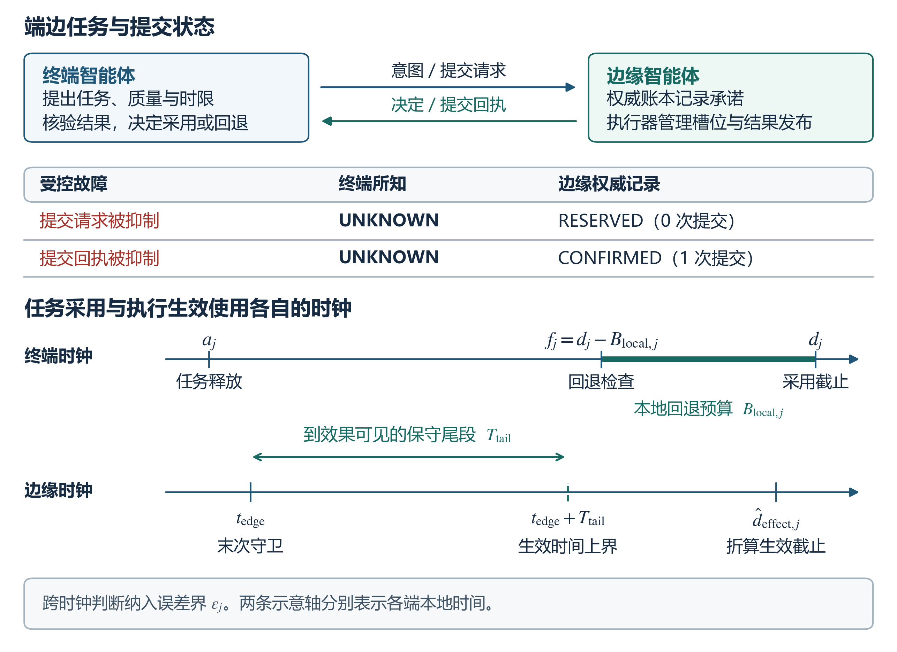
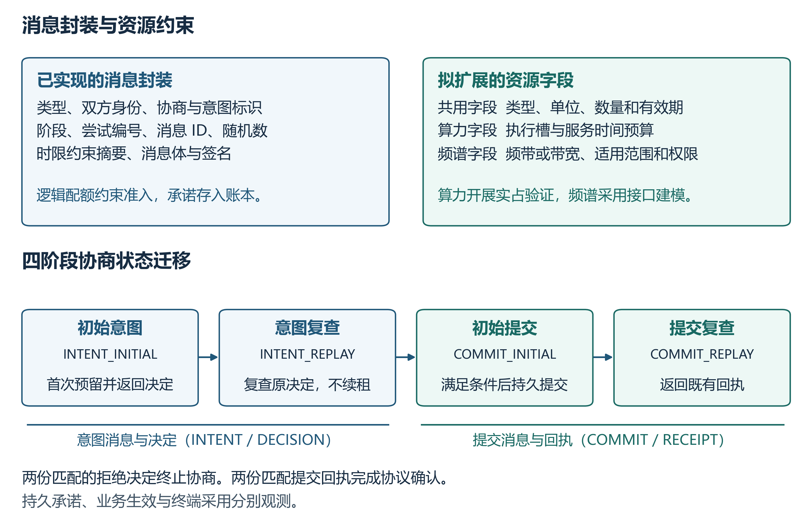
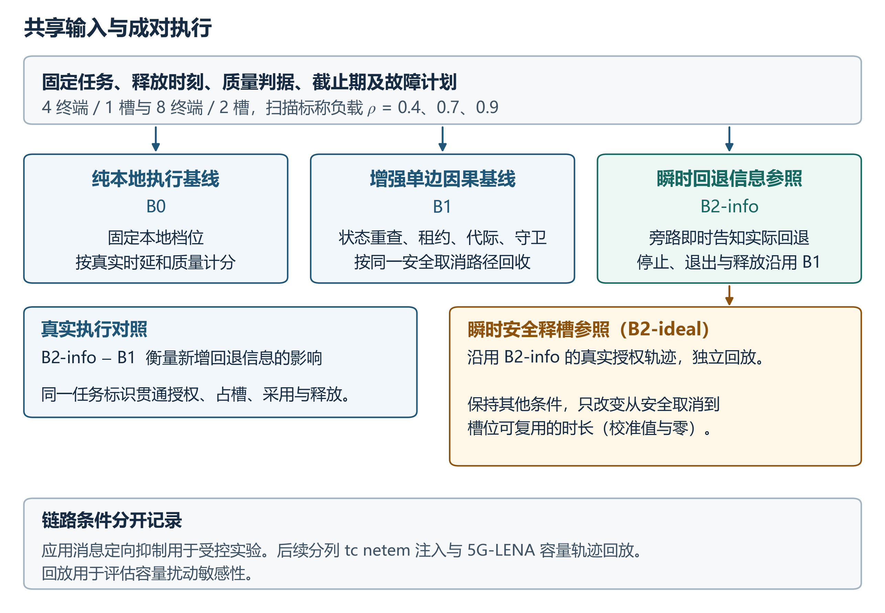

# 面向6G智能体网络的限时意图协商与服务履约保障机制研究

**硕士学位论文开题报告（评审版）**

对应导师课题《面向6G智能体网络的意图协商协议与机制设计》。

## 一、选题依据

### （一）研究背景与意义

边缘推理、业务代理和环境感知等服务要求终端在业务截止前拿到可用结果。以端边图像处理为例，终端可以在本地生成较低分辨率的结果，也可以请求边缘执行质量更高的处理。终端知道可接受的质量、结果采用期限和本地处理所需时间，边缘掌握当前准入条件、执行队列及结果发布状态。提交请求和回执经由不可靠链路交换，通信、排队、计算和读回都消耗同一任务的时间预算。终端等待过久会压缩本地回退时间，过早放弃也可能损失仍能按期交付的边缘结果。多个终端共享边缘算力时，已回退任务继续占用执行槽，还可能影响后继任务。

值得检验的矛盾产生于双方对同一任务所知不同。终端未收到提交回执时，边缘可能还没有收到请求，也可能已经完成提交甚至启动执行。此时终端应根据自身时限决定是否回退，边缘则需根据实际执行进度判断是否可以停止任务和归还资源。对这类故障，协议承诺、执行许可、实际占槽、结果可读及终端采用分别对应不同的事件。单看协商成功率或平均时延，无法判断哪些任务错过业务期限、哪些结果质量不足，以及哪些资源仍被已回退任务占用。

本课题以具有独立截止期的终端—边缘任务为应用单位，研究可表示的资源约束、具备条件的期限保障以及故障后行为的一致性。科学意义在于识别完成时限、执行安全和资源复用之间何时发生约束冲突，并通过可证伪的对照限定问题的成立范围。工程意义在于形成可复核的协议、接口和执行记录，使业务方能够把提交不确定、结果过期、重复计算和槽位长时间占用分别归因。面向6G是应用和体系背景，首轮实证采用边缘算力及可控链路，实际结论限定于已验证的执行状态和链路条件。

### （二）国内外研究现状

**标准规范。** 3GPP TS 22.186 Rel-19 V19.0.0 §5.4 给出扩展传感场景的通信载荷、时延与可靠性要求，§5.5 规定远程驾驶信息交换的指标。表 5.5-1 中的 5 ms 对应特定通信交换场景。TS 22.261 V19.13.0 §3.1 给出通信服务可用性等术语，§7.2.1 区分空口、系统传输、服务器侧传输和数据处理所占的时间。本文据此分别预算通信段与任务处理段，整个任务的结果采用期限由目标业务给出。TS 28.312 Rel-20 V20.1.0 §5.3.1 涉及意图处理能力查询，§5.3.9.3 涉及在保持其他目标规定范围的条件下查询最佳可达结果，§6.2.2.1.2 描述边缘服务支持期望。其管理服务语义为意图、能力、期望和履约反馈提供定义参考。本文考察单个任务的提交、执行和按期采用，并以实际执行证据解释满足与否。[1–3]

**智能体协作协议。** A2A（Agent2Agent）通过智能体能力卡描述服务与访问条件，支持任务委派、查询和取消，并定义能力卡的 JSON Web Signature（JWS）签名格式[4]。AGNTCY 的 ACP（Agent Connect Protocol）用 OpenAPI 规定跨框架调用、运行状态及结果接口[5]。其智能体目录协议（ADP）所对应的发现机制通过发布和查询能力记录支持跨目录发现，接口细节见 Agent Directory Service 个人草案[6]。这些公开接口可用于消息互通和能力发现。面向端边业务的算力和频谱预留、毫秒级业务采用截止与失联后的安全回退仍需由具体资源权威端和执行点共同约束。

**意图协商和限时事务。** Sharma 等提出意图驱动服务管理的协商框架，讨论在服务提供方资源约束下通过协商和备选意图提高接受机会，为候选意图、可行性判断及接受过程提供直接比较对象。Davidson、Lee 和 Wolfe 提出的 Timed Atomic Commitment 已同时讨论决策期限、动作期限、资源预留及故障条件下的异常状态。本文据此进一步区分承诺成立与业务结果按期采用，并把承诺后的排队、执行与资源复用纳入评价。[7–8]

**分布式执行与协议先例。** Burrows 的 Chubby §2.4 使用由接收方核验的序列凭证约束旧持有者的请求，为执行点识别旧代际提供先例。Lee 等的 RIFL 将请求身份、完成记录和重试接入已有操作，说明在回复丢失后使用持久结果处理重复调用的可行思路。RFC 8480 §3.4.4–§3.4.6 规定 6TiSCH 6P 事务的超时、终止、序号管理与不一致检测，服务对象是 TSCH 相邻节点的资源调度。RFC 7252 的消息可靠性与条件请求支持重复处理控制及资源修改条件，其中 §5.10.8.1 的 If-Match 对执行接口设计有参考意义。RFC 6241 §8.4 的 confirmed commit 提供配置确认和超时回滚语义。据此将持久结果重查、幂等重试、有限租约、执行点代际检查及期限守卫纳入强基线。待验证的差异集中在启用这些机制之后，接收回退事实的时机是否仍影响其他任务的合格交付。[9–13]

**应用系统研究。** Where2comm 以空间置信信息引导选择性共享。How2comm 关注通信特征选择和时空协作融合。BlindMap 的 INFOCOM 2026 会版以盲区预测支持免逐帧请求的感知交换。OPV2V 提供仿真多车辆感知数据与融合评测入口。这些工作表明，任务设定应同时交代通信载荷、处理时延和结果质量。协同感知文献评估信息选择与融合，本课题从服务交付角度考察计算与通信约束下的结果采用及失败处置。[14–17]

**国内研究。** 杨静雅等在《通信学报》讨论意图抽象和知识联合驱动的6G内生智能网络架构，关注从用户期望转向可实施的网络配置[18]。段晓东等在《通信学报》研究智能体通信网络体系与原型，为面向智能体的通信服务提供架构背景[19]。周伟杰等基于开放式无线接入网（O-RAN）构建智能体通感算控融合架构。其协议设计讨论了经 A2A 交换任务与刚性约束，以及执行端能力校验。论文在包含 OpenAirInterface、FlexRIC、软件无线电及两台商用终端的实测平台中，验证了自然语言视频业务意图驱动的下行吞吐量调权。单轮外层调节约为 1.8–2.0 s，毫秒级无线资源分配由基站调度器承担[20]。该实测的终点为吞吐量和调权时间。本课题以单个端边任务为单位，检验请求或回执丢失后的提交状态、结果采用期限与安全释槽。

### （三）现状评述与选题落点

相关工作分别提供需求表达、备选协商、可靠事务、条件写入、资源预留与边缘任务优化的方法。本课题采用三层证据口径。标准原文用于核对术语和能力边界，论文报告用于理解机制和适用场景，本课题的实验事实以可复核的原型、逐任务事件与业务读回为依据，具体结果见第五章。在此基础上，本课题的研究问题是，边缘与终端因通信故障暂时掌握不同状态时，采用状态查询、持久结果、租约和执行点守卫后，何种回退信息和执行条件仍会引发可归因的合格交付损失。这个问题连接了资源条款、时间保障和故障恢复。资源条款决定任务能否准入，期限决定何时可以继续等待或必须回退，故障恢复决定旧执行何时结束和资源何时可复用。拟通过同任务对照分离信息迟滞与停止执行的代价，再判断改善是否需要修改协商行为。

## 二、研究内容和目标

**图 1　端边限时意图协商系统与任务时间线。** 终端的采用与回退使用同一业务时钟。边缘尾段按执行端时钟度量。请求和回执分别被抑制时，终端可呈现相同的未知状态，权威账本的提交状态不同。

### （一）核心科学问题及研究对象

本课题研究不可靠链路下，端边智能体如何用资源条款约束准入和执行，并在规定期限内交付合格结果或触发安全回退。三个子问题分别对应资源表达、限时决策和故障恢复。资源表达经资格校验后，可形成受时间和作用域约束的执行许可。限时决策以许可、业务截止和已知任务状态为依据，输出继续等待、采用结果或启动回退的决定。故障恢复检查这些决定是否已经在两端生效，以及旧任务释放资源的时刻有无影响新任务的准入和交付。三部分由同一任务身份贯通，最终以实际结果及资源状态验证。

基本单元为终端智能体发起的单个任务 $j$。终端给出输入、可接受质量、相对截止预算 $D_j$ 和本地回退能力，边缘报告能力、安排执行槽位并负责发布结果。每个任务的终端和边缘构成一对协商主体。多个终端可以同时与同一边缘协商，共享有限数量的实际执行槽。预研中的权威承诺由一个持久账本记录。并发扩展仍围绕同一边缘资源管理者进行。终端状态记录其何时得知结果与何时回退，权威账本记录承诺是否持久化，执行点记录代际、实际占用及业务结果。相同的终端超时状态可以对应不同的账本事实。相同的持久承诺也可以对应未开始、正在执行或已经释放槽位等不同执行状态。

以任务释放时刻 $a_j$ 为起点，业务结果采用的截止为 $d_j=a_j+D_j$。本地回退预算记为 $B_{\mathrm{local},j}$，包括输入准备、处理、校验与采用。固定回退策略在 $f_j=d_j-B_{\mathrm{local},j}$ 检查是否已有可采用的合格结果。若没有，终端按既定策略启动本地处理。若 $B_{\mathrm{local},j}>D_j$，则在任务释放时标记该档位的回退预算不足，并保留该任务参与交付统计。回退启动后的迟到回复可以用于澄清远端状态，边缘结果是否仍可采用由预先确定的业务规则决定。研究将分别记录远端承诺是否成立、回退是否启动、远端结果是否被采用和最终交付是否满足最低质量。向边缘发送取消以及安全停止已有执行，是与终端回退决定相关但可单独观察的事件。

### （二）子问题一　资源约束怎样进入协商消息

以应用层智能体协作协议为参照，比较消息枚举、结构校验、身份认证及签名覆盖范围。研究沿用 RDINP 已实现的版本与签名结构，核对任务身份、请求有效期、资源需求、承诺和结果条款。资源段应区分需求、可用能力、预留承诺以及实际使用。终端的需求表达至少要含资源类型、资源度量和单位、数量、适用作用域、有效时段、最低可接受档位以及缺省处理方式。算力部分首轮以执行槽数、占用时间或可观察的服务时间预算为主。频谱部分在协议接口和 JSON Schema 中表达资源类型、频带或带宽单位、容量与适用时段，并规定来源、权限和字段兼容规则。Schema 校验负责检查字段与单位，准入还需核对实际能力、作用域和有效时段。端点收到语法正确、当前无法执行的约束时，应按规范返回不支持或拒绝原因。首轮实证采用算力执行槽，核对资源从请求、承诺到实占与可复用的过程。频谱分配需要额外接入有授权的控制接口。

每次协商用全局唯一的任务标识、输入摘要、消息版本、参与方身份和相应签名绑定同一份约束。接受或拒绝应明确以哪个版本的资源视图和条款为准，并保留可解释的拒绝原因。在允许重试的环节，同一任务、同一输入、同一版本的重复消息应用已声明的幂等语义。对相同任务标识但输入摘要或请求目的不同的操作，应明确拒绝冲突或经授权创建新任务。重新准入涉及的新执行代际由资源权威端授予，并与旧代际区分。签名绑定请求和承诺的内容，实际许可条件由掌握资源和时钟状态的执行点再次核对。

图 2 将现有四阶段控制流程与拟扩展的资源条款放在同一视图中。初始意图与意图复查使用同一业务意图，两阶段分别获取并比对权威决定。初始提交可以形成持久承诺，提交复查只能重读已有提交回执。复核阶段与阶段内重试分别计量。资源段的频谱字段用于接口表达，实际槽位由执行端根据许可和占用状态准入。

**图 2　RDINP 消息结构及四阶段控制流程。** 四阶段复用同一意图和任务身份。算力条款对应拟验证的实际执行接口，频谱条款对应协议表达。

预期完成一份面向任务的协议消息与接口规范，配套 JSON Schema、状态迁移表、字段约束和正反例测试。验证覆盖有效报价、资源超限、版本不兼容、失效授权、重复提交、改变输入的重放以及未支持资源字段。关键检验是表达出来的约束是否确能约束准入和执行，并在见证失败时指出具体字段、能力或时段。该项以可运行的算力接口和可追溯的检查结果作为验收依据。

### （三）子问题二　怎样在协商、执行和回退中保证时间敏感性

拟从通信、执行准备和业务结果采用三个层级分配时间预算。通信层包括请求、提交回执、状态查询及结果传送。执行层包括排队、资源许可检查、计算、结果持久化以及可见性验证。终端层包括读回、摘要核验、质量判断、本地回退和最终采用。计划衔接四阶段协议的承诺截止、许可有效范围、执行效果生效截止与终端结果采用截止。对每个计时判断明确使用哪一端的时钟和哪一种事件。

执行点最后一次检查与业务动作实际生效之间仍有处理尾段。设 $t_{\mathrm{edge}}$ 为边缘单调时钟记录的检查时刻，$T_{\mathrm{tail}}$ 为从该检查到指定执行效果可见的保守耗时上界，$\hat d_{\mathrm{effect},j}$ 为换算到该时钟域的执行生效截止，$\epsilon_j$ 为换算误差的保守上界，且各量使用同一时间单位。拟在这些边界可建立时核查如下充分条件。

$$t_{\mathrm{edge}}+T_{\mathrm{tail}}+\epsilon_j<\hat d_{\mathrm{effect},j}$$

执行生效期限应为结果传送、终端核验及采用留出时间。上式只约束指定执行效果，任务是否按期交付由终端同一时钟域内的实际采用记录和目标 SLA 判定。RDINP 候选协议原型的严格时限守卫约束持久提交，扩展至业务效果时需重新核对完整执行尾段。跨主机事件按任务身份和消息因果关系关联。有限次数测得的最大耗时只能描述试验条件。缺少可证明的尾段界或时钟误差界时，只报告观测时延、异常和回退结果。

预期建立期限预算与业务状态对照表，形成发起方检查、执行点检查和终端采用检查的记录规则。依次核对准时通过、迟到拒绝、仅有管理回执、实际结果尚未可读、过期结果到达以及回退完成。计划在同一任务和质量口径下核对按期边缘采用与按期回退。结果质量和采用终点固定时，才比较不同机制的时间成本和收益。

### （四）子问题三　怎样在动态智能体与共享执行条件下维持可靠性

首轮动态性主要来自终端任务陆续释放、通信阶段失联、执行者重启、旧请求在途以及一个任务的占用影响后续准入。已有权威记录用于区分尚未提交、已承诺、已取得执行资格、执行中、结果持久化与任务结束。执行点需要区分未用许可到期、运行中的请求停止、已可复用槽位以及对外副作用已出现。对尚未启动的执行许可，可以检查有限租约到期能否阻止旧许可再次使用。对运行中的任务，先验证旧执行是否安全停止，并由结果写入点检查代际与副作用条件。只有实际占用结束，才将槽位记为可复用。重启后按任务身份查询有效许可和持久结果，重复提交须遵守该状态和代际限制。若执行结果已对外可见，照常保留该效果的历史记录。

终端可根据自身采用期限和本地处理能力作出回退。边缘则能判断旧任务是否仍在运行、当前代际是否有效以及执行槽能否让给其他任务。研究将检验在双方采用状态查询、有限租约、常规监督回收和因果取消后，哪类事实仍只由一方及时掌握，是否造成可归因的准入或交付损失。动态智能体发现作为后续可选扩展，第一阶段使用预先配置身份和明确的认证关系，先把任务状态与执行可靠性做实。

可靠性目标包括任务状态可追溯、同一操作重试不会生成重复业务效果、旧代或超期结果的处置有据可查，以及安全释槽。重复计算耗费的执行时间与重复业务效果分别记录。对故障导致的信息缺口应在输出中保留其状态与原因。对可确定的异常和可重复的恢复行为建立固定的正反例。对无法安全停止的任务，记录其继续占用多久、是否影响后续请求以及是否已产生不可回滚效果。

### （五）关键假设与预期目标

- **假设一，特定并发条件下，提交观测分歧可能影响后继任务交付。** 在状态重查、有限租约、执行点守卫和因果取消均启用时，若回退后仍占用可安全释放的执行槽，且后继任务的剩余时间不足以等待，可能出现可归因的合格结果超期或降档。反例包括本地结果已普遍满足业务要求、预先公布的回退界限已缩短无用占用，以及无排队需求可利用更早释放。观测到这些反例时应收窄或结束该假设。
- **假设二，回退信息迟滞与安全停止成本对后继任务的影响可分别检验。** 给边缘瞬时回退信息后，沿用同一取消与执行安全机制仍可能让其他任务提前取得资源。若改善只在把停止代价也设为零时出现，得到的是执行撤销代价方面的线索。该结果将约束哪类协议改动具有现实价值。
- **假设三，受限条件下的执行规则可以在不引入额外违规的前提下改善至少一项业务指标。** 前提是先获得真实或明确标注的可复现开发负载上的残差，再选择具备可执行动作的最小机制。主要检验合格结果按期采用、回退率、过期或重复副作用、无效占槽和额外协议开销。若额外通知无法早于普通取消抵达，或新增轮次反而压缩可用执行时间，预期收益将受到限制。

阶段成果包括协议接口、端边运行原型和同任务配对实验。协议接口以有效承诺、资源超限和旧代拒绝等正反例验收。并发原型须能用一个任务标识关联提交、准入、执行、读回、回退或采用和释槽。配对实验须能区分回退信息迟滞、运行中停止代价及缺少后继请求等情形。小论文以其中能够复现的业务机制及边界为论证对象，硕士论文围绕同一问题补足协议语义、条件性期限论证和跨链路复测。

## 三、研究方案及可行性分析

### （一）技术路线与任务模型

以 RDINP 候选协议原型与持久执行原型为基础，已用 CPU 图像处理负载贯通任务状态、业务读回和物理槽位，并完成首轮同机并发配对。边缘执行较高质量档，终端提供低档回退。后续将按目标业务重新计量本地与边缘的执行预算，并沿用任务身份、输入与输出摘要以及业务采用事件的记录规则。质量按事前固定的分辨率或其他有效业务指标判断，输出摘要用于核对结果关联与完整性。比较前确定最低质量、首次可读的定义及采用期限。该载荷用于验证时序、并发和安全行为。具体应用的 SLA 仍待结合业务方意见确定。收集到可用业务轨迹后，按同一接口替换载荷并重新核验服务时间分布和质量条件。

在一次运行中以 4 个或 8 个终端进程共享 1 个或 2 个物理执行槽。基于无注入条件下测得的单任务服务时间 $S$，用 $\rho=\lambda\,\mathbb E[S]/m$ 定义标称负载，其中 $\lambda$ 为总任务释放率、$m$ 为并行槽位数。预先设置 0.4、0.7、0.9 三个标称负载档。联合报告回退前实际获得有效授权的任务数、实际占槽、就绪等待与准入受阻事件，以检验标称负载是否形成了预期的执行端竞争。分别设置正常、上行受扰、下行受扰和双向受扰条件，覆盖故障开始与回退时刻相邻的情形。租约长度、重查间隔和本地预算在比较前根据无故障测量及业务允许范围确定。增强单边因果对照采用公开的回退时刻及业务采用规则。如果边缘依据保守时钟界和结果发布状态已可判定该任务的边缘结果无法再被采用，就应允许它沿相同安全流程提前停止。这种情形用于检验回退通知是否真的增加了可用信息。

### （二）并发判定实验与强基线

**图 3　并发判定与配对实验技术路线。** 实测组执行相同释放计划。瞬时信息对照保持实际安全释放路径。瞬时释槽对照在独立回放模型中比较停止尾段，分别统计模型与实测结果。

- **纯本地执行基线（B0）。** 记录真实本地时延和质量，建立无需边缘承诺时的业务参照。终端使用相同硬件档位，能够处理的任务并发和排队按实际测量记账。
- **增强单边因果基线（B1）。** 利用幂等任务 ID、忙后重新准入、按固定 RTO 查询任务状态并重查持久化结果、有限租约、唯一代际、执行点期限守卫、因果幂等取消与固定回退。准入不足时，在剩余时间允许且无有效执行许可的条件下重试。终端收到相同任务的持久结果时按统一采用条件处理。回退后的取消只能使用当时已知事实，可重发并以任务 ID、代际和状态条件约束。对于确实死亡的本地受管进程，允许按已确认状态回收。存活执行者须完成安全停止或受相应代际与副作用守卫约束，旧执行结束占用且资源管理器允许复用时，才记录物理槽位释放。后继任务实际开始时间另行记账。
- **瞬时回退信息参照（B2-info）。** 边缘在终端实际启动回退时立即获知该事实。预知回退检查时刻只说明终端将在该点检查合格结果，实际启动仍取决于检查结果。复用 B1 的取消程序、存储校验、运行中任务停止代价和安全条件。与 B1 的配对差用于估计回退信息迟滞的影响。
- **瞬时安全释槽参照（B2-ideal）。** 在相同回退信息的基础上，把确可安全取消的任务从收到取消到可复用的延迟理想化为零。对已产生不可撤销业务效果的任务，照常记录已发生的效果。此条件给出乐观比较点，须验证调度及业务条件后才可就相应指标讨论上界。与 B2-info 的差用于判断停止与归还资源成本的作用。

三个实测组使用相同任务、输入、释放时间、质量判据和故障计划。边缘实测组保持排队与调度规则一致。独立回放复用同一任务计划及瞬时回退信息参照中的实测有效授权轨迹，在模型内部对比有校准停止时长与零停止时长的结果。两类参照结果仅用于离线归因。待评方案以 B1 为基线，采用相同业务约束、可执行动作和可取得的因果观测。拟比较的额外交互须计入实际消息、等待和执行开销。

现有应用层故障试验可定向抑制请求、回执与取消。后续拟在 Linux 实际端点使用 tc netem 注入方向性延迟、突发丢包与速率扰动，记录注入条件、端点实际观测及传输层重传。5G-LENA 前传容量受限仿真基线输出的容量变化用于独立的分段扰动敏感性分析。回放明确仿真时间、容量单位及链路映射。前传容量轨迹描述网络负载环境，协议往返时延按端点观测计量。[21]

### （三）指标、分析与判定

主指标为合格结果按期采用率。设一条运行轨迹释放 $N$ 个任务，$Y_j=1$ 表示终端在规定的业务期限内采用了通过核验且达到最低质量档位的结果，否则 $Y_j=0$。单次运行的按期采用率为 $N^{-1}\sum_{j=1}^{N}Y_j$。判定规则同时适用于边缘结果与本地回退。分母保留拒绝、缺失、过期及质量不足的任务，另列边缘采用、合格回退和未达标回退计数。资源方面，记录终端回退后仍被旧任务实际占用的时间，并区分其中可安全释放和不可立即释放的部分。协议开销按请求、回复、重查和取消的次数及字节数报告。安全评价分别记录重复计算、重复业务效果、旧代写入、迟到生效和无法解释的状态跳转。

对声称由无效占用导致超期的个案，须用同一任务 ID 核对持久提交、准入、执行守卫、结果读回、回退或采用和实际释槽。需要查明哪些后继任务当时已就绪、是否因旧任务占用而无法启动，以及在对照路径中是否确实获得了新的执行机会并按期采用合格结果。由此把资源占用变化与具体的业务结果对应起来。

对实测运行，按共享任务释放与故障轨迹计算瞬时回退信息参照相对增强单边因果基线的合格按期采用率差，单位为百分点。对释槽模型，在相同授权轨迹与模型条件下计算零停止尾段和校准停止尾段的差，单列结果。按预设负载和扰动条件分别报告，同时列出受影响的任务数与资源占用变化。能够取得足量独立轨迹时，按轨迹或故障批次整体配对重抽样，保留同批任务之间的相关性。只有少量轨迹时，报告原始计数及事件见证，待增加独立证据再判断稳定性。具有业务意义的差距以预先明确的 SLA 和资源约束为依据。

若已形成实际资源争用且增强单边因果基线已满足目标业务要求，或已观测到待检验的失效机制而瞬时回退信息仍缺少可复现的改善，则保留强基线结果并收窄研究。若关键事件未发生，首先将试验判为目标工况覆盖不足。若差距仅在 B2-ideal 中出现，继续核对安全停止与资源回收成本。若瞬时回退信息对照留下可复现差距，则先核查现有取消和公开回退时刻能否消除该差距。只有在这些简单做法仍有不足、且额外交换能改变实际执行决策时，才评价新增协商机制。

### （四）可行性与前期排除路径

现有 SQLite 账本、CPU 执行器及 HTTP 代理支持按任务核对许可、业务读回、采用与资源复用。首轮同机并发配对已观测到定向消息抑制以及回退后旧任务持续占槽。边缘两组均未出现由执行槽不足触发的应用层准入拒绝，因此该样本尚未覆盖旧任务阻塞后继者的完整事件链。公开回退点、结果提交时原子释槽以及纯计算可安全停止同时成立时，在回退点仍持槽时，边缘可根据期限和当前占用启动相同的停止路径。实验需区分这项信息充分性结论与实际调度、停止和持久释放的耗时差异。

下一轮优先核对真实业务的可接受质量、绝对截止与旧执行退出条件，定位当前终端排队和有效准入之间的时间瓶颈。有独立业务事件证明后继任务被旧任务阻塞时，再复核共享槽位假设。若公开停止规则已足以处理该情形，则转向确有外部副作用或端点独有状态的受限业务，先用状态重查、代际保护和单边准入检验其能否解决问题。

OPV2V 开发回放中，需求反馈相对普通补包的 AP@0.7 差值为 −0.02125，同时改变了消息开销、等待和补包内容，无法单独归因于需求信号。XR 的 5G-LENA 前传容量受限仿真基线在已核对运行中满足受保护 VR 和云游戏流的 10 ms 数据报门槛，缺少需要双边机制的实证。这两项对照促使研究聚焦限时履约及其可验证的执行边界。

## 四、创新点

**资源承诺到任务履约的执行语义。** 面向端边任务，拟建立由资源条款、可执行许可、任务代际和结果采用期限共同约束的履约规则。用同一任务身份连接持久承诺、许可生效、实际占槽、结果读回及安全复用，形成可核验的业务证据链。现有协议的消息结构、签名和持久账本提供实现基础。拟研究的重点是承诺如何转化为能够约束后续执行和结果采用的规则。

**并发履约损失的分项测量。** 在保留状态重查、租约、唯一代际和执行点保护的强对照下，拟以两类比较分别识别回退事实到达时间与安全停止尾段的影响。将就绪、准入受阻、实际释槽和结果采用关联到各任务，识别额外时序信息能够改变后继任务交付的业务条件。

**具有条件安全性和时限边界的恢复机制。** 面向强单边基线下可归因的履约损失，拟研究可核验的双边限时履约与安全回收机制。在明确时钟误差、执行尾段上界、代际检查和外部效果约束的前提下，建立允许采用结果、停止旧任务和复用资源的充分条件。以远端按期采用、合格回退和安全释槽的事件证据检验该机制适用范围与交互成本。

## 五、研究基础和工作条件

### （一）已完成原型及可复核结果

| 验证模块 | 实验环境 | 核心实测结果 | 验证的边界 |
| --- | --- | --- | --- |
| RDINP 候选协议原型 | 本地 HTTP 端点、版本化 JSON Schema、签名与 SQLite 权威账本，受控抑制消息 | 5/5 项定向回归通过。抑制提交请求与抑制提交回执两案，终端均观察到未知状态（UNKNOWN），权威端分别保持已预留、0 次提交，以及已确认、1 次提交。 | 区分发起方所知与权威事实。确定性论证依赖方向性有界丢失、处理上界及持久化尾段条件。 |
| 单槽顺序任务执行原型 | 真实 CPU 执行、持久结果重查、800 ms 开发期限与本地低分辨率回退 | 48/48 个任务按期交付，结果摘要均匹配。候选协议路径的 12 个次任务因逻辑配额被拒，直接持久租约路径的 12 个次任务均完成边缘处理。 | 按期交付含低档回退。顺序试验可区分逻辑配额和物理执行槽，最低业务质量仍按目标业务约定核验。 |
| 真实反向代理执行面验证 | Caddy v2.11.9 配置变更与实际 HTTP 业务读回 | 受控扣留个案中，发起方守卫已通过，首次新业务读回仍比截止晚约 85.45 ms。执行点守卫拦截了迟到变更。另一运行中，管理确认与新路由首次读回后，旧请求仍在途，随后返回。 | 证明管理确认、首次新路由业务读回和在途旧请求结束可发生在不同时间。排空上界需针对业务、执行者和在途请求单独验证。 |
| 共享算力并发配对预研 | 单台 Ubuntu，4 个终端共享 1 槽与 8 个终端共享 2 槽，受控分向消息抑制 | 完成 144 个配对和 5,184 条任务×方法记录。96 个中高标称负载配对中，瞬时回退信息参照相对增强单边因果基线的合格按期采用率差为 −0.174 个百分点，95% 区间为 [−0.434，0.000] 个百分点。 | 两个实测边缘组均未观测到执行槽不足导致的准入拒绝。该估计仅描述实跑工况。零停止尾段的回放作为单独的模型分析。 |
| 会话级可复用多档许可原型实测 | 本机独立协议进程、受控环回链路与实际 CPU 图像任务，服务截止期为 400 ms | 四种子先导中，结构化组的许可签发与刷新实测耗时按全部释放任务摊销为 9.66 ms/任务。独立的逐任务四阶段签名控制探针共 24 笔，仅控制链的 p95 为 521.30 ms。六项定向安全用例全部通过，观测到的旧代际结果污染和重复副作用均为零。 | 逐笔 p95 与每个释放任务的摊销均值采用不同口径。时延结果适用于本机夹具，安全结论限于已测用例。 [原型实测记录](../../rdinp/experiments/permit-prototype/evidence/step2-20261128-r01/RESULTS.md) |

前三项研究基础分别验证了消息故障观测、实际计算和业务代理可见性。并发预研中，增强单边因果基线的 1,728 个释放任务仅有 150 个在回退点前获得有效授权，1,384 个逾期任务均来自低档本地回退路径。其中 874 个任务在业务截止之前触发回退，本地计算却在截止后才启动。这组观测同时定位了回退点前有效授权不足，以及回退触发至本地计算启动的等待。后者是当前单机预研中涉及逾期任务最多的阶段。两组边缘执行均未出现槽位不足导致的准入受阻。后续将先单独量化终端本地排队的影响，再在实际观测到槽位竞争的工况下复核共享算力假设。

### （二）设备、环境及待补工作

本机具备 Windows、Python、SQLite 和 Caddy 的已有运行条件，可继续复测同机协议、账本、CPU worker 与 HTTP 路由。远端 Ubuntu 已运行同机并发配对，可用于真实 CPU 任务以及后续 Linux 链路注入预检。首轮 CPU 载荷不依赖 GPU。跨主机端点、双向故障注入权限、时钟映射误差与故障回放需经部署预检。

现有并发对照已按任务记录持久提交、业务采用或回退、运行中停止及资源释放。后续复测将以事务提交返回、后续准入和执行事件核验槽位真正可复用，并在真实代理或跨机器场景中补充业务读回与时钟对应关系。实验记录保存代码版本、输入清单、故障窗口、系统配置、原始事件和计数规则。已有协议和设备可支撑原型阶段，业务 SLA、并发负载和可安全取消条件是首轮需要单独确认的实验前提。

## 六、研究计划

| 计划起止年月 | 阶段与里程碑 | 主要工作与阶段交付 | 风险控制 |
| --- | --- | --- | --- |
| 2026.12–2027.01 | 完成开题及业务边界确认 | 核定服务主体、采用期限、最低质量档及旧请求排空语义，形成确认后的场景定义、初步协议字段和开题报告。 | 业务 SLA 暂无法取得时，使用明确界定的开发夹具，并保留业务验证事项。 |
| 2027.01–2027.02 | 小论文补证审查（GOAL-1） | 在已完成的会话许可原型和先导实测基础上，按事前固定方案核查 400 ms 的三组配对补测、切档尾段预算和按期采用记录，整理程序与实测复现材料。 | 按全部释放任务统计，保留不同链路下的超期及负向结果。 |
| 2027.02–2027.04 | 完成机制取舍与小论文定稿 | 复核许可成本、当前条件下的快切收益、近邻工作和图表，明确受控本机结果的适用范围，完成可交付稿件。 | 若配对证据无法支持稳定收益，按实测结果收窄论断。 |
| 2027.04–2027.08 | **小论文投稿**与学位论文实验预检（GOAL-2） | 完成投稿材料，拟检查跨主机独立时钟域的测量误差、链路扰动和安全守卫。核对真实边缘负载及质量下限，将 OPV2V 协同感知作为候选业务负载。 | 现场验证按可用设备、链路条件和任务指标安排。本机结果用于评估原型和受控链路。 |
| 2027.09–2028.03 | 完成**硕士论文撰写、送审及答辩准备** | 整合资源消息规范、条件安全性、时限分析和可复核的业务履约证据，完成归档、论文与答辩材料，答辩按学院安排执行。 | 动态发现和频谱控制扩展依据独立接口权限、实验条件及培养进度确定。 |

小论文原型已完成 16 个种子的 400 ms 配对采集，未达到两条受扰链路均获益的预定判据，成果以实测控制成本与履约适用边界收尾。

各阶段以可复核的程序、事件记录或推导作为验收依据。保留拒绝、过期、回退和运行异常，在正式采集比较数据前确定样本与判断准则。既有预研用于工程准备，独立评价采用事前锁定的测量规则和轨迹。

## 参考文献

[1] 3GPP. Service requirements for enhanced V2X scenarios: TS 22.186, Release 19, V19.0.0[S/OL]. 2025[2026-11-28]. https://www.etsi.org/deliver/etsi_ts/122100_122199/122186/19.00.00_60/ts_122186v190000p.pdf.

[2] 3GPP. Service requirements for the 5G system: TS 22.261, Release 19, V19.13.0[S/OL]. 2026[2026-11-28]. https://www.etsi.org/deliver/etsi_ts/122200_122299/122261/19.13.00_60/ts_122261v191300p.pdf.

[3] 3GPP. Management and orchestration; Intent driven management services for mobile networks: TS 28.312, Release 20, V20.1.0[S/OL]. 2026[2026-11-28]. https://www.3gpp.org/ftp/Specs/archive/28_series/28.312/28312-k10.zip.

[4] A2A PROJECT. Agent2Agent (A2A) Protocol Specification: v1.0.0[EB/OL]. 2026[2026-11-28]. https://a2a-protocol.org/v1.0.0/specification/.

[5] AGNTCY. Agent Connect Protocol: OpenAPI v0.2.3[EB/OL]. 2025[2026-11-28]. https://github.com/agntcy/acp-spec/blob/main/openapi.json.

[6] MUSCARIELLO L, POLIC R. Agent Directory Service: draft-mp-agntcy-ads-03[EB/OL]. (2026-11-02)[2026-11-28]. https://datatracker.ietf.org/doc/draft-mp-agntcy-ads/03/.

[7] SHARMA Y, BHAMARE D, KASSLER A, et al. Intent Negotiation Framework for Intent-Driven Service Management[J]. IEEE Communications Magazine, 2023, 61(6): 73–79. DOI: 10.1109/MCOM.001.2200504.

[8] DAVIDSON S B, LEE I, WOLFE V. Timed Atomic Commitment[J]. IEEE Transactions on Computers, 1991, 40(5): 573–583. DOI: 10.1109/12.88481.

[9] BURROWS M. The Chubby Lock Service for Loosely-Coupled Distributed Systems[C]//Proceedings of the 7th USENIX Symposium on Operating Systems Design and Implementation. USENIX Association, 2006: 335–350.

[10] LEE C, PARK S J, KEJRIWAL A, et al. Implementing Linearizability at Large Scale and Low Latency[C]//Proceedings of the 25th Symposium on Operating Systems Principles. ACM, 2015: 71–86. DOI: 10.1145/2815400.2815416.

[11] WANG Q, VILAJOSANA X, WATTEYNE T. 6TiSCH Operation Sublayer (6top) Protocol (6P): RFC 8480[S/OL]. 2018[2026-11-28]. https://www.rfc-editor.org/rfc/rfc8480.html.

[12] SHELBY Z, HARTKE K, BORMANN C. The Constrained Application Protocol (CoAP): RFC 7252[S/OL]. 2014[2026-11-28]. https://www.rfc-editor.org/rfc/rfc7252.html.

[13] ENNS R, BJORKLUND M, SCHOENWAELDER J, et al. Network Configuration Protocol (NETCONF): RFC 6241[S/OL]. 2011[2026-11-28]. https://www.rfc-editor.org/rfc/rfc6241.html.

[14] HU Y, FANG S, LEI Z, et al. Where2comm: Communication-Efficient Collaborative Perception via Spatial Confidence Maps[C]//Advances in Neural Information Processing Systems 35. 2022: 4874–4886.

[15] YANG D, YANG K, WANG Y, et al. How2comm: Communication-Efficient and Collaboration-Pragmatic Multi-Agent Perception[C]//Advances in Neural Information Processing Systems 36. 2023: 25151–25164.

[16] ZHU Z, JIANG Y, ZHAO Y. BlindMap: Explicit Blind-Area Prediction and Request-Free Communication for Efficient Cooperative Perception[C]//IEEE INFOCOM 2026. IEEE, 2026: 1–10. DOI: 10.1109/INFOCOM59046.2026.11571528.

[17] XU R, XIANG H, XIA X, et al. OPV2V: An Open Benchmark Dataset and Fusion Pipeline for Perception with Vehicle-to-Vehicle Communication[C]//2022 International Conference on Robotics and Automation. IEEE, 2022: 2583–2589. DOI: 10.1109/ICRA46639.2022.9812038.

[18] 杨静雅, 唐晓刚, 周一青, 等. 意图抽象与知识联合驱动的6G内生智能网络架构[J]. 通信学报, 2023, 44(2): 12–26. DOI: 10.11959/j.issn.1000-436x.2023016.

[19] 段晓东, 黄正磊, 陆璐, 等. 智能体通信网络（ACN）：面向6G的网络发展新范式[J]. 通信学报, 2025, 46(11): 332–346. DOI: 10.11959/j.issn.1000-436x.2025203.

[20] 周伟杰, 张朝阳, 秦天怡, 等. 意图驱动的智能体通感算控一体化融合网络：架构、协议设计与实现[J]. 中国科学：信息科学, 2026, 56(11): 2843–2859. DOI: 10.1360/SSI-2026-0115.

[21] IPROUTE2 PROJECT. tc-netem(8): Network Emulator[EB/OL]. [2026-11-28]. https://man7.org/linux/man-pages/man8/tc-netem.8.html.
