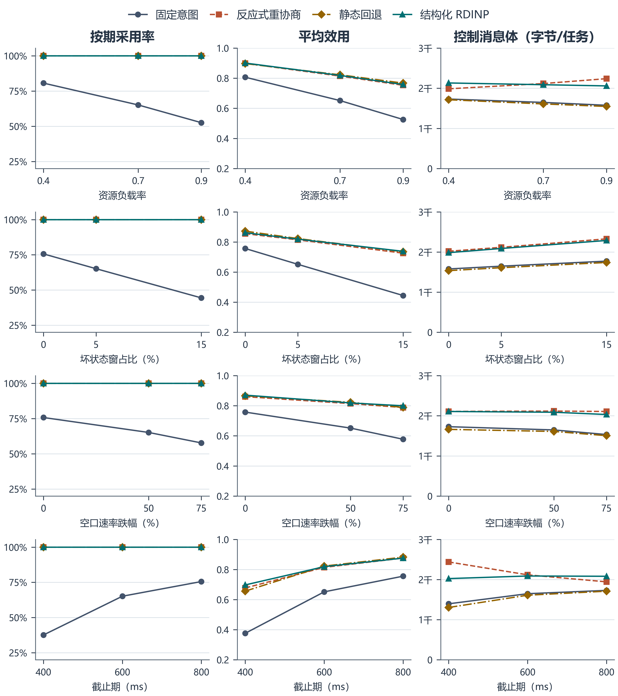
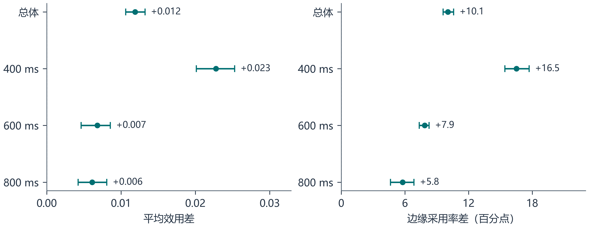
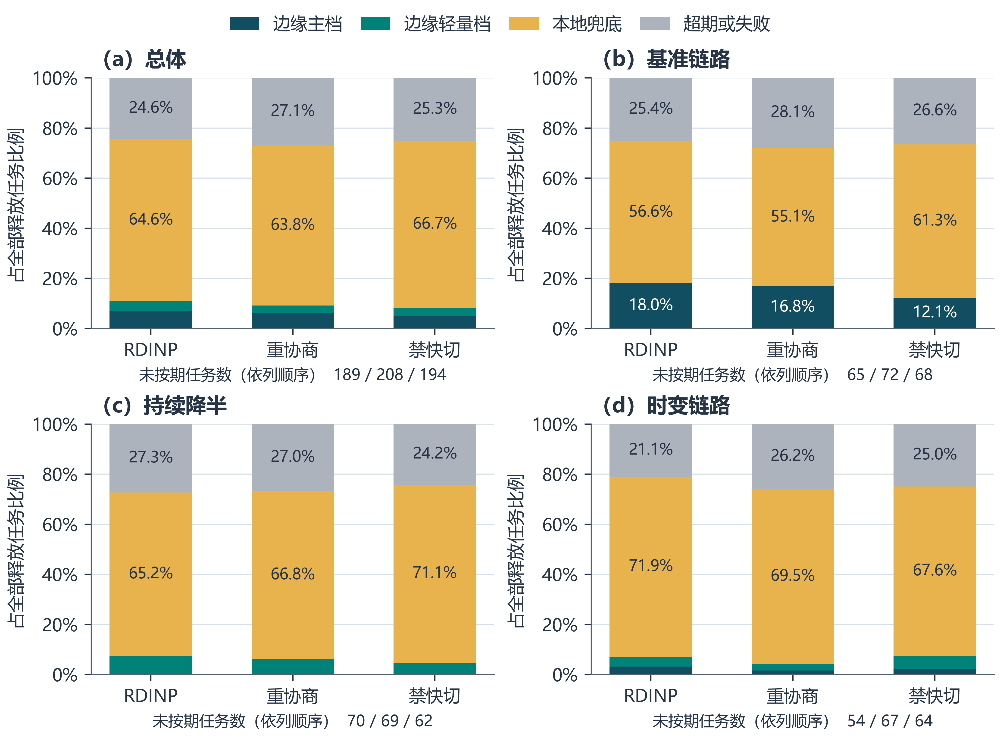
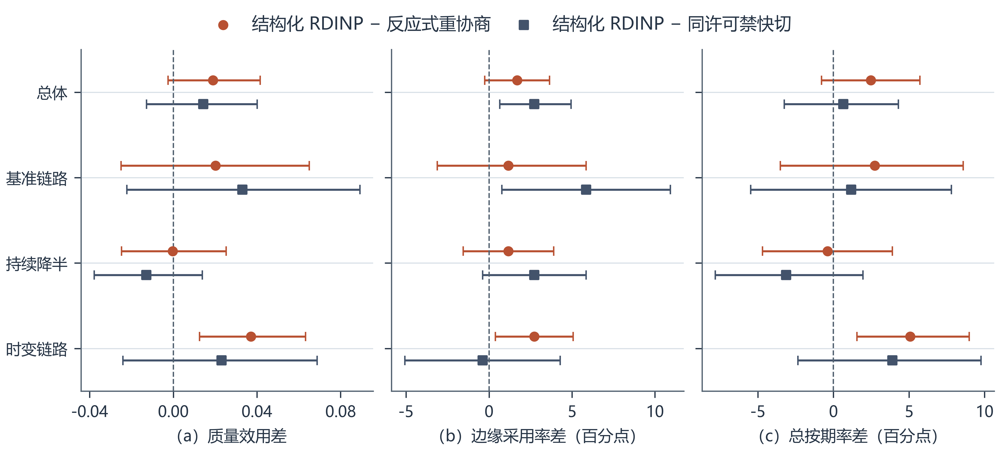
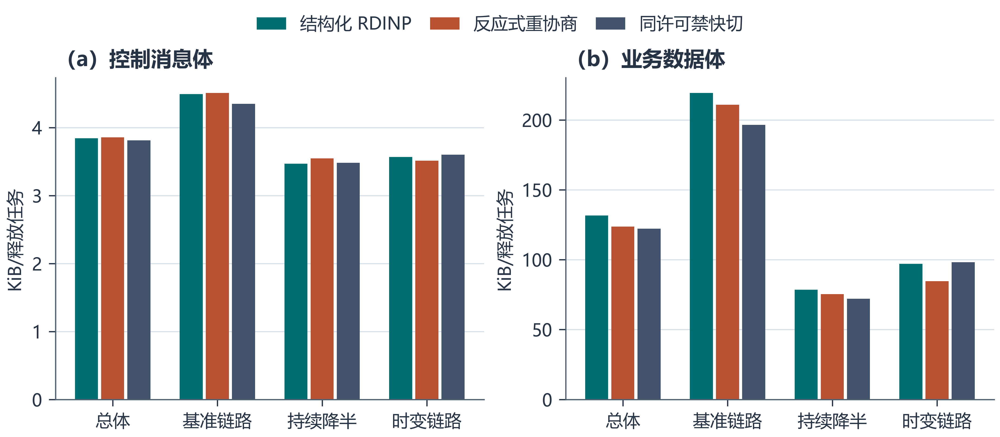

## 摘要

端边智能体需要在链路和队列变化下把业务意图落实为可执行的资源与时限约束。本文实现 RDINP 的会话级可复用多档许可，由慢环签发绑定身份、档位、资源上限、有效期与代际的许可，快环以因果快照选择档位，以期限和代际检查控制结果采用。810 组离散事件配对仿真中，同菜单下开启快切的平均效用差为 +0.0119。在同机独立进程和受控环回链路上的 400 ms 补测中，16 个新种子覆盖三条固定轨迹，三种方法各测试 768 项释放任务。结构化方案相对反应式重协商的效用差为动态降容 +0.0371，配对 95% 区间 [0.0126, 0.0632]，持续降半 −0.0002，区间 [−0.0248, 0.0253]。两条压力轨迹共同获益的预设条件未达到。单独的逐任务四阶段控制探针 p95 为 521.30 ms。补测中，结构化组签发和刷新的累计耗时平均为 10.84 ms／释放任务。六项定向故障与重放测试均通过。结果刻画了预授权切档省去额外确认的控制代价，以及上传后切档和本地回退受软件时延限制的适用边界。

**关键词**　意图协商；边缘计算；会话许可；快慢环；截止期；代际隔离

## 1 引言

边缘智能体接收终端任务后，需要决定何时开始、使用多少算力、返回什么质量的结果。以图像特征提取为例，终端可以上传主档输入，换取较精细的边缘处理结果。若空口服务速率骤降或边缘槽位拥塞，任务也可改用较小的图像与较轻的边缘计算。无法及时可靠地采用边缘结果时，终端还可启动独立的本地兜底。可接受档位和任务截止由业务约束，链路速率、开始时间以及队列长度则会随运行而变化。

任务级协商为双方建立同一份执行条件，但控制面完成、边缘执行完成和结果被终端采用是三个可分辨的事件。当可用时间紧张，边缘完成在截止前仍可能因为回执、结果传输或验签而失去业务价值。固定主档可能浪费预期无法按期交付的传输。每次情况变差都再确认也会占用同一条链路。纯本地回退提高总按期率，同时可能降低任务质量。评价因此同时需要总按期率、边缘采用、质量效用和控制开销。

本文研究的问题是，在两端共享资源受限、只能看到已发生的链路与队列观测时，能否用一份会话级许可约定未来可用的多档动作，让任务在不追加切档协商的情况下完成，且保留截止、代际和重复执行保护。本文实现带状态与证据的独立协议版本，给出条件安全和时限边界，并分别用配对仿真与真实协议原型检验效果。两阶段实验回答不同问题。仿真覆盖较宽参数范围，原型检验签验、调度和业务采用的真实代价。

## 2 相关工作

**结构化意图与多时间尺度控制。** 3GPP TS 28.312 描述意图驱动的管理服务，通过意图期望、约束和履约信息组织管理交互[1]。TR 23.801-01 是 Release 20 的 6G 系统架构研究草案，为智能体相关的架构讨论提供背景[2]。本文把这类结构化表达落实到一类端边可执行任务的签名字段，具体约束档位、资源额度、期限及采用条件。AgentRAN 将不同时间尺度和协议层的控制分配给多个智能体，并在私有 5G 网络上验证无线调度[3]。它提供 RAN 编排层面的快慢控制参照，本文处理的是端边任务从许可、执行到结果采用的单任务时限。6G 智能体意图网络研究分别讨论将自然语言意图转成切片配置，以及按用户意图和链路条件选择物理层设置[4–5]。本文的慢环负责在会话内确定许可，快环负责在数百毫秒任务窗口内使用该许可。关注点是许可的因果使用、执行及按期采用。

**任务委派和意图协商。** A2A 提供能力描述、消息和任务生命周期及智能体卡片签名格式[6]。AGNTCY 的 ACP 以 OpenAPI 形式定义跨框架调用和执行接口[7]。智能体目录协议（ADP）的相关发现机制见 Agent Directory Service 个人草案，用于存储与查询描述可用能力的目录记录[8]。Sharma 等提出面向意图驱动业务管理的通用协商框架，允许资源不足时讨论备选意图，并以接受率与处理开销评价[9]。这些工作提供了能力发现、任务交互和档位约定的参照。本文进一步检验在约定可接受档位后，切换是否仍须为每个任务增加一轮确认，以及这一往返会怎样影响业务结果。

**期限、代际与幂等。** Timed Atomic Commitment 分开处理决定期限、动作期限及故障后的异常状态[10]。Chubby 让下游系统核验锁持有者的序列凭证，限制旧执行者产生作用[11]。RIFL 通过稳定请求身份、持久完成记录及重试检查避免重复执行[12]。RFC 8480 为 TSCH 相邻节点的时隙资源事务定义超时、终止和序号[13]。这些先例说明期限、代际和去重各有独立语义。本方案将它们放入同一条任务履约链，把许可、实际执行、输出提交和终端采用分别记账，并用配对数据量化省去切换确认的条件收益。

## 3 系统模型与评价目标

终端 $i$ 与边缘权威端已有双边身份关系。边缘提供 $M$ 个执行槽，单个任务占用一个槽。相同方向的数据与控制消息共享有限服务能力。两端的策略只能使用已获得的队列快照和已观测链路状态。快照会随传输和排队变旧，因此只作预测依据。边缘决定是否真正接纳任务时仍检查当下的槽位、队列、剩余时间与许可额度。

令任务 $j$ 的外生释放时刻为 $r_j$，允许的相对期限为 $D_j$，终端的绝对采用截止为 $d_j=r_j+D_j$。终端预留 $B_{\mathrm{loc},j}$ 给本地处理，则边缘采用的最晚界限为 $f_j=d_j-B_{\mathrm{loc},j}$。原型采用 $D_j=400\,\mathrm{ms}$、$B_{\mathrm{loc},j}=55\,\mathrm{ms}$。边缘结果需严格早于 $f_j$ 完成验签和采用。到达 $f_j$ 时若未采用合格结果，终端启动本地路径。该本地路径独立运行，期限仍为 $d_j$。分辨率与截止设置均为受控评价参数。

| 档位 | 输入与处理 | 交付要求 |
| --- | --- | --- |
| 主档 | 上传主档输入，边缘输出 512×512 边缘图 | 任务、许可和期限均通过验收 |
| 轻量边缘档 | 上传 384×384 输入，或用已收到的主档输入执行 384×384 处理 | 同一许可允许该档，可复用已上传的输入 |
| 本地兜底档 | 端侧直接产生 256×256 边缘图 | 本地采用须早于任务截止 |

档位质量由对齐到相同网格的实际结果与主档参考图计算。对齐后去除四像素边缘，使用软 Dice 相似度

$$
q(y,y^\star)=\frac{2\sum_p\min(y_p,y_p^\star)}{\sum_p y_p+\sum_p y_p^\star}.
$$

当两图总强度为零时相似度定义为 1。设 $t_j$ 为终端采用时间，$A_j$ 表示该结果通过对应档位的检查，第 $j$ 项任务得分定义为

$$
u_j=\begin{cases}
q(y_j,y_j^\star), & A_j=1\text{ 且 }t_j<d_j,\\
0, & \text{其余情况}.
\end{cases}
$$

平均效用 $U=N^{-1}\sum_{j=1}^{N}u_j$ 以全部已释放任务为分母。边缘输出在 $f_j$ 之后到达时，$A_j$ 不成立，本地结果仍按其自己的采用时间计分。按期率和边缘采用率也使用同一分母。净效用差为两组同一任务按期实际采用结果的平均得分差。控制消息在试验中真实执行并占用传输及等待时间，其影响随结果计入得分。控制字节、签验耗时和往返数单独计量。

## 4 RDINP 会话许可与快慢环履约

### 4.1 慢环签发可复用的多档许可

边缘权威端签发有限期的会话许可。许可签名覆盖权威端和终端身份、会话标识、权威端启动代际、许可代际、授权档位、签发与到期边界，以及任务数、并行槽数、输入字节和任务期限预算。签名使用 C2 的 ES256 和严格 JSON 规范化实现。独立报文版本、消息类型和收件方位于签名保护的消息中。执行数据另附原始负载，签名中包含对应摘要。许可和数据只有在同一主体、会话、版本及负载绑定一致时才能使用。

许可描述可尝试的动作范围。边缘每次收到任务仍根据可用槽位、配额和时限做准入。续签创建新代际。终端启动续签时暂停旧许可的结果采用，安装新回执后以其为当前许可。该设计将每代的签发成本分摊给该代实际面对的发布任务。首个任务和续签中的任务直接承担等待，发送失败也进入观测记录。

### 4.2 快环条件切换和本地兜底

终端先获取签名资源快照，其中含观测时刻、队列估计及运行中的槽数。终端用快照、既有帧大小和因果链路速率估计，按主档优先、轻量其次的次序选择预计来得及的上传形式。若在上传前判定需轻档，发送较小输入。主档已上传时，边缘在相同的准入函数中重新计算主档与轻量档的执行及返回时间。主档不满足条件、轻量档满足时，且许可和任务均已授权该切换，则使用缓存输入直接执行轻量档。数据已经发送的字节照实计入，此次切换没有额外的请求确认往返。补测为主档上传后的轻量执行在预算中增加固定 12 ms，用于两组的准入和工作启动检查。预先选轻档以及终端的 55 ms 本地窗口保持原口径。

原型的反应式对照可以执行同样的上传前预选，并缓存已收到的主档数据。收到同一边缘判据触发的轻量建议时，对照发送一次签名选择请求，然后用缓存输入执行。两个策略共享资源快照、前置档位选择、槽位并发和本地兜底。另设同许可关闭上传后切换的对照，用于观察在保留上传前选档时，这个动作是否增加边缘结果采用。数据上传、结果返回、当前许可的验签及所有快照开销均在两组中存在。这个比较只识别与该确认方式相关的差异，普通自适应策略如果预先授予同等切换权限，其往返行为可能与本文实现相同。

### 4.3 条件安全性和时限边界

执行端以“终端主体、稳定任务标识”为唯一键在持久账本登记任务。第一次请求将任务摘要和许可代际写入账本。后续相同请求读取既有记录并拒绝再次认领，内容不一致的同标识请求也拒绝。任务开始和输出提交分别用有条件的账本更新保证每个键最多执行一次认领、提交一次结果。续签改变许可代际，去重键保持稳定。由此，在单一权威端、账本不丢失且更新串行化的前提下，重复、并发和跨续签提交不能产生第二个输出提交。原型的副作用范围限于该结果账本和图像处理任务。

终端采用结果时核对当前许可代际、签名、身份、任务、输入摘要、输出摘要和档位。在发布前再次采样终端单调时钟。签名或绑定失败、旧代际或期限等号均走拒收路径。丢失许可回执时，终端没有可用于启动边缘任务的凭证，达到 $f_j$ 后可走本地兜底。已启动的边缘任务可能在终端回退后仍完成，采用守卫能够拒绝该结果。边缘账本产生记录与终端业务采用分开计数。

记 $t$ 为边缘接纳候选档位的时刻，$\widehat W(t)$ 为队列等待估计，$\widehat S_g$ 为档位 $g$ 的服务时间估计，$\widehat X_g$ 为结果返回及处理尾段预算，$e$ 为许可到期。边缘采用以下严格预算检查

$$
t+\widehat W(t)+\widehat S_g+\widehat X_g<\min(f_j,e).
$$

在同一时钟域、当前代际持续有效、消息交付且实际尾段受预算约束时，上式为能在边缘窗口内完成的充分时间条件。原型使用因果估计，实际调度和链路尾部可能超出估计。严格的最终结果采用检查保护时限边界，充分条件只在相应时间上界成立时有效。本地回退的按期条件是从 $f_j$ 到本地结果采用的总时长小于预留 $B_{\mathrm{loc},j}$，其中包含队列等待与本地计算。当前实测使用本机共享的高分辨率单调时钟。跨主机若需使用这些比较，需另行建立时钟误差界及时间转换。

## 5 性能评估

### 5.1 实验层次与指标

第一层是封存的离散事件仿真。固定意图、被动重协商、静态回退和结构化方案在 81 场景、10 个种子上使用相同的任务、带宽状态和槽位。负载、空口损伤和期限交叉组合。5G-LENA 只提供前传容量变化的回放输入，前传模型平均忙时不足 0.55%。主要压力来自受控空口扰动与有限边缘算力。仿真用两次抽象交换计算控制开销。

第二层使用独立进程，通过环回 HTTP 传输真实签名消息和图像，按固定轨迹限制上下行服务速率。签发、续签、签验、图像处理和结果采用均实测，端到端计时从计划释放到实际采用。先导阶段每条轨迹使用四个配对种子，补测预先固定 16 个新种子及三种方法。正常、持续降半、动态跌落和恢复三条轨迹上的 48 个条件与种子组合各释放 16 项任务。两个终端共用两个槽位，每个终端有两代许可，每代可处理四项任务。三组按固定排列轮换，并在任务窗口内取得或刷新许可。C2 四阶段签名确认单独测量。

### 5.2 大规模配对仿真

表 1 给出修正后的封存结果。每组均为 75,330 项释放任务，失败和回退在分母中保留。

| 策略 | 按期率 | 边缘采用率 | 平均效用 | 控制字节／任务 |
| --- | ---: | ---: | ---: | ---: |
| 固定意图 | 55.73% | 55.73% | 0.5573 | 1,605 |
| 被动重协商 | 100.00% | 57.89% | 0.7754 | 2,186 |
| 静态回退 | 100.00% | 49.30% | 0.7716 | 1,557 |
| 结构化 RDINP | 100.00% | 67.12% | 0.7832 | 2,078 |

{width=100%}

相对可缓存主档输入的被动重协商，结构化策略平均效用高 0.0078，每项释放任务少约 0.52 次交互、16.1 ms 协商耗时和 108 控制字节。相对静态回退，结构化策略平均效用高 0.0116，每任务增加约 520 控制字节和 13.7 ms。三组有兜底策略全部按期。结构化策略主要将一部分本地结果替换为轻量边缘结果，没有带来总按期率提升。

{width=100%}

在固定其他参考条件的 400 ms 切片中，结构化、被动重协商、静态回退的平均效用分别为 0.6975、0.6774 和 0.6564。参考切片的 600 ms 和 800 ms 下，静态回退的效用点估计略高于结构化策略，说明更宽松截止时需考虑额外控制成本。

{width=96%}

为分离多档菜单与快切本身，在保持菜单和消息大小一致的配对中，仅打开承诺后的快切，全配置平均效用提高 0.0119，探索性 95% 配对区间为 [0.0106, 0.0132]，边缘采用率提高 10.05 个百分点。按 400、600、800 ms 分层的效用差依次为 0.0228、0.0068、0.0061。仿真支持把原型验证聚焦到紧时限，真实交互成本仍需第二层数据检验。

### 5.3 400 ms 原型配对实测

首次四种子试验中，结构化方案相对反应式重协商的效用差为 +0.00401，探索性 95% 区间为 [−0.01394, +0.01726]。该次唯一超期发生在动态降容。主档上传因上行等待未在 345 ms 边缘窗口内发出，边缘没有接收或执行该任务。端侧在释放后 417.58 ms 完成本地回退。该记录促使补测区分上传后切档余量与本地兜底时延。

表 2 汇总 16 个新种子补测的实际采用结果。每种方法释放 768 项，全分母含超期并计零。同许可关闭上传后切换组仍可在上传前选档。结构化方案按期采用 579 项，反应式重协商采用 560 项，关闭上传后切换组采用 574 项。

| 策略 | 主档 | 轻量边缘 | 本地 | 超期 | 平均效用 |
| --- | ---: | ---: | ---: | ---: | ---: | ---: |
| 反应式重协商 | 47 | 23 | 490 | 208 | 0.4322 |
| 同许可关闭上传后切换 | 37 | 25 | 512 | 194 | 0.4368 |
| 结构化 RDINP | 54 | 29 | 496 | 189 | 0.4512 |

{width=100%}

表 3 给出结构化方案减去反应式重协商的配对差。每条轨迹每法 256 项释放任务。将同一种子的三条轨迹及其任务整簇重抽样 20,000 次，并取双侧 95% 百分位区间。种子改变释放抖动与样图分配，三条轨迹和样图池固定。补测按预设判据同时要求两条受扰轨迹的效用区间下界大于零、总体超期数至少持平，以及常速轨迹未检出明确负差。

| 链路 | 效用差及配对 95% 区间 | 结构化按期数 | 反应式按期数 |
| --- | ---: | ---: | ---: |
| 常速 | +0.02021 [−0.02502, +0.06503] | 191 | 184 |
| 持续降半 | −0.00025 [−0.02479, +0.02529] | 186 | 187 |
| 动态降容 | +0.03708 [+0.01258, +0.06320] | 202 | 189 |
| 总体 | +0.01901 [−0.00246, +0.04157] | 579 | 560 |

{width=100%}

动态降容的净效用差区间为正，持续降半仍跨零，且该条件下结构化组多一次超期，因此本轮未达到两条受扰轨迹共同获益的预设判据。总体边缘采用为 83/768 对 70/768，差 +1.69 个百分点，区间 [−0.26, +3.65] 个百分点。常速区间跨零，当前设计缺少预设非劣界。相对同许可关闭上传后切换，结构化组总体边缘采用差为 +2.73 个百分点，区间 [+0.65, +4.95] 个百分点，效用差 +0.01438，区间 [−0.01282, +0.04017]。结构化组实际只采用三项由主档上传后切到轻量档的结果。其余端到端差异也受队列、结果档位和本地兜底表现影响，不能单独归因于这三次切换。

### 5.4 控制成本与切档位置

补测中，结构化、反应式、关闭上传后切换组的许可签发和刷新累计时长摊销分别为 10.84、11.14、11.73 ms／释放任务。结构化组的应用层控制消息体为 3,935 字节／任务，反应式组为 3,949 字节／任务。两组追加选择尝试分别为 0 和 33 次。两组业务数据体分别为 134,761 和 126,598 字节／任务，结构化组每任务多约 8.16 kB。控制消息节约与业务字节变化分别计量。两组全任务 p95 为 451.70 和 451.49 ms。

{width=100%}

逐任务 C2 四阶段签名链另测 24 笔，21 笔的控制阶段在 400 ms 内完成，控制耗时中位数 180.40 ms、p95 为 521.30 ms。该探针只执行控制链。会话许可的 10.84 ms 是累计签发和刷新耗时除以全部释放任务的均值，首轮的对应均值为 9.66 ms。两个计量分别说明逐事务确认的尾部开销和复用许可在固定会话长度上的分摊成本。

持续降半的专项校准中，上传前选轻量档 9/9 在边缘期限内采用。主档上传后执行轻量档为 6/9，其余三项均在 400 ms 内完成本地回退，包括两次预算拒绝和一次没有及时交付。若将未按边缘期限采用的任务以 400 ms 计入路径校准，上传前、上传后两条路径的 p95 余量分别为 +73.22 和 −55.00 ms。后一个值反映规则对边缘未采用的计分，三项实际业务回退均未越过总期限。主档上传后切换可作为有余量时的条件动作。面向紧时限的默认路径以上传前选档和上传后超时回退为主。

### 5.5 故障验证与局限

采用 12 ms 保护量的权威端通过六项定向验收。许可回执的受控丢失和延迟都启动本地回退，边缘执行次数为零。终端拒绝 400 ms 期限后送达的带签结果，也拒绝仍在任务窗口内的旧代际结果。并发重复提交和跨续签重放对同一任务只产生一次账本认领和一次结果提交。六项受测路径中，观测到的旧代际污染和重复副作用均为零。

补测三组的 591 个超期都进入统计。结构化组 189 个超期中，有 58 个在到达 400 ms 时尚未开始本地计算，有 59 个从取得本地锁到计算结束耗时至少 55 ms。在其超期子集中，从边缘截止到请求本地锁的时延中位数为 42.57 ms，本地锁等待中位数为 0.0027 ms，本地计算到采用中位数为 30.71 ms。这些量来自不同阶段，分别汇总。12 ms 的保护只影响边缘启动估计，端侧唤醒和计算时延仍可使本地兜底用尽预算，动态降容的组间效用差不能完全解释为上传后切换收益。

原型使用三个公开样图、两个槽位和同一时钟域的独立进程，任务质量用与主档图像的相似度计量。用户任务的最低有效质量、真实空口和跨主机时钟误差仍需单独验证。如果普通边缘自适应预先获得相同权限，可以采用相同的切档路径。本文给出的协议证据是签名授权、代际与结果提交保护，以及受控条件下额外确认的实测代价。

## 6 结论与展望

本文在同一任务履约链中实现了签名会话许可、多档执行授权、截止采用和代际校验。配对仿真显示，在同菜单下开放快切有可能改善紧时限的交付结果。16 个新种子的 400 ms 原型补测观测到动态降容下正向的配对效用差，同时持续降半与整体验证仍存在不确定性，上传后路径的受控校准也表明其余量存在限制。因此当前贡献限定为可执行授权与采用保护、免追加确认的控制代价，以及上传位置和本地回退的时限边界。后续可在独立时钟域及真实边缘工作负载上核验这些条件，尤其要测量跨端传输与端侧回退尾延迟，并用业务质量门槛判断结果是否有效。

## 参考文献

\[1\] 3GPP. Management and orchestration; Intent driven management services for mobile networks: TS 28.312, V20.1.0[S/OL]. 2026[2026-11-28]. <https://portal.3gpp.org/desktopmodules/Specifications/SpecificationDetails.aspx?specificationId=3554>.

\[2\] 3GPP. Study on Architecture for 6G System; Stage 2: TR 23.801-01, draft V0.10.0[R/OL]. 2026[2026-11-28]. <https://portal.3gpp.org/desktopmodules/Specifications/SpecificationDetails.aspx?specificationId=4423>.

\[3\] ELKAEL M, D’ORO S, BONATI L, et al. AgentRAN: An Agentic AI Architecture for Autonomous Control of Open 6G Networks[EB/OL]. (2026-02-02)[2026-11-28]. <https://arxiv.org/abs/2508.17778v2>.

\[4\] JIANG G, WANG K, CHEN X, et al. Agentic AI Empowered Intent-Based Networking for 6G[EB/OL]. (2026-10-26)[2026-11-28]. <https://arxiv.org/abs/2601.06640v2>.

\[5\] LI Z, JIN X, PAN J, et al. Agentic Wireless Communication for 6G: Intent-Aware and Continuously Evolving Physical-Layer Intelligence[EB/OL]. (2026-02-19)[2026-11-28]. <https://arxiv.org/abs/2602.17096>.

\[6\] A2A PROJECT. Agent2Agent (A2A) Protocol Specification: v1.0.0[EB/OL]. 2026[2026-11-28]. <https://a2a-protocol.org/v1.0.0/specification/>.

\[7\] AGNTCY. Agent Connect Protocol: OpenAPI v0.2.3[EB/OL]. 2025[2026-11-28]. <https://github.com/agntcy/acp-spec/blob/main/openapi.json>.

\[8\] MUSCARIELLO L, POLIC R. Agent Directory Service: draft-mp-agntcy-ads-03[EB/OL]. (2026-11-02)[2026-11-28]. <https://datatracker.ietf.org/doc/draft-mp-agntcy-ads/03/>.

\[9\] SHARMA Y, BHAMARE D, KASSLER A, et al. Intent Negotiation Framework for Intent-Driven Service Management[J]. IEEE Communications Magazine, 2023, 61(6): 73–79. DOI: 10.1109/MCOM.001.2200504.

\[10\] DAVIDSON S B, LEE I, WOLFE V. Timed Atomic Commitment[J]. IEEE Transactions on Computers, 1991, 40(5): 573–583. DOI: 10.1109/12.88481.

\[11\] BURROWS M. The Chubby Lock Service for Loosely-Coupled Distributed Systems[C]//Proceedings of the 7th USENIX Symposium on Operating Systems Design and Implementation. Berkeley: USENIX Association, 2006: 335–350.

\[12\] LEE C, PARK S J, KEJRIWAL A, et al. Implementing Linearizability at Large Scale and Low Latency[C]//Proceedings of the 25th Symposium on Operating Systems Principles. New York: ACM, 2015: 71–86. DOI: 10.1145/2815400.2815416.

\[13\] WANG Q, VILAJOSANA X, WATTEYNE T. 6TiSCH Operation Sublayer (6top) Protocol (6P): RFC 8480[S/OL]. 2018[2026-11-28]. <https://www.rfc-editor.org/rfc/rfc8480.html>.

## 数据与代码说明

Step 1 使用封存 r02 的汇总和同菜单归因。首轮四种子和 16 新种子的补测分别保存。补测公开运行计划、每个释放任务的计量、汇总、置信区间和源摘要，完整的每次运行日志可通过录入的文件摘要复核。四阶段控制探针保留其原始计量口径。软件实际时延随主机负载和部署平台变化。
