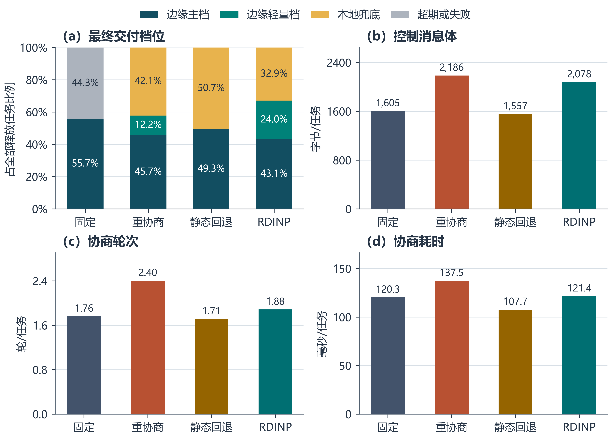
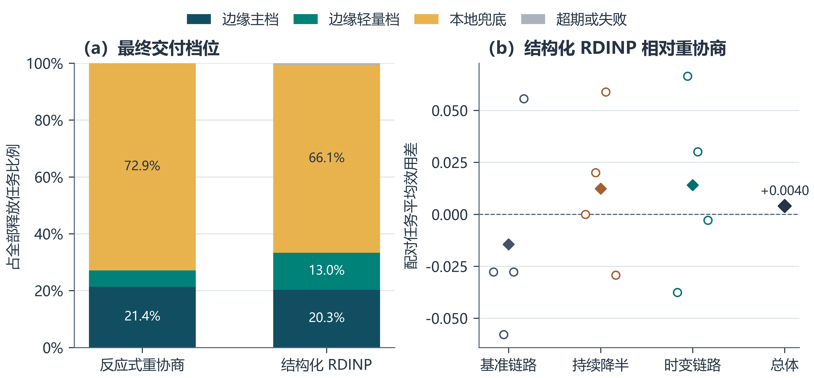
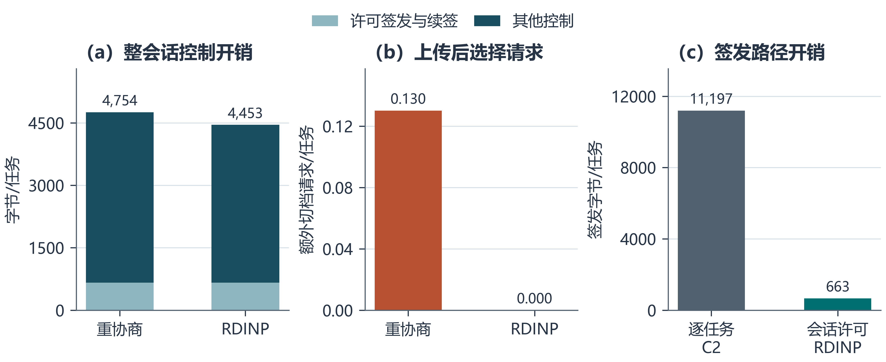
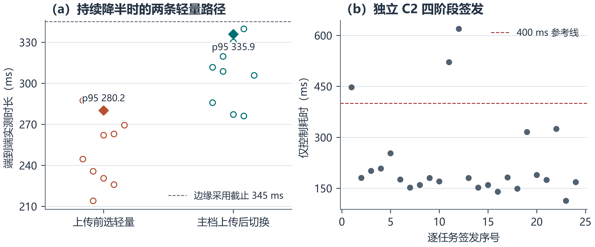

## 摘要

面向智能体的端边协作需要把业务意图转化为可执行的资源与时限约束。无线条件和边缘队列变化后，逐任务重新协商会消耗业务可用时间。本文提出 RDINP 的会话级可复用多档许可。慢环签发绑定双方身份、档位、资源上限、有效期和代际的许可。快环按有效观测选择轻量档，执行端以实时准入和稳定任务标识约束执行，终端以严格截止与代际检查决定采用或本地回退。在 810 组配对离散事件仿真中，四种策略各评估 75,330 项任务。带回退的三种策略全部按期，同菜单下打开快切使平均质量效用提高 0.0119，400 ms 子集提高 0.0228。进一步用独立协议进程、真实 CPU 图像处理和受控环回链路评估 400 ms 任务。每组 192 项任务，结构化方案与同档位、同观测的反应式重协商对照平均效用分别为 0.6596 和 0.6556，按期采用边缘结果分别为 64 项和 52 项，实测控制消息体约少 301 字节／任务。效用差的探索性配对区间跨零。六项故障与重放测试中未出现旧代际结果采用或重复副作用。该结果给出了紧时限下减少额外协商的实测证据，并揭示收益对链路、切档位置及服务质量的依赖。

**关键词**　意图协商；边缘计算；会话许可；快慢环；截止期；代际隔离

## 1 引言

边缘智能体接收终端任务后，需要决定何时开始、使用多少算力、返回什么质量的结果。以图像特征提取为例，终端可以上传主档输入，换取较精细的边缘处理结果。若空口服务速率骤降或边缘槽位拥塞，任务也可改用较小的图像与较轻的边缘计算。无法及时可靠地采用边缘结果时，终端还可启动独立的本地兜底。可接受档位和任务截止由业务约束，链路速率、开始时间以及队列长度则会随运行而变化。

任务级协商为双方建立同一份执行条件，但控制面完成、边缘执行完成和结果被终端采用是三个可分辨的事件。当可用时间紧张，边缘完成在截止前仍可能因为回执、结果传输或验签而失去业务价值。固定主档可能浪费预期无法按期交付的传输。每次情况变差都再确认也会占用同一条链路。纯本地回退提高总按期率，同时可能降低任务质量。评价因此同时需要总按期率、边缘采用、质量效用和控制开销。

本文研究的问题是，在两端共享资源受限、只能看到已发生的链路与队列观测时，能否用一份会话级许可约定未来可用的多档动作，让任务在不追加切档协商的情况下完成，且保留截止、代际和重复执行保护。本文实现带状态与证据的独立协议版本，给出条件安全和时限边界，并分别用配对仿真与真实协议原型检验效果。两阶段实验回答不同问题。仿真覆盖较宽参数范围，原型检验签验、调度和业务采用的真实代价。

## 2 相关工作

**结构化意图与多时间尺度控制。** 3GPP TS 28.312 描述意图驱动的管理服务，通过意图期望、约束和履约信息组织管理交互[1]。TR 23.801-01 是 Release 20 的 6G 系统架构研究草案，为智能体相关的架构讨论提供背景[2]。本文把这类结构化表达落实到一类端边可执行任务的签名字段，具体约束档位、资源额度、期限及采用条件。AgentRAN 把不同时间尺度和协议层的控制交给分布的智能体，并报告开放无线接入网络中的在线实验[3]。6G 智能体意图网络研究分别讨论将自然语言意图转成切片配置，以及按用户意图和链路条件选择物理层设置[4–5]。本文的慢环负责在会话内确定许可，快环负责在数百毫秒任务窗口内使用该许可。关注点是许可的因果使用、执行及按期采用。

**任务委派和意图协商。** A2A 提供能力描述、消息和任务生命周期及智能体卡片签名格式[6]。AGNTCY 的 ACP 以 OpenAPI 形式定义跨框架调用和执行接口[7]。智能体目录协议（ADP）的相关发现机制见 Agent Directory Service 个人草案，用于存储与查询描述可用能力的目录记录[8]。Sharma 等提出在服务提供方的资源约束下交换可行意图及替代方案的框架[9]。这些工作提供了能力发现、任务交互和档位约定的参照。本文进一步检验在约定可接受档位后，切换是否仍须为每个任务增加一轮确认，以及这一往返会怎样影响业务结果。

**期限、代际与幂等。** Timed Atomic Commitment 分开处理决定期限、动作期限及故障后的异常状态[10]。Chubby 让下游系统核验锁持有者的序列凭证，限制旧执行者产生作用[11]。RIFL 通过稳定请求身份、持久完成记录及重试检查避免重复执行[12]。RFC 8480 为 TSCH 相邻节点的时隙资源事务定义超时、终止和序号[13]。这些先例说明期限、代际和去重各有独立语义。本方案将它们放入同一条任务履约链，把许可、实际执行、输出提交和终端采用分别记账，并用配对数据量化省去切换确认的条件收益。

## 3 系统模型与评价目标

终端 $i$ 与边缘权威端已有双边身份关系。边缘提供 $M$ 个执行槽，单个任务占用一个槽。相同方向的数据与控制消息共享有限服务能力。两端的策略只能使用已获得的队列快照和已观测链路状态。快照会随传输和排队变旧，因此只作预测依据。边缘决定是否真正接纳任务时仍检查当下的槽位、队列、剩余时间与许可额度。

令任务 $j$ 的外生释放时刻为 $r_j$，允许的相对期限为 $D_j$，终端的绝对采用截止为 $d_j=r_j+D_j$。终端预留 $B_{\mathrm{loc},j}$ 给本地处理，则边缘采用的最晚界限为 $f_j=d_j-B_{\mathrm{loc},j}$。原型采用 $D_j=400\,\mathrm{ms}$、$B_{\mathrm{loc},j}=55\,\mathrm{ms}$。边缘结果需严格早于 $f_j$ 完成验签和采用。到达 $f_j$ 时若未采用合格结果，终端启动本地路径。该本地路径独立运行，期限仍为 $d_j$。分辨率与截止设置均为受控评价参数。

| 档位 | 输入与处理 | 交付要求 |
| --- | --- | --- |
| 主档 | 上传主档输入，边缘输出 512×512 边缘图 | 任务、许可和期限均通过验收 |
| 轻量边缘档 | 上传 384×384 输入，或用已收到的主档输入执行 384×384 处理 | 同一许可允许该档，可复用已上传的输入 |
| 本地兜底档 | 端侧直接产生 256×256 边缘图 | 本地采用须早于任务截止 |

档位质量由对齐到相同网格的实际结果与主档参考图计算。对齐后去除四像素边缘，使用软 Dice 相似度

$$
q(y,y^\star)=\frac{2\sum_p\min(y_p,y_p^\star)}{\sum_p y_p+\sum_p y_p^\star}.
$$

当两图总强度为零时相似度定义为 1。设 $t_j$ 为终端采用时间，$A_j$ 表示该结果通过对应档位的检查，第 $j$ 项任务得分定义为

$$
u_j=\begin{cases}
q(y_j,y_j^\star), & A_j=1\text{ 且 }t_j<d_j,\\
0, & \text{其余情况}.
\end{cases}
$$

平均效用 $U=N^{-1}\sum_{j=1}^{N}u_j$ 以全部已释放任务为分母。边缘输出在 $f_j$ 之后到达时，$A_j$ 不成立，本地结果仍按其自己的采用时间计分。按期率和边缘采用率也使用同一分母。净效用差为两组同一任务按期实际采用结果的平均得分差。控制消息在试验中真实执行并占用传输及等待时间，其影响随结果计入得分。控制字节、签验耗时和往返数单独计量。

## 4 RDINP 会话许可与快慢环履约

### 4.1 慢环签发可复用的多档许可

边缘权威端签发有限期的会话许可。许可签名覆盖权威端和终端身份、会话标识、权威端启动代际、许可代际、授权档位、签发与到期边界，以及任务数、并行槽数、输入字节和任务期限预算。签名使用 C2 的 ES256 和严格 JSON 规范化实现。独立报文版本、消息类型和收件方位于签名保护的消息中。执行数据另附原始负载，签名中包含对应摘要。许可和数据只有在同一主体、会话、版本及负载绑定一致时才能使用。

许可描述可尝试的动作范围。边缘每次收到任务仍根据可用槽位、配额和时限做准入。续签创建新代际。终端启动续签时暂停旧许可的结果采用，安装新回执后以其为当前许可。该设计将每代的签发成本分摊给该代实际面对的发布任务。首个任务和续签中的任务直接承担等待，发送失败也进入观测记录。

### 4.2 快环条件切换和本地兜底

终端先获取签名资源快照，其中含观测时刻、队列估计及运行中的槽数。终端用快照、既有帧大小和因果链路速率估计，按主档优先、轻量其次的次序选择预计来得及的上传形式。若在上传前判定需轻档，发送较小输入。主档已上传时，边缘在相同的准入函数中重新计算主档与轻量档的执行及返回时间。主档不满足条件、轻量档满足时，且许可和任务均已授权该切换，则使用缓存输入直接执行轻量档。数据已经发送的字节照实计入，此次切换没有额外的请求确认往返。

原型的反应式对照可以执行同样的上传前预选，并缓存已收到的主档数据。收到同一边缘判据触发的轻量建议时，对照发送一次签名选择请求，然后用缓存输入执行。两个策略共享资源快照、前置档位选择、槽位并发和本地兜底。数据上传、结果返回、当前许可的验签及所有快照开销均在两组中存在。这个比较只识别与该确认方式相关的差异，普通自适应策略如果预先授予同等切换权限，其往返行为可能与本文实现相同。

### 4.3 条件安全性和时限边界

执行端以“终端主体、稳定任务标识”为唯一键在持久账本登记任务。第一次请求将任务摘要和许可代际写入账本。后续相同请求读取既有记录并拒绝再次认领，内容不一致的同标识请求也拒绝。任务开始和输出提交分别用有条件的账本更新保证每个键最多执行一次认领、提交一次结果。续签改变许可代际，去重键保持稳定。由此，在单一权威端、账本不丢失且更新串行化的前提下，重复、并发和跨续签提交不能产生第二个输出提交。原型的副作用范围限于该结果账本和图像处理任务。

终端采用结果时核对当前许可代际、签名、身份、任务、输入摘要、输出摘要和档位。在发布前再次采样终端单调时钟。签名或绑定失败、旧代际或期限等号均走拒收路径。丢失许可回执时，终端没有可用于启动边缘任务的凭证，达到 $f_j$ 后可走本地兜底。已启动的边缘任务可能在终端回退后仍完成，采用守卫能够拒绝该结果。边缘账本产生记录与终端业务采用分开计数。

记 $t$ 为边缘接纳候选档位的时刻，$\widehat W(t)$ 为队列等待估计，$\widehat S_g$ 为档位 $g$ 的服务时间估计，$\widehat X_g$ 为结果返回及处理尾段预算，$e$ 为许可到期。边缘采用以下严格预算检查

$$
t+\widehat W(t)+\widehat S_g+\widehat X_g<\min(f_j,e).
$$

在同一时钟域、当前代际持续有效、消息交付且实际尾段受预算约束时，上式为能在边缘窗口内完成的充分时间条件。原型使用因果估计，实际调度和链路尾部可能超出估计。严格的最终结果采用检查保护时限边界，充分条件只在相应时间上界成立时有效。本地回退的按期条件是从 $f_j$ 到本地结果采用的总时长小于预留 $B_{\mathrm{loc},j}$，其中包含队列等待与本地计算。当前实测使用本机共享的高分辨率单调时钟。跨主机若需使用这些比较，需另行建立时钟误差界及时间转换。

## 5 性能评估

### 5.1 实验层次与指标

第一层是封存的离散事件仿真。固定意图、被动重协商、静态回退和结构化方案在 81 场景、10 个种子上使用相同的任务、带宽状态和槽位。负载、空口损伤和期限交叉组合。5G-LENA 只提供前传容量变化的回放输入，前传模型平均忙时不足 0.55%。主要压力来自受控空口扰动与有限边缘算力。仿真用两次抽象交换计算控制开销。

第二层是独立进程真实原型，终端和边缘通过环回 HTTP 交换签名数据。按外生时序注入上下行服务速率限制，签发、许可重复使用、续签、准备、签验、实际图像处理及采用均实测。每个条件四个配对种子，正常、持续降半、动态跌落与恢复共三个条件。每对释放 16 项任务，两个终端共用两个执行槽，每个终端有两代许可，每代可处理四项。过程中的许可证和观测不提前免费发放。两组交错执行，端到端统计使用计划释放到实际采用的时间。单独执行的 C2 控制对照只衡量四阶段的签名确认成本。

### 5.2 大规模配对仿真

表 1 给出修正后的封存结果。每组均为 75,330 项释放任务，失败和回退在分母中保留。

| 策略 | 按期率 | 边缘采用率 | 平均效用 | 控制字节／任务 |
| --- | ---: | ---: | ---: | ---: |
| 固定意图 | 55.73% | 55.73% | 0.5573 | 1,605 |
| 被动重协商 | 100.00% | 57.89% | 0.7754 | 2,186 |
| 静态回退 | 100.00% | 49.30% | 0.7716 | 1,557 |
| 结构化 RDINP | 100.00% | 67.12% | 0.7832 | 2,078 |

{width=100%}

相对可缓存主档输入的被动重协商，结构化策略平均效用高 0.0078，每项释放任务少约 0.52 次交互、16.1 ms 协商耗时和 108 控制字节。相对静态回退，结构化策略平均效用高 0.0116，每任务增加约 520 控制字节和 13.7 ms。三组有兜底策略全部按期。结构化策略主要将一部分本地结果替换为轻量边缘结果，没有带来总按期率提升。

{width=100%}

在固定其他参考条件的 400 ms 切片中，结构化、被动重协商、静态回退的平均效用分别为 0.6975、0.6774 和 0.6564。参考切片的 600 ms 和 800 ms 下，静态回退的效用点估计略高于结构化策略，说明更宽松截止时需考虑额外控制成本。

{width=96%}

为分离多档菜单与快切本身，在保持菜单和消息大小一致的配对中，仅打开承诺后的快切，全配置平均效用提高 0.0119，探索性 95% 配对区间为 [0.0106, 0.0132]，边缘采用率提高 10.05 个百分点。按 400、600、800 ms 分层的效用差依次为 0.0228、0.0068、0.0061。仿真支持把原型验证聚焦到紧时限，真实交互成本仍需第二层数据检验。

### 5.3 400 ms 原型配对实测

表 2 给出正式实测每组 192 项任务的交付结果。质量由实际采用的图像计算，超期未采用记 0。两组的控制和数据都经过同一受控容量条件。按期边缘采用由 52 项增至 64 项，对应 6.25 个百分点。结构化方案实际出现 1 项超期，按期总采用率 99.48%，反应式对照为 100.00%。

| 策略 | 主档 | 轻量边缘 | 本地 | 超期 | 平均效用 |
| --- | ---: | ---: | ---: | ---: | ---: |
| 反应式重协商 | 41 | 11 | 140 | 0 | 0.6556 |
| 结构化 RDINP | 39 | 25 | 127 | 1 | 0.6596 |

{width=100%}

完整配对的效用差为 +0.0040。将同一个种子下的三个条件作为相关组进行配对重抽样，得到探索性 95% 区间 [−0.0139, +0.0173]。这一小幅正差不能排除无效果或负效果。正常链路下效用从 0.8041 降至 0.7896。持续降半时从 0.5749 升至 0.5873，动态扰动时从 0.5878 升至 0.6019。三种条件各有 64 项任务。两类压力条件的方向与快切机制的预期一致，正常条件差异需要更多独立重复才能判定。

### 5.4 控制成本与切档位置

两组各发起并确认 48 次会话许可签发或续签，平均许可消息体均为 663 字节／释放任务。按完整会话摊销的许可处理与传输实测时长，结构化组和反应式组分别为 9.66 ms 和 8.91 ms／任务。实际测得的所有控制消息体分别为 4,453 和 4,754 字节／任务。结构化组没有额外选择请求，反应式组发起 25 次追加选择尝试。快切增加了边缘成果返回，业务数据的发送与接收总量约为 194,748 与 190,610 字节／任务。业务字节和控制字节的方向不同。全部任务的端到端中位数分别为 353.78 和 354.31 ms，p95 分别为 372.23 和 370.72 ms。

{width=100%}

冻结 C2 控制对照在独立进程间进行了 24 次四阶段签名确认。24 次最终确认中，有 21 次的控制阶段在 400 ms 内完成。确认发布耗时中位数为 180.4 ms，p95 为 521.3 ms。四次胜出交换的应用消息体合计 9,250 字节，计入实际重试后，每次释放平均 11,197 字节。旧对照没有执行业务上传和图像检测，适合独立解释逐任务确认的开销。原型账本和终端分别记录请求准备、签验、边缘排队和处理。采用的边缘任务中，结构化和反应式的排队中位数分别为 8.56、9.43 ms，处理时间中位数分别为 13.15、13.61 ms。

{width=96%}

在另一次固定降半链路的路径检查中，分别测了九次上传前选轻量档和九次完整上传后执行轻量档。两路均为 9/9 在 345 ms 边缘窗口内采用。以采用时长 p95 计算，上传前选档余量为 64.84 ms，上传后切换余量为 9.08 ms。后者对排队和额外消息延迟更敏感。它在该夹具中的余量为正，正式配对保留此快切动作。

### 5.5 故障验证与局限

独立故障验收覆盖六项。正常签名回执下结果能够采用。许可回执丢失和延迟的任务在 347.47 ms 和 360.09 ms 采用本地结果，均未启动边缘执行。一项真实签名的边缘结果被延至 511.03 ms 送达，终端拒收并已在 349.66 ms 采用本地结果。仍在期限内送达的旧代际响应也被拒收。并发提交和跨续签重放同一个稳定任务标识时，账本仅登记一次执行认领和一次结果提交。六项测试的旧代际污染和重复副作用均为零。该证据覆盖了记录的执行路径。

原型只有三个样图、两个执行槽和四个配对种子。当前质量分值衡量边缘图的相似程度，特定业务的最低有效质量需由真实 SLA 另行定义。环回注入能评估软件真实开销以及受控链路作用，物理空口、独立主机时钟和现场负载会引入更多变化。对照的结果说明同一菜单下省去签名选择往返在紧期限受扰条件有潜在价值。已有合适权限的直接边缘自适应策略可能获得接近效果。逐任务四阶段的历史控制成本和单次轻量路径的正余量也不能转化为普适的服务保证。

## 6 结论与展望

本文实现了以签名会话许可约束档位、资源和期限的 RDINP 原型。在同菜单下省去切档确认，使开发仿真在紧截止期的边缘结果采用和质量效用有所改善。400 ms 真实原型配对中，边缘按期采用从 52/192 增至 64/192，控制消息体减少，净效用点估计提高 0.0040，探索性区间跨零。端到端测量同时观察到一项超期和正常链路条件的负向点差，说明业务质量收益依赖工况。用户应根据任务资源预算选择切档位置。后续需要在可核实的业务质量底线、独立时钟域和真实链路上确认这些适用条件，并评价更强的就地自适应方案。

## 参考文献

\[1\] 3GPP. Management and orchestration; Intent driven management services for mobile networks: TS 28.312, V20.1.0[S/OL]. 2026[2026-11-28]. <https://portal.3gpp.org/desktopmodules/Specifications/SpecificationDetails.aspx?specificationId=3554>.

\[2\] 3GPP. Study on Architecture for 6G System; Stage 2: TR 23.801-01, draft V0.10.0[R/OL]. 2026[2026-11-28]. <https://portal.3gpp.org/desktopmodules/Specifications/SpecificationDetails.aspx?specificationId=4423>.

\[3\] ELKAEL M, D’ORO S, BONATI L, et al. AgentRAN: An Agentic AI Architecture for Autonomous Control of Open 6G Networks[EB/OL]. (2026-02-02)[2026-11-28]. <https://arxiv.org/abs/2508.17778v2>.

\[4\] JIANG G, WANG K, CHEN X, et al. Agentic AI Empowered Intent-Based Networking for 6G[EB/OL]. (2026-10-26)[2026-11-28]. <https://arxiv.org/abs/2601.06640v2>.

\[5\] LI Z, JIN X, PAN J, et al. Agentic Wireless Communication for 6G: Intent-Aware and Continuously Evolving Physical-Layer Intelligence[EB/OL]. (2026-02-19)[2026-11-28]. <https://arxiv.org/abs/2602.17096>.

\[6\] A2A PROJECT. Agent2Agent (A2A) Protocol Specification: v1.0.0[EB/OL]. 2026[2026-11-28]. <https://a2a-protocol.org/v1.0.0/specification/>.

\[7\] AGNTCY. Agent Connect Protocol: OpenAPI v0.2.3[EB/OL]. 2025[2026-11-28]. <https://github.com/agntcy/acp-spec/blob/main/openapi.json>.

\[8\] MUSCARIELLO L, POLIC R. Agent Directory Service: draft-mp-agntcy-ads-03[EB/OL]. (2026-11-02)[2026-11-28]. <https://datatracker.ietf.org/doc/draft-mp-agntcy-ads/03/>.

\[9\] SHARMA Y, BHAMARE D, KASSLER A, et al. Intent Negotiation Framework for Intent-Driven Service Management[J]. IEEE Communications Magazine, 2023, 61(6): 73–79. DOI: 10.1109/MCOM.001.2200504.

\[10\] DAVIDSON S B, LEE I, WOLFE V. Timed Atomic Commitment[J]. IEEE Transactions on Computers, 1991, 40(5): 573–583. DOI: 10.1109/12.88481.

\[11\] BURROWS M. The Chubby Lock Service for Loosely-Coupled Distributed Systems[C]//Proceedings of the 7th USENIX Symposium on Operating Systems Design and Implementation. Berkeley: USENIX Association, 2006: 335–350.

\[12\] LEE C, PARK S J, KEJRIWAL A, et al. Implementing Linearizability at Large Scale and Low Latency[C]//Proceedings of the 25th Symposium on Operating Systems Principles. New York: ACM, 2015: 71–86. DOI: 10.1145/2815400.2815416.

\[13\] WANG Q, VILAJOSANA X, WATTEYNE T. 6TiSCH Operation Sublayer (6top) Protocol (6P): RFC 8480[S/OL]. 2018[2026-11-28]. <https://www.rfc-editor.org/rfc/rfc8480.html>.

## 数据与代码说明

Step 1 使用封存的 r02 汇总、同菜单归因及原始任务记录。Step 2 的运行计划、逐任务与逐运行记录、按对的签名账本检查、故障验收、C2 控制测量及门禁结果随复现包保存。会话许可的测量值、仿真值和历史记录分别呈现。程序用输入与源码摘要核对复现版本，协议实测的具体延迟随主机负载变化。
